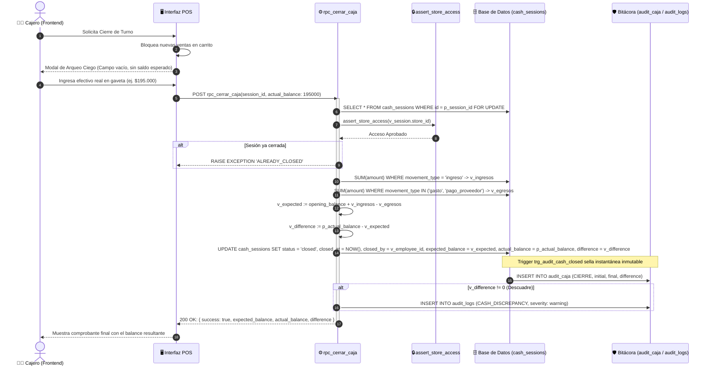
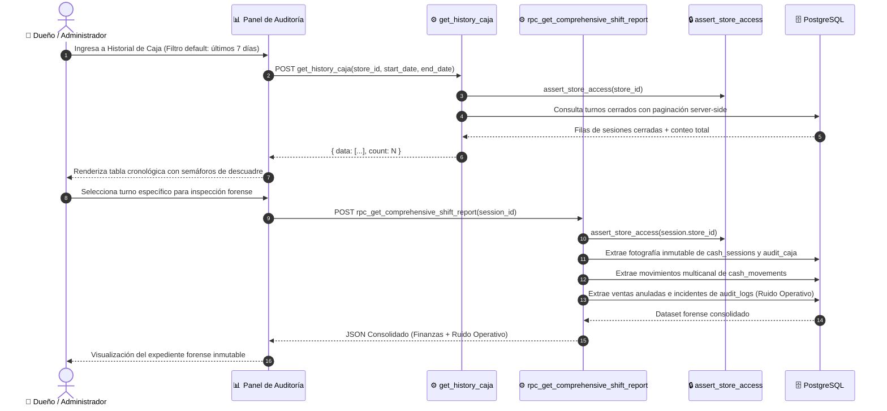
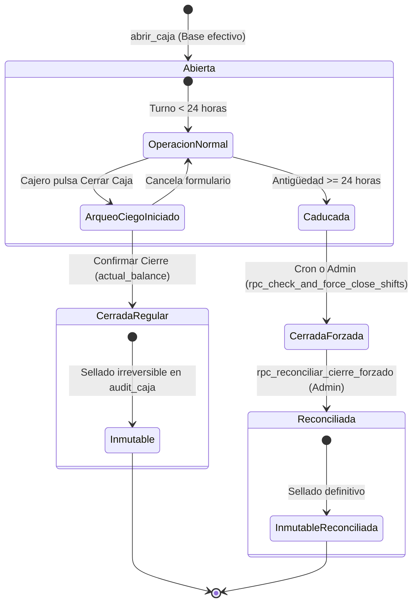

# SDD-027-01: Reportes y Auditoría de Caja Diaria

> **Asociado a:** [FRD-027-01](../FRD/FRD_027_01_REPORTES_DE_CAJA.md)  
> **Fase del Plan:** Ola 4: Reportes, Auditoría y Cuentas por Pagar (Ítem 1)  
> **Estado:** 🟢 Aprobado y Sanitizado (Protocolo PAC-SDD v2.0)  
> **Última Actualización:** 2026-10-16  

---

## 0. Alcance y Restricciones Aplicables (PEA-N)

### 0.1 Políticas Globales Activadas (ARQ-002)
| Política ID | Dominio | Impacto Concreto en este SDD |
|-------------|---------|------------------------------|
| **POL-AUTH-01** | Multi-tenant | Aislamiento multi-tenant obligatorio. Invocación mandatoria de `assert_store_access(p_store_id)` como instrucción #1 en todos los RPCs de reporte e historial (`get_history_caja`, `get_daily_summary`, `rpc_get_comprehensive_shift_report`), y filtrado por `store_id = get_current_store_id()` en RLS. |
| **POL-AUD-01** | Auditoría | Inviolabilidad Histórica. Toda sesión cerrada (`status = 'closed'`) queda congelada irrevocablemente con su timestamp (`closed_at`), autor de cierre (`closed_by`) y respaldo fotográfico inmutable en `audit_caja`. Prohibición de mutaciones retroactivas. |
| **POL-AUD-02** | Auditoría | Dicotomía del Reporte. Separación estricta entre el Reporte Operativo (resumen limpio por canal para cuadre físico/digital del cajero, ciego a metas teóricas) y el Reporte de Auditoría Interna (destinado al dueño con seguimiento forense de ruido operativo, intentos fallidos y descuadres). |
| **POL-AUD-03** | Auditoría | Autenticidad de Descuadres. Cualquier discrepancia entre lo calculado por el servidor y lo declarado físicamente por el cajero genera un registro indeleble clasificado como anomalía (`CASH_DISCREPANCY`) en `audit_logs` con severidad `warning`. |
| **POL-FIN-01** | Financiero | Fidelidad al Flujo Puro. Los reportes de caja tienen terminantemente prohibido proyectar ingresos futuros (fiados no cobrados) o egresos futuros (facturas por pagar pendientes). El reporte refleja exclusivamente la liquidez real: `opening_balance + SUM(ingresos) - SUM(gastos + pagos_proveedor)`. |
| **POL-SEC-01** | Seguridad | Arqueo Ciego y Ceguera Operativa. El backend tiene PROHIBIDO exponer el saldo esperado (`expected_balance`) al usuario cajero antes y durante el formulario de cierre. La consulta de historial consolidado y reportes forenses está reservada a roles de administración (`admin`, `owner`). |
| **SPEC-010** | Moneda | Manejo monetario en pesos colombianos (COP) en números enteros sin decimales fiduciarios. |
| **SPEC-011** | Decimales | Presentación visual formateada con punto separador de miles (ej: `$195.000`), sin alterar los valores numéricos íntegros persistidos en el backend. |

### 0.2 Restricciones Transversales Inyectadas
| SDD Origen | Restricción Inyectada | Impacto en los Reportes de Caja |
|------------|-----------------------|---------------------------------|
| **SDD_004 / SDD_020 (Caja Diaria y Multicanal)** | Núcleo de sesiones de caja (`cash_sessions`), base en efectivo y movimientos monetarios (`cash_movements`). | La conciliación matemática líquida calcula el saldo esperado deduciendo tanto egresos OPEX (`gasto`) como amortizaciones de proveedores (`pago_proveedor`), liquidando el descuadre exacto `difference = actual_balance - expected_balance`. |
| **SDD_027_02 (Límite 24 Horas)** | Caducidad forzada de turnos a las 24 horas (`forced_close = true`). | El listado cronológico de turnos cerrados (RN-6) debe identificar claramente turnos regulares versus turnos cerrados forzosamente por caducidad o abandono de turno. |
| **SDD_021 (Historiales Multicanal)** | Extracción de movimientos desglosados por canal monetario. | Alimenta el Reporte Operativo permitiendo segregar ingresos y egresos según canal (`efectivo`, `nequi`, `daviplata`). Respuestas estandarizadas al contrato canónico `{ data: [...], count: N }`. |
| **SDD_022 / SDD_026 (Gastos y OPEX Inmediato)** | Egresos registrados directamente en `cash_movements` con barrera de sobregiro por canal. | El Reporte de Auditoría Interna expone el ruido operativo, incluyendo los intentos fallidos de egreso rechazados por falta de fondos (`INSUFFICIENT_FUNDS`). |
| **SDD_005 (Auditoría Forense)** | Inviolabilidad append-only en `audit_logs` y `audit_caja`. | Registro inmutable de anomalías de cuadre con severidad de alerta silenciosa (`warning`) sin posibilidad de edición o borrado. |
| **SDD_018 (Control Operacional)** | Desacople entre flujo puro de caja y P&L devengado. | Garantiza que los cobros de cartera (abonos) y pagos de pasivos (proveedores) reflejen liquidez de gaveta sin distorsionar ingresos operacionales ni COGS de catálogo. |

### 0.3 Auditoría de Base de Datos contra Realidad Físico-Técnica
| Hallazgo / Componente | Estado Real en Producción | Decisión de Diseño Vinculante |
|-----------------------|---------------------------|-------------------------------|
| 🔴 Tabla Alucinada `cash_session_balances` | NO EXISTE en la base de datos de producción (alucinación de la versión previa de SDD-027-01). | Erradicación total de `cash_session_balances`. El modelo físico se fundamenta exclusivamente en las tablas reales `cash_sessions` y `cash_movements`. |
| 🔴 Fórmula de Egresos en `cerrar_caja` Legacy | En la base de datos legacy, `cerrar_caja` solo resta `movement_type = 'gasto'`, ignorando `movement_type = 'pago_proveedor'`. | Estandarización obligatoria de la fórmula universal: `v_expected := opening_balance + SUM(ingresos) - SUM(gastos + pagos_proveedor)`. Evita faltantes ficticios al pagar a proveedores desde caja. |
| 🔴 Ceguera Operativa en `get_history_caja` | `get_history_caja` valida `assert_store_access` pero carece de filtro RBAC, exponiendo saldos esperados a roles no administradores. | Restricción estricta del listado histórico y reporte forense para requerir membresía en `admin_profiles`, preservando la ceguera del cajero sobre turnos activos. |
| 🔴 Inmutabilidad de Turnos Cerrados (RLS) | `cash_sessions` posee Default-Deny en DELETE, pero la política UPDATE `cash_sessions_update_store` no restringe `status != 'closed'`. | Mandato de política RLS estricta y trigger `BEFORE UPDATE` que rechace con excepción cualquier intento de edición directa sobre sesiones cerradas. |
| 🔴 Esquema de Inserción en `audit_logs` | Funciones históricas referencian columnas inexistentes (`action`, `entity`, `payload`). | Normalización vinculante sobre las columnas reales: `actor_id`, `event_type`, `resource_id`, `metadata`, `store_id`, `severity`. |

---

## 1. Reglas de Negocio

### RN-027-01-01: Dicotomía del Reporte
El sistema debe proveer dos perfiles segregados de extracción de información del turno:
- **Reporte Operativo (Visual/Humano):** Diseñado exclusivamente para el cajero. Muestra resúmenes limpios segregados por canal financiero (`efectivo`, `nequi`, `daviplata`) sin mezclarlos entre sí, orientados a facilitar el conteo y cuadre físico y digital del momento.
- **Reporte de Auditoría Interna (Sistema/Dueño):** Diseñado exclusivamente para la seguridad y control del propietario. Rastrea y documenta cada movimiento, intentos fallidos de sobregiro por falta de fondos, transacciones de contrapeso (anulaciones de ventas), mermas declaradas y discrepancias matemáticas entre lo físico y lo calculado.

### RN-027-01-02: Ceguera Operativa (Arqueo Ciego)
Durante el transcurso de un turno activo y en el instante de cerrarlo, el sistema tiene estrictamente PROHIBIDO mostrarle al usuario cajero cuál es el saldo total esperado en efectivo (`expected_balance`). El operario debe contar el dinero físico a ciegas y declarar la suma real en mano (`actual_balance`), impidiendo que ajuste o manipule billetes para hacerlos cuadrar artificialmente con la expectativa del software.

### RN-027-01-03: Inmutabilidad del Cierre (Sello de Tiempo y Fotografía Forense)
En el instante en que el operario declara el monto físico y confirma el cierre del turno, el servidor genera una instantánea matemática irreversible de los totales y el descuadre (si lo hubiere). El turno queda sellado con `status = 'closed'` y `closed_at = NOW()`, y el trigger del sistema genera automáticamente una fotografía en `audit_caja`. Nadie, ni siquiera un administrador, puede alterar, editar o recalcular los valores de una sesión cerrada en el futuro.

### RN-027-01-04: Fidelidad al Flujo Puro
Los reportes de caja tienen terminantemente prohibido proyectar ingresos futuros (fiados no cobrados) o egresos futuros (facturas de proveedores pendientes de pago). El reporte es un reflejo dogmático de la liquidez exclusiva que cambió físicamente de manos en el turno.

### RN-027-01-05: Autenticidad de Descuadres
Si el monto físico declarado por el operario difiere del monto líquido calculado por el servidor (`actual_balance != expected_balance`), el sistema genera un registro de anomalía clasificado como `CASH_DISCREPANCY` en `audit_logs` con `severity = 'warning'`, dejando constancia indeleble del faltante o sobrante y emitiendo alertas silenciosas a los perfiles administrativos.

### RN-027-01-06: Navegación Temporal por Turnos Cerrados
El módulo de reportes permite al Administrador consultar turnos cerrados anteriores mediante un mecanismo de selección temporal:
- **Unidad de consulta:** El turno individual (`session_id`) es la unidad atómica de auditoría. Cada turno se inspecciona individualmente.
- **Listado de turnos:** Presentación cronológica de turnos cerrados mostrando para cada uno: fecha, hora de apertura, hora de cierre, empleado responsable y estado de cuadre (cuadrado / con descuadre / forzado).
- **Filtro por rango de fechas:** El listado es filtrable por un rango de fechas (desde–hasta). Por defecto, el sistema muestra los turnos de los últimos 7 días.
- **Acceso al detalle:** Al seleccionar un turno cerrado de la lista, el sistema extrae el reporte de auditoría interna completo de ese turno, mostrando la instantánea inmutable generada al momento del cierre.

---

## 2. Casos de Uso y Modelado de Flujos

### Caso A: Ejecución de Arqueo Ciego y Cierre de Turno
- **Actor:** Usuario Operativo / Cajero (con permiso para operar caja).
- **Precondición:** Turno de caja en estado `open` con antigüedad menor a 24 horas. El servidor calcula internamente el saldo esperado acumulado en gaveta sin revelarlo.
- **Flujo Principal:**
  1. El cajero inicia el proceso de cierre de turno en la interfaz. El sistema bloquea la entrada de nuevas ventas o gastos.
  2. La interfaz solicita al usuario introducir la cantidad de efectivo físico presente en la gaveta, ocultando completamente el valor esperado por el sistema.
  3. El usuario cuenta físicamente el dinero e introduce el monto real contado (ej: `$195.000`).
  4. El usuario presiona "Confirmar Cierre".
  5. El servidor recibe `actual_balance`, ejecuta el bloqueo transaccional, calcula el saldo esperado (`opening_balance + ingresos - egresos`), liquida el descuadre (`difference = actual - expected`), y sella el turno con `status = 'closed'`.
  6. El servidor genera la fotografía forense en `audit_caja` e inserta la alerta de anomalía en `audit_logs` si existe descuadre.
  7. El servidor devuelve el resumen del cierre al cajero revelando la meta calculada y la diferencia resultante.
- **Flujo Alternativo:** Si la sesión ya fue cerrada previamente por caducidad o concurrencia, el sistema aborta con `ALREADY_CLOSED`.
- **Postcondición:** Turno cerrado irreversiblemente. El cajero no pudo maquillar el conteo porque desconocía la meta matemática.



---

### Caso B: Inspección Forense del Propietario y Navegación Temporal
- **Actor:** Administrador / Propietario.
- **Precondición:** Usuario autenticado con rol en `admin_profiles` (`admin` o `owner`).
- **Flujo Principal:**
  1. El propietario ingresa a la sección de "Reportes y Auditoría de Caja".
  2. El sistema carga la lista cronológica de turnos cerrados de los últimos 7 días invocando `get_history_caja`.
  3. Cada fila muestra: fecha, hora apertura, hora cierre, empleado responsable, y distintivo visual de estado de cuadre (verde si `difference = 0`, rojo si `difference != 0`, naranja si `forced_close = true`).
  4. El propietario puede ajustar el filtro de fechas (desde–hasta) para consultar períodos anteriores.
  5. El propietario hace clic en un turno específico para auditarlo.
  6. El sistema invoca `rpc_get_comprehensive_shift_report(p_session_id)` y presenta el reporte forense completo:
     - Resumen financiero inmutable (apertura, ingresos, egresos por categoría, expectativa y descuadre).
     - Desglose multicanal de movimientos reales en `cash_movements`.
     - "Ruido Operativo": intentos fallidos de gasto por saldo insuficiente (`INSUFFICIENT_FUNDS`), cancelaciones de venta mediante movimientos de contrapeso (`is_voided = true`), y ventas forzadas registradas en `audit_logs`.
- **Postcondición:** El propietario obtiene visibilidad fidedigna y forense de las operaciones del turno, protegido contra alteraciones retroactivas.



---

## 3. Estados de la Interfaz y Diagramas de Estado

### 3.1 Ciclo de Estados de una Sesión de Caja


### 3.2 Matriz de Visualización de la Dicotomía Operativo vs Forense
| Elemento Visual | Vista Operativa (Cajero) | Vista Forense (Dueño / Admin) |
|-----------------|--------------------------|-------------------------------|
| **Estado del Turno** | `Abierta` / `Cerrada` | `Abierta` / `Cerrada Regular` / `Cerrada Forzada 24h` |
| **Saldo Inicial (Base)** | Visible (`opening_balance` efectivo) | Visible con responsable de apertura |
| **Saldo Esperado (`expected_balance`)** | **OCULTO** (Ceguera operativa absoluta en turno abierto) | **VISIBLE** en todo momento |
| **Conteo Real (`actual_balance`)** | Solo editable en modal ciego de cierre | Visible como dato histórico auditado |
| **Descuadre (`difference`)** | Visible únicamente *después* de confirmar el cierre | Visible con semáforo (Verde = 0, Rojo != 0) |
| **Navegación Histórica** | Bloqueada (solo opera su sesión actual) | Filtro por rango de fechas (default: últimos 7 días) |
| **Ruido Operativo (Anulaciones/Sobregiros)**| Oculto | Desglose completo de eventos en `audit_logs` |

---

## 4. Criterios de Aceptación

- [ ] **CA-FRD-027-01-01 (Ceguera Operativa):** La interfaz visual orientada al cajero oculta obligatoriamente el acumulado de efectivo esperado antes y durante el formulario de cierre de turno. El endpoint `get_active_cash_session` no expone `expected_balance`.
- [ ] **CA-FRD-027-01-02 (Inmutabilidad del Turno Cerrado):** El servidor rechaza cualquier petición de base de datos que intente aplicar una operación de edición (`UPDATE`) o borrado (`DELETE`) sobre el registro histórico de un turno ya cerrado (`status = 'closed'`).
- [ ] **CA-FRD-027-01-03 (Clasificación de Descuadres):** El sistema clasifica automáticamente cualquier discrepancia entre el monto esperado por cálculo y el monto declarado por conteo (`difference != 0`) como una "anomalía de cuadre", registrándola de manera separada en `audit_logs` con `event_type = 'CASH_DISCREPANCY'` y `severity = 'warning'`.
- [ ] **CA-FRD-027-01-04 (Navegación Cronológica):** El módulo de reportes presenta una lista cronológica de turnos cerrados filtrable por rango de fechas (desde–hasta), con carga inicial por defecto de los últimos 7 días.
- [ ] **CA-FRD-027-01-05 (Metadata de Turnos en Lista):** Cada turno cerrado en la lista muestra fecha, hora de apertura, hora de cierre, empleado responsable y estado de cuadre (cuadrado / faltante / sobrante / forzado 24h).
- [ ] **CA-FRD-027-01-06 (Inspección del Detalle Forense):** Al seleccionar un turno cerrado, el sistema muestra la instantánea inmutable del reporte de auditoría de ese turno, con los mismos datos inalterados generados al momento del cierre.

---

## 5. Contrato de Interfaz

### 5.1 Endpoint Operativo de Cierre: `rpc_cerrar_caja`
- **Tipo:** RPC Postgres / Acción (WRITE)
- **Rol Permitido:** `cashier`, `admin`, `owner`
- **Payload de Entrada (JSON Schema):**
```json
{
  "$schema": "http://json-schema.org/draft-07/schema#",
  "title": "CerrarCajaInput",
  "type": "object",
  "properties": {
    "p_session_id": {
      "type": "string",
      "format": "uuid",
      "description": "Identificador único de la sesión de caja abierta"
    },
    "p_actual_balance": {
      "type": "number",
      "minimum": 0,
      "description": "Monto real en efectivo contado en la gaveta por el cajero (a ciegas)"
    }
  },
  "required": ["p_session_id", "p_actual_balance"],
  "additionalProperties": false
}
```

- **Payload de Respuesta Exitosa (JSON Schema):**
```json
{
  "$schema": "http://json-schema.org/draft-07/schema#",
  "title": "CerrarCajaSuccessResponse",
  "type": "object",
  "properties": {
    "success": { "type": "boolean", "const": true },
    "data": {
      "type": "object",
      "properties": {
        "session_id": { "type": "string", "format": "uuid" },
        "status": { "type": "string", "const": "closed" },
        "opening_balance": { "type": "number" },
        "expected_balance": { "type": "number" },
        "actual_balance": { "type": "number" },
        "difference": { "type": "number" },
        "closed_at": { "type": "string", "format": "date-time" },
        "closed_by": { "type": "string", "format": "uuid" }
      },
      "required": ["session_id", "status", "expected_balance", "actual_balance", "difference", "closed_at", "closed_by"]
    }
  },
  "required": ["success", "data"]
}
```

- **Catálogo de Errores Técnicos:**
| Código de Error | Condición Desencadenante | Mensaje al Usuario |
|-----------------|--------------------------|--------------------|
| `STORE_ACCESS_DENIED` | Usuario no pertenece a la tienda de la sesión | No tiene permisos para operar en esta tienda |
| `SESSION_NOT_FOUND` | `p_session_id` no existe en la base de datos | Sesión de caja no encontrada |
| `ALREADY_CLOSED` | La sesión ya fue cerrada previamente | El turno de caja ya se encuentra cerrado |
| `INVALID_BALANCE` | Monto reportado menor a cero | El monto físico declarado no puede ser negativo |
| `UNAUTHORIZED` | Empleado sin permisos de operación de caja | No cuenta con autorización para cerrar turnos de caja |

---

### 5.2 Endpoint de Navegación Temporal: `get_history_caja`
- **Tipo:** RPC Postgres / Consulta de Lista (READ)
- **Rol Permitido:** `admin`, `owner`
- **Payload de Entrada (JSON Schema):**
```json
{
  "$schema": "http://json-schema.org/draft-07/schema#",
  "title": "GetHistoryCajaInput",
  "type": "object",
  "properties": {
    "p_store_id": { "type": "string", "format": "uuid" },
    "p_start_date": { "type": "string", "format": "date", "description": "Fecha inicial YYYY-MM-DD" },
    "p_end_date": { "type": "string", "format": "date", "description": "Fecha final YYYY-MM-DD" },
    "p_limit": { "type": "integer", "default": 20, "minimum": 1, "maximum": 100 },
    "p_offset": { "type": "integer", "default": 0, "minimum": 0 }
  },
  "required": ["p_store_id", "p_start_date", "p_end_date"],
  "additionalProperties": false
}
```

- **Payload de Respuesta Exitosa (JSON Schema):**
```json
{
  "$schema": "http://json-schema.org/draft-07/schema#",
  "title": "GetHistoryCajaSuccessResponse",
  "type": "object",
  "properties": {
    "data": {
      "type": "array",
      "items": {
        "type": "object",
        "properties": {
          "id": { "type": "string", "format": "uuid" },
          "status": { "type": "string", "enum": ["open", "closed"] },
          "forced_close": { "type": "boolean" },
          "opened_at": { "type": "string", "format": "date-time" },
          "closed_at": { "type": ["string", "null"], "format": "date-time" },
          "opened_by_name": { "type": "string" },
          "closed_by_name": { "type": ["string", "null"] },
          "opening_balance": { "type": "number" },
          "expected_balance": { "type": ["number", "null"] },
          "actual_balance": { "type": ["number", "null"] },
          "difference": { "type": ["number", "null"] },
          "total_income": { "type": "number" },
          "total_expenses": { "type": "number" },
          "total_movements": { "type": "integer" }
        },
        "required": ["id", "status", "forced_close", "opened_at", "opened_by_name", "opening_balance", "total_income", "total_expenses", "total_movements"]
      }
    },
    "count": { "type": "integer", "description": "Total de sesiones en el rango para paginación" }
  },
  "required": ["data", "count"]
}
```

---

### 5.3 Endpoint Forense de Turno: `rpc_get_comprehensive_shift_report`
- **Tipo:** RPC Postgres / Consulta Atómica (READ)
- **Rol Permitido:** `admin`, `owner`
- **Payload de Entrada (JSON Schema):**
```json
{
  "$schema": "http://json-schema.org/draft-07/schema#",
  "title": "GetComprehensiveShiftReportInput",
  "type": "object",
  "properties": {
    "p_session_id": { "type": "string", "format": "uuid" }
  },
  "required": ["p_session_id"],
  "additionalProperties": false
}
```

- **Payload de Respuesta Exitosa (JSON Schema):**
```json
{
  "$schema": "http://json-schema.org/draft-07/schema#",
  "title": "GetComprehensiveShiftReportSuccessResponse",
  "type": "object",
  "properties": {
    "success": { "type": "boolean", "const": true },
    "data": {
      "type": "object",
      "properties": {
        "session": {
          "type": "object",
          "properties": {
            "id": { "type": "string", "format": "uuid" },
            "store_id": { "type": "string", "format": "uuid" },
            "status": { "type": "string" },
            "forced_close": { "type": "boolean" },
            "opened_at": { "type": "string", "format": "date-time" },
            "closed_at": { "type": ["string", "null"] },
            "opened_by_name": { "type": "string" },
            "closed_by_name": { "type": ["string", "null"] },
            "opening_balance": { "type": "number" },
            "expected_balance": { "type": ["number", "null"] },
            "actual_balance": { "type": ["number", "null"] },
            "difference": { "type": ["number", "null"] }
          },
          "required": ["id", "store_id", "status", "opened_at", "opening_balance"]
        },
        "financial_summary": {
          "type": "object",
          "properties": {
            "total_sales_cash": { "type": "number" },
            "total_sales_transfer": { "type": "number" },
            "total_credit_sales": { "type": "number", "description": "Solo informativo, excluido de liquidez" },
            "total_client_abonos": { "type": "number" },
            "total_opex_expenses": { "type": "number" },
            "total_supplier_payments": { "type": "number" },
            "net_cash_flow": { "type": "number" }
          },
          "required": ["total_sales_cash", "total_sales_transfer", "total_opex_expenses", "total_supplier_payments", "net_cash_flow"]
        },
        "movements": {
          "type": "array",
          "items": {
            "type": "object",
            "properties": {
              "id": { "type": "string", "format": "uuid" },
              "movement_type": { "type": "string" },
              "amount": { "type": "number" },
              "description": { "type": "string" },
              "created_at": { "type": "string", "format": "date-time" }
            },
            "required": ["id", "movement_type", "amount", "description", "created_at"]
          }
        },
        "operational_noise": {
          "type": "object",
          "properties": {
            "voided_sales": {
              "type": "array",
              "items": {
                "type": "object",
                "properties": {
                  "sale_id": { "type": "string", "format": "uuid" },
                  "ticket_number": { "type": "integer" },
                  "total": { "type": "number" },
                  "void_reason": { "type": "string" },
                  "voided_by_name": { "type": "string" }
                }
              }
            },
            "rejected_overdrafts": {
              "type": "array",
              "items": {
                "type": "object",
                "properties": {
                  "event_id": { "type": "string", "format": "uuid" },
                  "attempted_amount": { "type": "number" },
                  "channel": { "type": "string" },
                  "reason": { "type": "string" },
                  "created_at": { "type": "string", "format": "date-time" }
                }
              }
            },
            "forced_sales": {
              "type": "array",
              "items": {
                "type": "object",
                "properties": {
                  "sale_id": { "type": "string" },
                  "reason": { "type": "string" },
                  "severity": { "type": "string" }
                }
              }
            }
          },
          "required": ["voided_sales", "rejected_overdrafts", "forced_sales"]
        }
      },
      "required": ["session", "financial_summary", "movements", "operational_noise"]
    }
  },
  "required": ["success", "data"]
}
```

---

## 6. Análisis de Seguridad y Políticas RLS

### 6.1 Reutilización de Funciones Centralizadas de Seguridad (Regla 4)
- **`assert_store_access(p_store_id UUID)`**:
  - Función centralizada de seguridad (`SECURITY DEFINER`).
  - Invocada como **instrucción #1** incondicional en todos los procedimientos de reporte y cierre:
    - `get_history_caja(p_store_id, ...)`
    - `get_daily_summary(p_store_id, ...)`
    - `rpc_cerrar_caja(p_session_id, ...)` (obteniendo previamente `store_id` desde `cash_sessions`)
    - `rpc_get_comprehensive_shift_report(p_session_id)`
  - Aborta inmediatamente con `EXCEPTION 'STORE_ACCESS_DENIED'` si el usuario no tiene membresía activa en la tienda.
- **`get_current_store_id() RETURNS UUID`**:
  - Resuelve autoritativamente la tienda del usuario desde el JWT (`app_metadata`), `admin_profiles`, `employees` o `daily_passes`.
  - Utilizado exclusivamente en los predicados de las políticas RLS.
- **`get_employee_id_from_session() RETURNS UUID`**:
  - Resuelve autoritativamente en servidor el identificador del empleado responsable del cierre (`closed_by`) previniendo suplantación de identidad por parámetros manipulados desde el cliente.

### 6.2 Políticas RLS Estandarizadas
- **Tabla `cash_sessions`**:
  - `SELECT`: `store_id = get_current_store_id()`.
  - `INSERT`: `with_check (store_id = get_current_store_id())`.
  - `UPDATE`: `store_id = get_current_store_id() AND status = 'open'`. **Restricción obligatoria**: impide que clientes PostgREST modifiquen sesiones con `status = 'closed'`.
  - `DELETE`: Prohibido (Default-Deny, sin política de borrado).
- **Tabla `cash_movements`**:
  - `SELECT`: `EXISTS (SELECT 1 FROM cash_sessions cs WHERE cs.id = cash_movements.session_id AND cs.store_id = get_current_store_id())`.
  - `INSERT`: Controlado por RPCs `SECURITY DEFINER` o restringido a sesiones con `cs.status = 'open'`.
  - `UPDATE` / `DELETE`: Prohibido (Default-Deny).
- **Tabla `audit_logs`**:
  - `SELECT`: Restringido exclusivamente a administradores (`admin_profiles`) de la misma tienda: `EXISTS (SELECT 1 FROM admin_profiles ap WHERE ap.id = auth.uid() AND ap.store_id = audit_logs.store_id AND ap.role IN ('admin', 'owner'))`.
  - `INSERT`: Reservado a triggers y procedimientos `SECURITY DEFINER`.
- **Tabla `audit_caja`**:
  - `SELECT`: `store_id = get_current_store_id()`.
  - `INSERT`: Exclusivo del trigger `trg_audit_cash_closed` (`fn_audit_cash_closed()`).

### 6.3 Privilegios Base de Tablas (Regla 8)
Todas las tablas referenciadas disponen de los privilegios base otorgados a los roles correspondientes para prevenir errores 42501 (Permission Denied):
- `cash_sessions`, `cash_movements`: `GRANT ALL` a `authenticated` y `anon`.
- `audit_logs`, `audit_caja`: `GRANT SELECT` a `authenticated`, y `GRANT ALL` a `service_role`. Inserciones operan mediante funciones `SECURITY DEFINER`.

---

## 7. Modelo de Datos, Entidades y Deudas Técnicas

### 7.1 Esquema Físico Verificado de Tablas

#### Tabla `cash_sessions` (12 columnas físicas)
| Columna | Tipo de Dato | Nulable | Constraint / Default | Propósito Funcional |
|---|---|---|---|---|
| `id` | `uuid` | NO | PK (`gen_random_uuid()`) | Identificador atómico del turno de caja |
| `store_id` | `uuid` | NO | FK `stores.id` | Aislamiento multi-tenant |
| `opened_by` | `uuid` | NO | FK `employees.id` / `admin_profiles.id` | Usuario responsable de la apertura |
| `closed_by` | `uuid` | SÍ | FK `employees.id` / `admin_profiles.id` | Usuario responsable del cierre |
| `opening_balance` | `numeric` | NO | Base física en efectivo | Saldo con el que inició el turno |
| `expected_balance` | `numeric` | SÍ | Calculado por el servidor | Dinero líquido esperado según transacciones |
| `actual_balance` | `numeric` | SÍ | Declarado en arqueo ciego | Dinero real contado físicamente en gaveta |
| `difference` | `numeric` | SÍ | `actual - expected` | Descuadre (negativo = faltante, positivo = sobrante) |
| `status` | `text` | NO | CHECK (`'open'`, `'closed'`) | Estado operativo del turno |
| `opened_at` | `timestamptz` | NO | `now()` | Timestamp de apertura de caja |
| `closed_at` | `timestamptz` | SÍ | Null mientras `open` | Timestamp de cierre y sellado inmutable |
| `forced_close` | `boolean` | NO | `false` | Bandera de caducidad forzada a las 24 horas |

#### Tabla `cash_movements` (7 columnas físicas)
| Columna | Tipo de Dato | Nulable | Constraint / Default | Propósito Funcional |
|---|---|---|---|---|
| `id` | `uuid` | NO | PK (`gen_random_uuid()`) | Identificador único del movimiento |
| `session_id` | `uuid` | NO | FK `cash_sessions.id` | Turno de caja al que pertenece |
| `movement_type` | `text` | NO | CHECK (`'ingreso'`, `'gasto'`, `'pago_proveedor'`) | Clasificación del flujo monetario |
| `amount` | `numeric` | NO | CHECK (`amount > 0`) | Monto positivo de la transacción |
| `description` | `text` | NO | Longitud >= 3 | Detalle descriptivo y canal consignado |
| `sale_id` | `uuid` | SÍ | FK `sales.id` | Vinculación a venta si aplica |
| `created_at` | `timestamptz` | NO | `now()` | Timestamp indeleble del movimiento |

#### Tabla `audit_caja` (7 columnas físicas)
| Columna | Tipo de Dato | Nulable | Propósito Funcional |
|---|---|---|---|
| `id` | `uuid` | NO | Identificador único de la instantánea de auditoría |
| `session_id` | `uuid` | SÍ | Sesión de caja auditada |
| `store_id` | `uuid` | NO | Tienda asociada |
| `actor_id` | `uuid` | SÍ | Responsable de la acción |
| `event_type` | `text` | NO | `'APERTURA'` o `'CIERRE'` |
| `metadata` | `jsonb` | NO | Fotografía inmutable de saldos (`initial_amount`, `final_amount`, `difference`) |
| `created_at` | `timestamptz` | NO | Timestamp de disparo del trigger |

#### Tabla `audit_logs` (9 columnas físicas)
| Columna | Tipo de Dato | Nulable | Propósito Funcional |
|---|---|---|---|
| `id` | `uuid` | NO | Identificador único del evento forense |
| `actor_id` | `uuid` | NO | Usuario autor de la operación |
| `event_type` | `text` | NO | Tipo de evento (`CASH_DISCREPANCY`, `FORCE_CLOSE_24H`, `FORCE_SALE`) |
| `resource_id` | `text` | SÍ | Identificador del recurso (`session_id`, `sale_id`) |
| `metadata` | `jsonb` | SÍ | Detalle contextual estructurado |
| `created_at` | `timestamptz` | SÍ | Timestamp de auditoría |
| `store_id` | `uuid` | SÍ | Tienda asociada para aislamiento multi-tenant |
| `severity` | `text` | SÍ | Nivel de criticidad (`'info'`, `'warning'`, `'critical'`) |
| `ip_address` | `text` | SÍ | Dirección IP del cliente si aplica |

---

### 7.2 Deudas Técnicas y Trade-offs Formalizados (Regla 7)

A continuación se registran formalmente las **N=6 deudas técnicas** identificadas y reconciliadas en el proceso de verificación PAC-SDD:

#### D-1 (H-1): Discrepancia en Fórmula de Egresos en `cerrar_caja` Legacy (Omisión de `pago_proveedor`)
- **Qué se decidió:** Normar que todo cálculo de saldo esperado en reportes y procedimientos de cierre compute obligatoriamente `movement_type IN ('gasto', 'pago_proveedor')`: `expected_balance = opening_balance + SUM(ingresos) - SUM(gastos + pagos_proveedor)`.
- **Por qué (Trade-off):** Corrige la omisión de `pago_proveedor` en la función legacy de BD para erradicar falsos faltantes de caja cuando se pagan facturas desde la gaveta, manteniendo transitoriamente la función legacy en producción sin parches DDL en caliente durante la fase documental.
- **Condición de revisión futura:** Despliegue de la migración de consolidación de caja de la Ola 4.

#### D-2 (H-2): Erradicación de la Tabla Alucinada `cash_session_balances` hacia la Arquitectura Física Real
- **Qué se decidió:** Basar el contrato de persistencia física exclusivamente en las tablas reales `cash_sessions` y `cash_movements`, erradicando cualquier referencia activa a la tabla inexistente `cash_session_balances` en los RPCs de producción.
- **Por qué (Trade-off):** Elimina la alucinación de la versión previa de SDD-027-01 que habría causado errores `42P01` en tiempo de ejecución, respetando la estructura real de la base de datos sin obligar a una migración DDL prematura.
- **Condición de revisión futura:** Despliegue de la suite multicanal formal en la Ola 4/5.

#### D-3 (H-3): Estandarización de Payloads de Lista en `get_history_caja` (`{ data, count }`)
- **Qué se decidió:** Normar que el endpoint de navegación temporal de turnos cerrados (`get_history_caja`) retorne la estructura canónica `{ data: [...], count: N }` con paginación server-side y filtro por rango de fechas (default: últimos 7 días).
- **Por qué (Trade-off):** Satisface la Regla Global 4.1 del Contrato de Interfaz y previene truncamiento silencioso del historial por el `LIMIT 100` plano actual.
- **Condición de revisión futura:** Migración de procedimientos de analítica y reportes de la Ola 4.

#### D-4 (H-4): Blindaje de Ceguera Operativa y Control de Acceso RBAC en Reportes Históricos
- **Qué se decidió:** Normar que `get_history_caja` y el reporte forense `rpc_get_comprehensive_shift_report` verifiquen rol administrativo (`admin_profiles`) antes de exponer totales calculados (`expected_balance`), mientras que `get_active_cash_session` se mantiene como único endpoint operativo para cajeros sin exponer la meta esperada.
- **Por qué (Trade-off):** Protege dogmáticamente el arqueo ciego (POL-SEG-01, RN-2, CA-FRD-027-01-01) evitando que el cajero consulte la expectativa matemática por vías alternas del historial.
- **Condición de revisión futura:** Implementación en el cuerpo PL/pgSQL de las funciones de reporte en Ola 4.

#### D-5 (H-5): Corrección de Esquema en Inserciones a `audit_logs` (Nombres Reales Anti-Alucinación)
- **Qué se decidió:** Documentar y normar que todo registro forense en `audit_logs` use estrictamente las columnas físicas reales (`actor_id`, `event_type`, `resource_id`, `metadata`, `severity`), erradicando las columnas inexistentes (`action`, `entity`, `payload`) usadas por funciones heredadas (`rpc_check_and_force_close_shifts`, `rpc_reconciliar_cierre_forzado`).
- **Por qué (Trade-off):** Previene excepciones `42703` (column does not exist) en runtime durante eventos de cierre forzado o registro de anomalías de cuadre (`CASH_DISCREPANCY`).
- **Condición de revisión futura:** Remediación de las funciones PL/pgSQL `rpc_check_and_force_close_shifts` y `rpc_reconciliar_cierre_forzado` en Ola 4.

#### D-6 (H-6): Inviolabilidad Post-Cierre en `cash_sessions` (Bloqueo Estricto de UPDATE sobre Turnos Cerrados)
- **Qué se decidió:** Especificar un trigger `BEFORE UPDATE ON cash_sessions` o endurecimiento en RLS que rechace categóricamente (`RAISE EXCEPTION 'CANNOT_MODIFY_CLOSED_SESSION'`) cualquier intento de mutación sobre filas con `status = 'closed'` (salvo reconciliación administrativa de cierre forzado).
- **Por qué (Trade-off):** Garantiza el cumplimiento del criterio CA-FRD-027-01-02 (Inmutabilidad del turno cerrado) frente a clientes directos de PostgREST.
- **Condición de revisión futura:** Próxima migración de seguridad y RLS de Ola 4.
