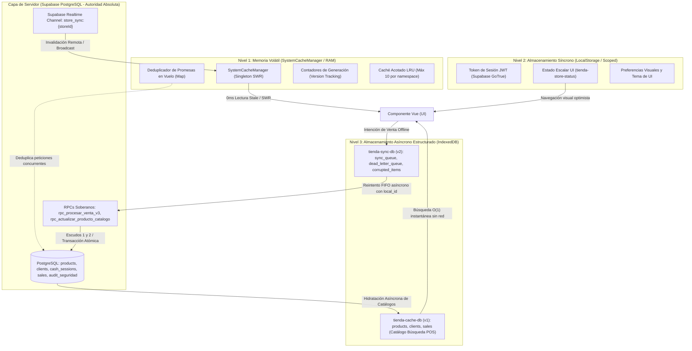
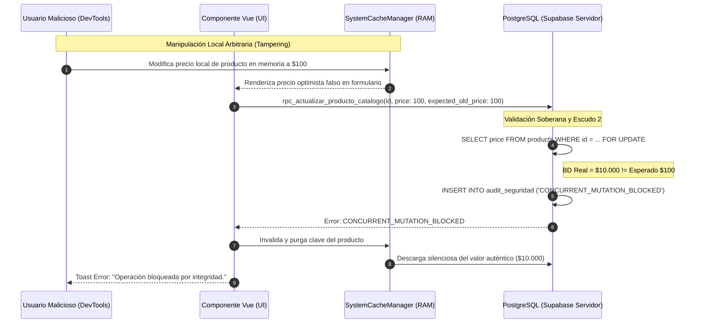
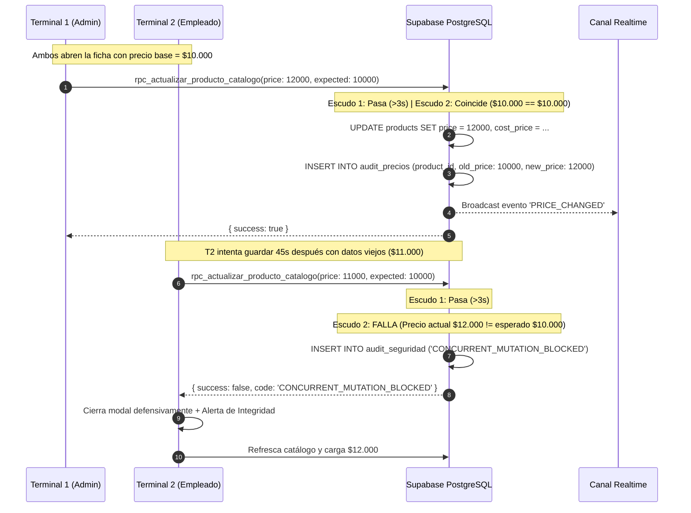

# SDD-028: Almacenamiento Local Seguro y Caché de Aplicación

> **Asociado a:** [FRD-028](../FRD/FRD_028_ALMACENAMIENTO_LOCAL_SEGURO.md)  
> **Fase del Plan:** Ola 5 — Sesiones, Autenticación, Offline y Gobernanza de Caché  
> **Estado:** 🟢 Aprobado (Protocolo PAC-SDD v2.0)  
> **Versión:** 2.0.0 (Consolidada con Gobernanza de Memoria, SWR y Blindaje de Concurrencia)  
> **Última Actualización:** 2026-10-26  

---

## 0. Contexto y Restricciones Aplicables

### 0.1 Políticas Globales Activadas (ARQ-002)

| Política ID | Dominio | Impacto Concreto en este SDD |
| :--- | :--- | :--- |
| **POL-DATA-01** | Arquitectura | **Autoridad Soberana del Backend:** El almacenamiento local (`IndexedDB`, memoria RAM y `localStorage`) es exclusivamente una caché cosmética y acelerador visual. Jamás sustituye la verdad financiera o de stock de PostgreSQL en Supabase. |
| **POL-AUTH-01** | Seguridad | **Aislamiento Multi-Tenant en Cliente:** Toda clave en `localStorage`, memoria y registro en `IndexedDB` se particiona estrictamente por `store_id`. |
| **POL-SEC-01** | Seguridad | **Ceguera Financiera y Cero Secretos:** Prohibido almacenar credenciales sensibles o costos en texto plano en almacenamiento síncrono. Bloqueo definitivo de mutaciones concurrentes sospechosas. |

### 0.2 Contratos Vecinos que Limitan el Diseño

| SDD Vecino | Restricción que Impone |
| :--- | :--- |
| **SDD_012 (Sincronización Offline)** | Gobierna el límite duro de 50 transacciones en `sync_queue` (alerta al 80%, bloqueo al 100% — Hallazgo H20) y la supervivencia de la cola ante cierres de sesión (`RN-CACHE-03`). |
| **SDD_011 (Manejo de Errores)** | Define la cuarentena en `dead_letter_queue` ante rechazos definitivos de reglas de negocio (`4xx` / `P0001`). |
| **SDD_007 / SDD_007_01 (POS)** | Provee `idempotency_key` / `local_id` para garantizar procesamiento exactamente una vez al reconectar. |
| **SDD_005 (Auditoría y Trazabilidad)** | Provee la tabla append-only `audit_seguridad` para asentar bloqueos de concurrencia (`CONCURRENT_MUTATION_BLOCKED`). |
| **SDD_006_PADRE (Inventario)** | Desacopla la mutación de catálogo (`rpc_actualizar_producto_catalogo`) de los movimientos logísticos de Kardex, prohibiendo mutaciones directas a `products.current_stock`. |

### 0.3 Auditoría de BD contra Realidad (Deuda Técnica Formalizada)

Se declaran las **N=7 decisiones y deudas técnicas** (desglosadas en la Sección 7):
- **D-1:** Prohibición de colecciones masivas en `localStorage`; migración obligatoria de catálogos (`products`, `clients`, `sales`) a `IndexedDB`.
- **D-2:** Invalidez de valores cacheados en el cliente para autorizar mutaciones en servidor (Backend Authority).
- **D-3:** Supervivencia selectiva de `sync_queue` y `dead_letter_queue` durante el logout hasta su vaciado exitoso.
- **D-4:** Recuperación automática ante corrupción de JSON/esquema local sin provocar pantalla en blanco (Regla 3 de `AGENTS.md`).
- **D-5:** Particionamiento estricto por `store_id` en almacenes locales (`scopedStorage`).
- **D-6:** Desacoplamiento del Sello de Concurrencia respecto al trigger `trg_products_updated` (Blindaje de falsos bloqueos durante ventas POS).
- **D-7:** Erradicación de `current_stock` en el mapper y contrato de actualización de catálogo (`rpc_actualizar_producto_catalogo`).

---

## 1. INTRODUCCIÓN Y PROPÓSITO ARQUITECTÓNICO

El presente documento define la arquitectura formal, límites operacionales y gobernanza de seguridad para la persistencia en el lado cliente (Navegador Web) en Tienda Barrio Pro. Su propósito fundamental es establecer una delimitación estricta entre el almacenamiento en memoria volátil (RAM), el almacenamiento síncrono en `localStorage` y el almacenamiento asíncrono estructurado en `IndexedDB`, salvaguardando en todo momento el principio de **Autoridad Soberana del Backend (Backend Authority)** consagrado en el Contrato de Interfaz del sistema.

Bajo la regla de negocio fundamental **"El dato es sagrado y no se negocia"**, cualquier fragmento de información residente en el cliente (precios, existencias de inventario, cupos de crédito, estados de caja o roles de usuario) es clasificado exclusivamente como una **copia optimista de conveniencia cosmética**. El almacenamiento local tiene como única finalidad acelerar la navegación de la interfaz gráfica de usuario (UI), habilitar búsquedas instantáneas en el Punto de Venta (POS) y sostener la operación transaccional en contingencias de red (Offline-First). Toda mutación transaccional, financiera o de inventario debe ser remitida y validada de manera soberana e inmutable por el motor de base de datos relacional PostgreSQL en Supabase.

Adicionalmente, bajo el escenario de concurrencia real de hasta 6 dispositivos simultáneos (1 Administrador + 5 Empleados), este diseño implementa un motor centralizado de caché operacional (`SystemCacheManager`) con deduplicación de promesas en vuelo, jerarquía estricta de invalidación y un blindaje dual de mutación (**Escudo 1 y Escudo 2**) que bloquea definitivamente cualquier sobrescritura destructiva entre cuentas.

---

## 2. POLÍTICAS GLOBALES Y TRAZABILIDAD REGULATORIA (ARQ-002 / AGENTS.MD)

1. **POL-AUTH-01 (Aislamiento Multi-Tenant Absoluto):**
   Toda información almacenada en el cliente debe pertenecer estrictamente a la tienda activa (`store_id`). En el almacenamiento síncrono (`localStorage`), el adaptador `scopedStorage` obliga a prefijar todas las claves con el identificador del tenant (`tienda-${currentStoreId}-${key}`). En el gestor de caché en memoria (`SystemCacheManager`), el prefijo de partición es mandatorio (`${storeId}:${namespace}:${queryKey}`). En el servidor, toda sincronización valida la pertenencia mediante la invocación mandatoria de `assert_store_access(p_store_id)`.

2. **POL-FIN-01 (Backend Authority Financiero e Inventario):**
   El servidor es la única autoridad de cálculo contable y valoración económica. El cliente tiene terminantemente prohibido realizar cálculos matemáticos de ventas, cómputo de impuestos, determinación de saldos de clientes o valoración FIFO de inventarios. Toda mutación envía únicamente intenciones operativas y cantidades; PostgreSQL valida las reglas y asienta los cambios en el libro mayor correspondiente.

3. **POL-AUD-01 (Inviolabilidad Contable y Auditoría Forense):**
   Todo hecho económico capturado localmente debe preservarse con fidelidad histórica. Las ventas generadas en contingencia offline son inmutables y no pueden eliminarse arbitrariamente. Cualquier anomalía grave, sospecha de manipulación de almacenamiento (*tampering*) o colisión de concurrencia bloqueada genera un asiento inmutable en `public.audit_seguridad` con severidad y payload forense.

4. **Reglas de AGENTS.md (2, 3, 4, 6 y 8):**
   Se verifica el esquema real antes de escribir SQL (Regla 2); se prohíbe el uso de bloques que silencien errores de parseo o rechazos de seguridad convirtiéndolos en respuestas falsamente exitosas (Regla 3); se reutilizan las funciones centralizadas de acceso `get_current_store_id()` y `assert_store_access()` (Regla 4); se audita el impacto cruzado en tablas compartidas (Regla 6); y se ratifica la asignación de privilegios plenos en tablas nuevas (Regla 8).

---

## 3. ARQUITECTURA DEL SISTEMA Y FLUJO UNIDIRECCIONAL DE DATOS

La arquitectura de persistencia en el cliente se estructura en tres niveles jerárquicos claramente diferenciados por velocidad, persistencia, capacidad y nivel de riesgo:



### 3.1 Flujo de Verificación y Resistencia al Tampering



### 3.2 Flujo de Concurrencia entre Dispositivos (Escudo 1 y Escudo 2)



---

## 4. ESPECIFICACIÓN DETALLADA DE REGLAS DE NEGOCIO Y MODELO DE PERSISTENCIA

### 4.1 RN-CACHE-01: Prohibición de Almacenamiento Masivo en LocalStorage
Queda terminantemente prohibido almacenar arrays, colecciones o registros masivos de entidades de negocio en `localStorage`. Toda persistencia local de catálogos masivos debe residir en `IndexedDB` (`tienda-cache-db`).

### 4.2 RN-CACHE-02: Caché Optimista vs Autoridad del Backend
El estado en memoria o almacenamiento local es estrictamente cosmético. Toda mutación se valida y procesa en PostgreSQL.

### 4.3 RN-CACHE-03: Supervivencia de Datos Críticos ante Logout
El flujo de logout destruye tokens y credenciales pero **PRESERVA intactas e inmutables** las colas de IndexedDB `tienda-sync-db` (`sync_queue`, `dead_letter_queue` y `corrupted_items`).

### 4.4 RN-CACHE-04: Resiliencia ante Corrupción Local y Prevención del WSOD
Toda lectura de almacenamiento se encapsula en manejadores seguros (`safeParseJson`). Ante claves corruptas se purga la clave y se re-descarga silenciosamente desde Supabase.

### 4.5 RN-CACHE-05: Gobernanza del Caché Operacional en Memoria (RAM)
1. **Configuración de TTLs Diferenciados por Nivel:**

| Nivel | Tipología de Datos | TTL Vigencia | TTL Stale Máximo | Estrategia | Stores Asociados |
| :--- | :--- | :--- | :--- | :--- | :--- |
| **Nivel 1 (Estáticos)** | Perfiles, Configuración de Tienda | 60 minutos | 24 horas | Cache-First | `auth`, `devices` |
| **Nivel 2 (Catálogos)** | Productos, Clientes, Empleados, Proveedores | 5 minutos | 30 minutos | SWR | `inventory`, `clients`, `employees`, `suppliers` |
| **Nivel 3 (Financiero/Caja)** | Sesión activa de caja, saldo en pantalla | 30 segundos | 2 minutos | SWR Corto | `cashRegister`, `sales` (resumen día), `expenses` |
| **Nivel 4 (Transaccional)** | Decisiones de cobro, arqueo, cierre de caja | 0 segundos | 0 segundos | Network-Only | RPCs soberanos (cero caché) |
| **Nivel 5 (Consultas/Reportes)** | Historiales, Kardex, Lotes, Analítica | 2 minutos | 10 minutos | LRU Bounded | `useHistory`, `reports`, `financial`, `batches` |

2. **Deduplicación de Peticiones en Vuelo:**
   `SystemCacheManager` mantiene un mapa reactivo `inFlightPromises: Map<string, Promise<any>>`. Si un segundo llamador invoca `fetchSWR` sobre una clave que ya se está descargando, se suscribe a la misma promesa existente sin generar una segunda petición HTTP.

3. **Contador de Generación contra Carreras de Invalidación:**
   Cada entrada almacena un entero `generation: number`. Al invocar `invalidate(key)` o `invalidateNamespace(ns)`, el contador de generación se incrementa. Si una promesa en vuelo finaliza después de que la clave fue invalidada, su resultado es descartado automáticamente.

4. **Acotamiento de Memoria (LRU Bounded):**
   Para consultas parametrizadas, el gestor almacena un máximo de 10 entradas por namespace (`MAX_ENTRIES = 10`). Al alcanzar el límite, se purga la entrada consultada hace más tiempo (`least recently used`).

### 4.6 RN-CACHE-06: Conectividad y Reconexión como Evento de Invalidación
1. El composable `useOnlineStatus` y el listener del canal Realtime detectan la pérdida de conectividad.
2. Ante una desconexión superior a 5 segundos, todas las claves de Nivel 2 y Nivel 3 en memoria se marcan con `isStale = true`.
3. Al detectarse el evento `reconnect` o el restablecimiento de WebSocket, el gestor dispara un `invalidateAll()` silencioso. Las vistas activas revalidan en segundo plano sin interrumpir la interacción del usuario.

### 4.7 RN-CACHE-07: Política de Arranque en Frío (Cold Start)
Los datos recuperados desde persistencia local (`pinia-plugin-persistedstate` o `IndexedDB`) tras un refresco de página (`F5`) se inicializan con `lastFetchedAt = 0`. Esto permite pintarlos de inmediato en la UI mientras el motor dispara la revalidación asíncrona de fondo en el primer ciclo de renderizado.

### 4.8 RN-CACHE-08: Blindaje de Concurrencia y Bloqueo Definitivo de Mutación (Escudos 1 y 2)

#### Algoritmo del Escudo 1 — Cooldown Mínimo por Vector (`< 3 segundos`)
1. El backend intercepta la solicitud de mutación en el RPC respectivo.
2. Consulta el timestamp del último registro en la tabla de auditoría del vector:
   - Para el **Vector Catálogo/Precio**: `SELECT max(created_at) FROM audit_precios WHERE product_id = p_product_id;`
   - Para el **Vector Logístico/Stock**: `SELECT max(created_at) FROM inventory_movements WHERE product_id = p_product_id AND movement_type != 'venta';`
3. Si `now() - max(created_at) < interval '3 seconds'`, la mutación se bloquea de forma inmediata.

#### Algoritmo del Escudo 2 — Sello de Estado Base por Vector (`Vector Snapshot Seal`)
1. El cliente envía `p_expected_old_price`, `p_expected_old_cost` y `p_expected_name`.
2. El RPC bloquea la fila con `SELECT price, cost_price, name FROM products WHERE id = p_product_id FOR UPDATE;`.
3. Compara estrictamente los valores de catálogo:
   $$\text{price} == \text{expected\_old\_price} \quad \land \quad \text{name} == \text{expected\_name}$$
4. **Regla de Oro:** Se prohíbe comparar `products.updated_at` o `current_stock`, puesto que las ventas del cajero disparan el trigger `trg_products_updated` continuamente sin alterar los datos del catálogo comercial.

#### Manejo de Idempotencia por Red Lenta
Si el sello no coincide (`price != expected_old_price`), pero:
- `price == p_new_price` (el cambio ya se aplicó) **Y**
- El último registro en `audit_precios` fue ejecutado por el mismo `actor_id` hace menos de 10 segundos.
El RPC retorna `{ success: true, code: 'ALREADY_APPLIED_IDEMPOTENT' }`, evitando registrar falsas alertas de seguridad por reintentos de red.

#### Registro Seguro en Auditoría (Sin Rollback Ciego)
En PostgreSQL, una excepción con `RAISE EXCEPTION` revierte toda la transacción, borrando cualquier inserción en `audit_seguridad`. Por tanto, ante el fallo del Escudo 1 o Escudo 2:
1. El RPC ejecuta `INSERT INTO public.audit_seguridad (actor_id, store_id, event_type, metadata) VALUES (v_employee_id, v_store_id, 'CONCURRENT_MUTATION_BLOCKED', jsonb_build_object('reason', 'STALE_VECTOR_SNAPSHOT', ...));`.
2. Omite el `UPDATE` sobre `products`.
3. Retorna `{ success: false, code: 'CONCURRENT_MUTATION_BLOCKED', message: 'Bloqueo defensivo por colisión concurrente.' }`.

---

## 5. CONTRATO DE INTERFAZ Y COMUNICACIÓN (CLIENTE - SERVIDOR - STORAGE)

### 5.1 Estructura del Almacén de Transacciones Offline (IndexedDB: `sync_queue`)
*(Se mantiene idéntico a v1.0 — 50 ítems de cuota e indexación FIFO).*

### 5.2 Estructura del Almacén de Transacciones Fallidas (IndexedDB: `dead_letter_queue`)
*(Se mantiene idéntico a v1.0).*

### 5.3 Contrato de Respuesta Unificada del Backend (`ActionResponse`)

```json
{
  "$schema": "http://json-schema.org/draft-07/schema#",
  "title": "ActionResponseSchema",
  "type": "object",
  "description": "Contrato universal de respuesta de Supabase ante mutaciones de datos",
  "required": ["success"],
  "properties": {
    "success": { "type": "boolean" },
    "data": { "type": "object" },
    "error": { "type": "string" },
    "code": {
      "type": "string",
      "enum": [
        "DUPLICATE_RESOLVED",
        "NO_OPEN_CASH_SESSION",
        "SHIFT_EXPIRED",
        "STORE_ACCESS_DENIED",
        "INSUFFICIENT_STOCK",
        "CREDIT_LIMIT_EXCEEDED",
        "CONCURRENT_MUTATION_BLOCKED",
        "ALREADY_APPLIED_IDEMPOTENT",
        "MUTATION_COOLDOWN_ACTIVE"
      ]
    },
    "details": { "type": "object" }
  }
}
```

### 5.4 Contrato RPC: `rpc_actualizar_producto_catalogo`

```json
{
  "$schema": "http://json-schema.org/draft-07/schema#",
  "title": "RpcActualizarProductoCatalogoParams",
  "type": "object",
  "required": ["p_product_id", "p_name", "p_price", "p_expected_old_price", "p_expected_name"],
  "properties": {
    "p_product_id": { "type": "string", "format": "uuid" },
    "p_name": { "type": "string", "minLength": 2 },
    "p_price": { "type": "number", "minimum": 50 },
    "p_cost": { "type": "number", "minimum": 0 },
    "p_min_stock": { "type": "integer", "minimum": 0 },
    "p_plu": { "type": ["string", "null"] },
    "p_category_id": { "type": ["string", "null"], "format": "uuid" },
    "p_expected_old_price": { "type": "number", "description": "Sello Escudo 2: precio base que leyó el usuario" },
    "p_expected_old_cost": { "type": "number" },
    "p_expected_name": { "type": "string", "description": "Sello Escudo 2: nombre base que leyó el usuario" }
  }
}
```

---

## 6. GESTIÓN DE LA ESPERA, TOLERANCIA A FALLOS Y RESILIENCIA OFFLINE

| Operación | Estado Pendiente (Wait State) | Mecanismo de Bloqueo | Manejo de Re-entrada |
|---|---|---|---|
| **Carga de Catálogo (SWR)** | Retorna dato en RAM inmediatamente (0ms) si está fresco. Si está stale, muestra datos en caché e icono sutil de refresco de fondo. | Bloqueo cero. El usuario navega sin esperas. | Deduplicación singleton en vuelo; llamadas simultáneas comparten la misma promesa. |
| **Edición de Producto (Guardar)** | Spinner en botón "Guardar" y formulario deshabilitado. | Bloqueo estricto del modal. Previene doble clic (`isSubmitting = true`). | Si falla por concurrencia (`CONCURRENT_MUTATION_BLOCKED`), cierra el modal, muestra toast de bloqueo y recarga datos reales. |
| **Venta en POS** | Spinner en "Cobrar". | Bloqueo estricto del botón de pago. | Idempotencia garantizada por `local_id`. |
| **Reconexión de Red** | Ícono de sincronización parpadeante en header. | Cero bloqueo sobre la navegación. | Revalidación global en segundo plano (`invalidateAll()`). |

---

## 7. MATRIZ DE TRAZABILIDAD, DEUDAS TÉCNICAS Y DECISIONES ARQUITECTÓNICAS (REGLA 7)

### D-1 (H-1): Prohibición de Colecciones Masivas en LocalStorage y Persistencia en IndexedDB
- **Qué se decidió:** Prohibir terminantemente el almacenamiento de arrays masivos en `localStorage`. Utilizar exclusivamente `IndexedDB` (`tienda-cache-db`) para la persistencia masiva.
- **Por qué / Trade-off:** `localStorage` impone cuota rígida de ~5MB y bloquea el Event Loop. `IndexedDB` soporta cientos de megabytes de forma asíncrona.
- **Condición de revisión futura:** Permanente.

### D-2 (H-2): Caché Optimista Cosmética vs Backend Authority Absoluto
- **Qué se decidió:** Toda clave de estado en cliente es estrictamente optimista. Toda mutación se valida y calcula en PostgreSQL.
- **Por qué / Trade-off:** El cliente es inspeccionable y manipulable. La soberanía del backend erradica fraudes y corrupción contable.
- **Condición de revisión futura:** Permanente.

### D-3 (H-3): Supervivencia Selectiva de Colas Transaccionales al Logout
- **Qué se decidió:** Logout purga tokens pero **PRESERVA intactas** las colas de IndexedDB (`sync_queue`, `dead_letter_queue`).
- **Por qué / Trade-off:** Destruir estas colas destruiría hechos económicos cobrados físicamente a clientes reales (*POL-AUD-01*).
- **Condición de revisión futura:** Permanente.

### D-4 (H-4): Resiliencia Progresiva ante Corrupción Local y Erradicación del WSOD
- **Qué se decidió:** Envoltorios seguros `safeParseJson` con auto-sanación atómica ante datos corruptos.
- **Por qué / Trade-off:** Impide la temida pantalla blanca de la muerte (*WSOD*) ante fallos de energía o versiones desactualizadas de esquemas.
- **Condición de revisión futura:** Permanente.

### D-5 (H-5): Aislamiento Multi-tienda Forzado en Almacenamiento Local
- **Qué se decidió:** Particionamiento obligatorio por tenant (`tienda-${currentStoreId}-${key}` y namespaces en RAM).
- **Por qué / Trade-off:** Previene fuga de información o colisión de inventarios en terminales compartidas entre comercios.
- **Condición de revisión futura:** Permanente.

### D-6 (H-CACHE-10): Desacoplamiento del Sello de Concurrencia respecto al Trigger de Venta
- **Qué se decidió:** El Escudo 2 de concurrencia compara exclusivamente la fotografía del vector (`expected_old_price`, `expected_name`) y **TIENE PROHIBIDO** evaluar `products.updated_at` o `current_stock`.
- **Por qué / Trade-off:** Cada venta en el POS dispara el trigger `update_product_stock()`, el cual ejecuta un `UPDATE products` que muta `updated_at`. Si el sello evaluara `updated_at`, cualquier venta en caja mientras el Administrador edita el precio provocaría un falso bloqueo y una falsa alerta de seguridad.
- **Condición de revisión futura:** Permanente. Invariante de independencia vectorial entre catálogo comercial y logística física.

### D-7 (H-CACHE-03): Erradicación de `current_stock` en Persistencia de Catálogo
- **Qué se decidió:** Prohibir el uso del `UPDATE products` genérico que incluya `current_stock` desde el frontend. Toda mutación de catálogo debe ejecutarse mediante `rpc_actualizar_producto_catalogo` enviando únicamente atributos comerciales.
- **Por qué / Trade-off:** El formulario de edición modal leía el stock al abrirse y, al guardar, sobrescribía el stock en la base de datos, destruyendo silenciosamente las ventas concurrentes del POS.
- **Condición de revisión futura:** Permanente.
