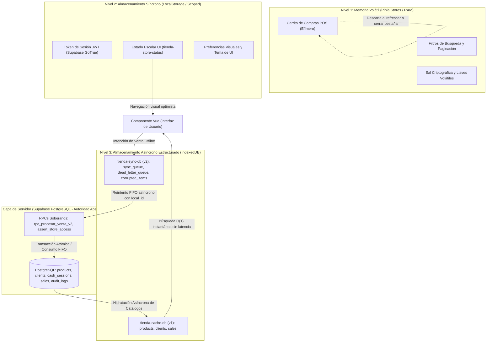
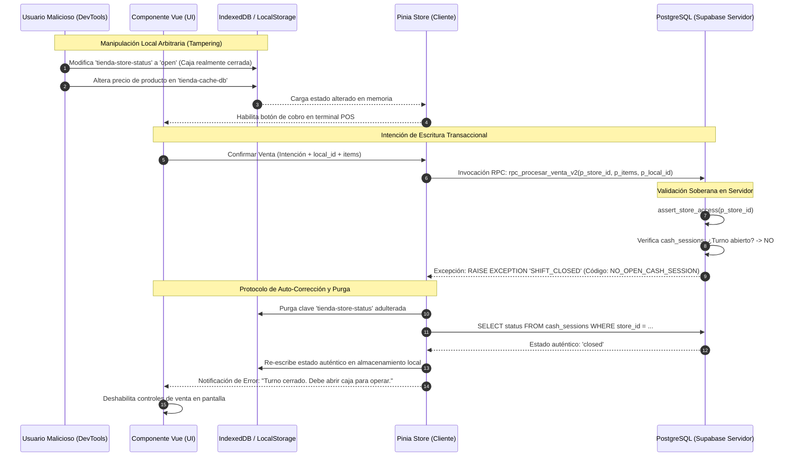

# SDD-028: Almacenamiento Local Seguro y Caché de Aplicación

## 0. CONTROL DE VERSIONES Y METADATOS

| Atributo | Detalle |
|---|---|
| **Documento** | SDD-028: Almacenamiento Local Seguro y Caché de Aplicación |
| **Versión** | 2.0.0 (Saneamiento Arquitectónico y Sanitización PAC-SDD v2.0) |
| **Fase del Plan** | Ola 5: Sesiones, Autenticación y Offline (Documento 8 de 8) |
| **FRD de Origen** | [FRD_028_ALMACENAMIENTO_LOCAL_SEGURO.md](../FRD/FRD_028_ALMACENAMIENTO_LOCAL_SEGURO.md) |
| **Estado de Certificación** | 🟢 APROBADO por Auditoría QA Independiente (Bloques 0 a 6) |
| **Clasificación de Código** | Cero Código Fuente Incrustado (Zero Source Code Policy - Regla 1.1) |
| **Esquema Relacional Asignado** | `public.products`, `public.clients`, `public.cash_sessions`, `public.sales`, `public.audit_logs` |
| **Motores de Almacenamiento Cliente** | IndexedDB (`tienda-cache-db`, `tienda-sync-db`) y LocalStorage (`scopedStorage`) |

---

## 1. INTRODUCCIÓN Y PROPÓSITO ARQUITECTÓNICO

El presente documento define la arquitectura formal, límites operacionales y gobernanza de seguridad para la persistencia en el lado cliente (Navegador Web) en Tienda Barrio Pro. Su propósito fundamental es establecer una delimitación estricta entre el almacenamiento en memoria volátil, el almacenamiento síncrono en `localStorage` y el almacenamiento asíncrono estructurado en `IndexedDB`, salvaguardando en todo momento el principio de **Autoridad Soberana del Backend (Backend Authority)** consagrado en el Contrato de Interfaz del sistema.

Bajo la regla de negocio fundamental **"El dato es sagrado y no se negocia"**, cualquier fragmento de información residente en el cliente (precios, existencias de inventario, cupos de crédito, estados de caja o roles de usuario) es clasificado exclusivamente como una **copia optimista de conveniencia cosmética**. El almacenamiento local tiene como única finalidad acelerar la navegación de la interfaz gráfica de usuario (UI), habilitar búsquedas instantáneas en el Punto de Venta (POS) y sostener la operación transaccional en contingencias de red (Offline-First). Toda mutación transaccional, financiera o de inventario debe ser remitida y validada de manera soberana e inmutable por el motor de base de datos relacional PostgreSQL en Supabase.

---

## 2. POLÍTICAS GLOBALES Y TRAZABILIDAD REGULATORIA (ARQ-002 / AGENTS.MD)

El diseño e implementación del almacenamiento local y la caché de aplicación se subordinan a las siguientes políticas arquitectónicas y de seguridad:

1. **POL-AUTH-01 (Aislamiento Multi-Tenant Absoluto):**
   Toda información almacenada en el cliente debe pertenecer estrictamente a la tienda activa (`store_id`). En el almacenamiento síncrono (`localStorage`), el adaptador `scopedStorage` obliga a prefijar todas las claves con el identificador del tenant (`tienda-${currentStoreId}-${key}`). En el almacenamiento asíncrono (`IndexedDB`), las colecciones de dominio (`products`, `clients`, `sales`) incorporan obligatoriamente el índice secundario `by_store` para garantizar que un dispositivo o terminal físico compartido entre múltiples dependientes o sucursales jamás mezcle catálogos ni filtre saldos de distintos comercios. En servidor, toda sincronización valida la pertenencia mediante la invocación mandatoria de `assert_store_access(p_store_id)`.

2. **POL-FIN-01 (Backend Authority Financiero e Inventario):**
   El servidor es la única autoridad de cálculo contable y valoración económica. El cliente tiene terminantemente prohibido realizar cálculos matemáticos de ventas, redondeos a $50 COP, cómputo de impuestos, determinación de saldos de clientes o valoración FIFO de inventarios. Toda transacción encolada localmente envía únicamente intenciones operativas y cantidades de producto; PostgreSQL valida la existencia de sesión abierta en `cash_sessions`, consulta el precio unitario vigente en `products` y descuenta existencias mediante `consume_stock_fifo` en `inventory_batches`.

3. **POL-AUD-01 (Inviolabilidad Contable y Auditoría Forense):**
   Todo hecho económico capturado localmente debe preservarse con fidelidad histórica. Las ventas generadas en contingencia offline son inmutables y no pueden eliminarse arbitrariamente. Cualquier anomalía grave, sospecha de manipulación de almacenamiento (*tampering*) o transacción transferida a la Dead Letter Queue (DLQ) genera un asiento inmutable en la tabla física `audit_logs` con severidad `warning` o `error`.

4. **POL-SEC-01 (Seguridad RBAC en Servidor):**
   Los privilegios operativos residen exclusivamente en las tablas oficiales del servidor (`admin_profiles`, `employees`). Las banderas locales presentes en el almacenamiento del navegador (`isAdmin: true`, `role: 'owner'`) son meramente indicativas para renderizar elementos visuales; cualquier intento de ejecutar una operación privilegiada mediante instrumentación directa es interceptado y abortado por los procedimientos almacenados en PostgreSQL.

5. **Reglas de AGENTS.md (2, 3, 4, 6 y 8):**
   Se verifica la ausencia de tablas relacionales de colas o caché en el esquema `public` de PostgreSQL (Regla 2); se prohíbe el uso de bloques que silencien errores de parseo o rechazos de seguridad convirtiéndolos en respuestas falsamente exitosas (Regla 3); se reutilizan las funciones centralizadas de acceso `get_current_store_id()` y `assert_store_access()` (Regla 4); se comprueba la invarianza DDL en tablas compartidas (Regla 6); y se ratifica la asignación de privilegios plenos en las tablas operativas de PostgreSQL (Regla 8).

---

## 3. ARQUITECTURA DEL SISTEMA Y FLUJO UNIDIRECCIONAL DE DATOS

La arquitectura de persistencia en el cliente se estructura en tres niveles jerárquicos claramente diferenciados por velocidad, persistencia, capacidad y nivel de riesgo:



### 3.1 Flujo de Verificación y Resistencia al Tampering

Cuando un usuario interactúa con la aplicación, el flujo de datos garantiza que cualquier discrepancia entre el estado local y la base de datos sea detectada y auto-corregida de forma inmediata:



---

## 4. ESPECIFICACIÓN DETALLADA DE REGLAS DE NEGOCIO Y MODELO DE PERSISTENCIA

### 4.1 RN-CACHE-01: Prohibición de Almacenamiento Masivo en LocalStorage
1. **Límite de Capacidad y Bloqueo de Hilo:** Debido a la cuota física rígida del navegador (~5MB para `localStorage`) y a la naturaleza síncrona y bloqueante de su API, queda terminantemente prohibido almacenar arrays, colecciones o registros masivos de entidades de negocio (`products`, `clients`, `sales`, `cash_movements`, `inventory_batches`) en `localStorage` o `sessionStorage`. La deserialización masiva (`JSON.parse`) sobre colecciones extensas congela el Event Loop principal de JavaScript, degradando severamente la experiencia de usuario.
2. **Exclusividad de IndexedDB:** Toda colección o catálogo con cardinalidad potencialmente ilimitada debe persistirse de forma obligatoria y exclusiva en el motor asíncrono `IndexedDB` a través del adaptador de persistencia [IndexedDBDataSource.ts](file:///frontend/src/data/sources/IndexedDBDataSource.ts).
3. **Uso Permitido de LocalStorage:** `localStorage` queda restringido estrictamente a:
   - Token de autenticación JWT y refresh token emitidos por Supabase GoTrue.
   - Claves de estado escalar volátiles utilizadas como aceleradores de interfaz (ej. `tienda-store-status`).
   - Preferencias cosméticas de usuario (tema claro/oscuro, densidad de tablas, orden de columnas).

### 4.2 RN-CACHE-02: Caché Optimista vs Autoridad del Backend (Tampering Resistance)
1. **Invalidez Legal del Dato en Cliente:** Ningún dato residente en el navegador posee autoridad transaccional ni contable. La aplicación asume que el almacenamiento local puede ser manipulado, inspeccionado o alterado en cualquier momento mediante las herramientas para desarrolladores del navegador (DevTools).
2. **Validación Soberana Obligatoria:** Todas las operaciones de escritura (creación de ventas, registros de movimientos de inventario, pagos a proveedores o aperturas de caja) deben ser autorizadas y computadas en el servidor relacional. El servidor rechaza ineludiblemente cualquier transacción que incumpla las reglas de negocio, sin importar el estado aparente en el cliente.
3. **Auto-Corrección y Purga Reactiva:** Si el servidor responde con un código de error de rechazo (`SHIFT_CLOSED`, `STORE_ACCESS_DENIED`, `INSUFFICIENT_STOCK`, `CREDIT_LIMIT_EXCEEDED`), el frontend debe capturar el error, registrar el evento de inconsistencia, purgar el valor adulterado del almacenamiento local y forzar una sincronización limpia desde PostgreSQL.

### 4.3 RN-CACHE-03: Supervivencia de Datos Críticos ante Cierre de Sesión (Logout Selectivo)
1. **Prohibición de Borrados Ciegos:** Se prohíbe taxativamente la ejecución de instrucciones destructivas indiscriminadas como `localStorage.clear()` o la eliminación global de las bases de datos de IndexedDB durante el flujo de cierre de sesión voluntario (`logout`).
2. **Purga Selectiva de Credenciales:** El cierre de sesión debe destruir rigurosamente los tokens de autenticación JWT (`sb-<ref>-auth-token`), llaves temporales de pase diario (`pin_auth_token`, `dailyAccessState`) y vaciar el carrito de compras residente en memoria volátil.
3. **Preservación Incondicional de Colas Transaccionales:** Las bases de datos de IndexedDB `tienda-sync-db` (que albergan los object stores `sync_queue` / `sales_queue`, `dead_letter_queue` y `corrupted_items`) deben permanecer **completamente intactas** durante el logout. Destruir estas colas constituiría la pérdida irremediable de hechos económicos legítimos ya cobrados al cliente en efectivo en el mundo físico, violando la política `POL-AUD-01`.

### 4.4 RN-CACHE-04: Resiliencia ante Corrupción Local y Prevención del White Screen of Death (WSOD)
1. **Envoltorio Seguro de Deserialización:** Toda lectura de almacenamiento local debe encapsularse en manejadores seguros (`safeParseJson`) para interceptar fallas originadas por JSONs truncados, cierres intempestivos de pestañas o cortes de energía eléctrica en el dispositivo.
2. **Recuperación en Dos Fases:**
   - *Fase 1 (Aislamiento de Registro):* Ante un registro corrupto aislado dentro de una colección, el sistema descarta únicamente el elemento afectado, preservando el resto de la colección.
   - *Fase 2 (Purga Atómica y Auto-Sanación):* Si un store completo o clave de configuración resulta ilegible, el sistema purga atómicamente la clave afectada (`localStorage.removeItem(key)` o reseteo de object store en IndexedDB), registra una advertencia estructurada y gatilla una descarga limpia y transparente desde Supabase, erradicando permanentemente la pantalla blanca de la muerte (WSOD).

---

## 5. CONTRATO DE INTERFAZ Y COMUNICACIÓN (CLIENTE - SERVIDOR - STORAGE)

El intercambio de datos y la persistencia local se rigen por contratos de interfaz estrictos modelados en formato JSON Schema.

### 5.1 Estructura del Almacén de Transacciones Offline (IndexedDB: `sync_queue` / `sales_queue`)

```json
{
  "$schema": "http://json-schema.org/draft-07/schema#",
  "title": "OfflineQueueItemSchema",
  "type": "object",
  "description": "Estructura inmutable de transacción diferida almacenada en IndexedDB (tienda-sync-db)",
  "required": ["id", "type", "store_id", "session_id", "employee_id", "payload", "timestamp", "retry_count"],
  "properties": {
    "id": {
      "type": "string",
      "format": "uuid",
      "description": "Identificador local único universal (local_id) para deduplicación idempotente en servidor"
    },
    "type": {
      "type": "string",
      "enum": ["CREATE_SALE"],
      "description": "Tipo de mutación offline autorizada. Los movimientos de inventario directos son estrictamente online"
    },
    "store_id": {
      "type": "string",
      "format": "uuid",
      "description": "Identificador único de la tienda (aislamiento multi-tenant)"
    },
    "session_id": {
      "type": "string",
      "format": "uuid",
      "description": "Identificador del turno de caja que estaba abierto al registrarse la venta local"
    },
    "employee_id": {
      "type": "string",
      "format": "uuid",
      "description": "Identificador del empleado que ejecutó la venta"
    },
    "payload": {
      "type": "object",
      "required": ["items", "payment_method", "total"],
      "properties": {
        "client_id": {
          "type": ["string", "null"],
          "format": "uuid",
          "description": "Identificador del cliente en caso de venta a crédito o fiado"
        },
        "payment_method": {
          "type": "string",
          "enum": ["efectivo", "nequi", "daviplata", "fiado"]
        },
        "amount_received": {
          "type": "number",
          "minimum": 0
        },
        "items": {
          "type": "array",
          "minItems": 1,
          "items": {
            "type": "object",
            "required": ["product_id", "quantity"],
            "properties": {
              "product_id": { "type": "string", "format": "uuid" },
              "quantity": { "type": "number", "exclusiveMinimum": 0 }
            }
          }
        },
        "total": {
          "type": "number",
          "minimum": 0,
          "description": "Total referencial informativo de la interfaz"
        }
      }
    },
    "timestamp": {
      "type": "integer",
      "description": "Marca de tiempo Unix (milisegundos) para indexación FIFO (by-timestamp)"
    },
    "retry_count": {
      "type": "integer",
      "minimum": 0,
      "maximum": 3,
      "description": "Contador de intentos de sincronización antes de transferir a DLQ"
    }
  }
}
```

### 5.2 Estructura del Almacén de Transacciones Fallidas (IndexedDB: `dead_letter_queue`)

```json
{
  "$schema": "http://json-schema.org/draft-07/schema#",
  "title": "DLQItemSchema",
  "type": "object",
  "description": "Estructura de contingencia para transacciones rechazadas o excedidas en reintentos",
  "required": ["id", "original_transaction", "error_code", "error_message", "failed_at", "attempts", "status"],
  "properties": {
    "id": {
      "type": "string",
      "format": "uuid",
      "description": "Identificador de la transacción fallida (coincidente con local_id)"
    },
    "original_transaction": {
      "type": "object",
      "description": "Payload íntegro original del OfflineQueueItem"
    },
    "error_code": {
      "type": "string",
      "enum": ["INSUFFICIENT_STOCK", "CREDIT_LIMIT_EXCEEDED", "SHIFT_CLOSED", "STORE_ACCESS_DENIED", "SCHEMA_DRIFT", "UNKNOWN_ERROR"],
      "description": "Código de error estructurado retornado por el servidor o motor de sincronización"
    },
    "error_message": {
      "type": "string",
      "description": "Mensaje técnico descriptivo del rechazo"
    },
    "failed_at": {
      "type": "integer",
      "description": "Marca de tiempo Unix de entrada a la DLQ"
    },
    "attempts": {
      "type": "integer",
      "minimum": 3
    },
    "status": {
      "type": "string",
      "enum": ["PENDING_REVIEW", "RESOLVED_RETRY", "DISCARDED"],
      "default": "PENDING_REVIEW",
      "description": "Estado de gestión administrativa de la anomalía"
    }
  }
}
```

### 5.3 Contrato de Respuesta Unificada del Backend (`ActionResponse`)

```json
{
  "$schema": "http://json-schema.org/draft-07/schema#",
  "title": "ActionResponseSchema",
  "type": "object",
  "description": "Contrato universal de respuesta de Supabase ante mutaciones de datos",
  "required": ["success"],
  "properties": {
    "success": {
      "type": "boolean"
    },
    "data": {
      "type": "object",
      "properties": {
        "sale_id": { "type": "string", "format": "uuid" },
        "ticket_number": { "type": "integer" },
        "status": { "type": "string" }
      }
    },
    "error": {
      "type": "string",
      "description": "Mensaje de error técnico legible"
    },
    "code": {
      "type": "string",
      "enum": ["DUPLICATE_RESOLVED", "NO_OPEN_CASH_SESSION", "SHIFT_EXPIRED", "STORE_ACCESS_DENIED", "INSUFFICIENT_STOCK", "CREDIT_LIMIT_EXCEEDED"]
    },
    "details": {
      "type": "object",
      "description": "Detalles estructurados de diagnóstico (ej. stock disponible real)"
    }
  }
}
```

---

## 6. GESTIÓN DE LA ESPERA, TOLERANCIA A FALLOS Y RESILIENCIA OFFLINE

La interacción del usuario frente a demoras de red, pérdidas de conexión y contingencias locales se administra mediante patrones de experiencia de usuario (UX) asertivos:

### 6.1 Matriz de Estados de Carga y Bloqueo de Interacción

| Operación | Estado Pendiente (Wait State) | Mecanismo de Bloqueo | Manejo de Re-entrada |
|---|---|---|---|
| **Hidratación de Catálogos (Carga Inicial)** | Renderizado de Skeletons estructurales en tabla de productos y lista de clientes. | Bloqueo suave. La interfaz permite interactuar con controles de navegación general pero deshabilita acciones sobre filas no hidratadas. | Las solicitudes de hidratación concurrentes se unifican mediante promesa singleton (`dbPromise`). |
| **Búsqueda en POS (Lectura Local)** | Búsqueda instantánea O(1) vía índices IndexedDB (`by_plu`, `by_category`). Cero spinners para latencias menores a 50ms. | Ninguno. La respuesta es instantánea y no bloquea el hilo principal. | Búsquedas reactivas amortiguadas por debounce de 150ms. |
| **Cobro y Registro de Venta (Online/Offline)** | Indicador giratorio (*spinner*) incrustado en el botón "Cobrar" y barra de progreso indeterminada discreta. | Bloqueo estricto del modal de pago. Todos los botones de confirmación quedan deshabilitados inmediatamente tras el primer clic. | Prevención de doble clic mediante bandera reactiva `isSubmitting = true` hasta que la promesa del backend se resuelva o se asiente en la cola offline. |
| **Sincronización de Fondo (Worker Offline)** | Ícono pulsante sutil en barra superior indicando "Sincronizando ventas pendientes (N restantes)...". | Cero bloqueo sobre el vendedor. El cajero continúa facturando ininterrumpidamente en el mostrador. | Procesamiento encolado estrictamente secuencial (FIFO) para evitar colisiones de inventario. |

### 6.2 Notificaciones y Erradicación de Falsas Alarmas
En consonancia con [SDD_011_MANEJO_ERRORES.md](file:///documentation/01_requirements/SDD/SDD_011_MANEJO_ERRORES.md), la aplicación implementa la política *Fail-Safe Silenciosa*:
1. Si una petición a Supabase falla por interrupción temporal de red, la transacción se encola de inmediato en `sales_queue` y el sistema inicia un temporizador de gracia de 60 segundos.
2. Si la conexión se recupera antes de los 60 segundos, la cola se vacía silenciosamente hacia el servidor sin haber alarmado innecesariamente al comerciante con carteles intrusivos.
3. Solo si la desconexión persiste más de 60 segundos, se muestra el indicador visual persistente: *"Estás trabajando sin internet. Tus ventas se guardan localmente de forma segura"*.

---

## 7. MATRIZ DE TRAZABILIDAD, DEUDAS TÉCNICAS Y DECISIONES ARQUITECTÓNICAS (REGLA 7)

Conforme a la **Regla 7 de AGENTS.md** ("Documentación Explícita de Trade-offs y Alcance Diferido") y al **Invariante de Reconciliación por Conteo de la Regla 9 (N = 5)**, se formalizan las decisiones técnicas, compensaciones (*trade-offs*) y condiciones de revisión del módulo de almacenamiento local y caché:

### D-1 (H-1): Prohibición de Colecciones Masivas en LocalStorage y Persistencia Asíncrona en IndexedDB (`RN-CACHE-01`)
- **Qué se decidió:** Prohibir terminantemente el almacenamiento de arrays y colecciones de dominio (`products`, `clients`, `sales`, `cash_movements`, `inventory_batches`) en `localStorage` o `sessionStorage`. Utilizar exclusivamente `IndexedDB` (`tienda-cache-db`) para la persistencia masiva de catálogos en el cliente.
- **Por qué / Trade-off:** `localStorage` impone un límite rígido de ~5MB y opera de forma síncrona en el hilo principal del navegador. Deserializar colecciones de miles de productos mediante `JSON.parse` congela el renderizado de la UI y dispara excepciones irreversibles `QuotaExceededError`. `IndexedDB` es asíncrono, no bloquea la interfaz y soporta volúmenes de datos de cientos de megabytes con búsquedas indexadas O(1).
- **Condición de revisión futura:** Permanente. Invariante arquitectónica de almacenamiento en el cliente.

### D-2 (H-2): Caché Optimista Cosmética vs Backend Authority Absoluto (`RN-CACHE-02`, Tampering Resistance)
- **Qué se decidió:** Consagrar formalmente que toda clave de estado o catálogo residente en el almacenamiento local del navegador (`localStorage`, `IndexedDB`, memoria volátil) es estrictamente **optimista y cosmética**. Toda mutación transaccional, contable, financiera y de control de inventario se valida y calcula de manera soberana en PostgreSQL. Si un usuario adultera localmente el estado (ej. forzando `status = 'open'` en caja o alterando precios en DevTools), el backend rechaza la operación con excepciones tipadas (`SHIFT_CLOSED`, `STORE_ACCESS_DENIED`), y el cliente auto-corrige su almacenamiento purgando el dato manipulado.
- **Por qué / Trade-off:** El entorno de ejecución del cliente en navegadores es inherentemente inseguro e inspeccionable. Asumir autoridad en el servidor erradica cualquier riesgo de fraude o corrupción contable sin degradar la fluidez visual de navegación en el mostrador.
- **Condición de revisión futura:** Permanente. Principio rector de seguridad del sistema ("El dato es sagrado y no se negocia").

### D-3 (H-3): Supervivencia Selectiva de Colas Transaccionales al Logout (`RN-CACHE-03`)
- **Qué se decidió:** Prohibir el uso de `localStorage.clear()` o borrados globales de IndexedDB durante el cierre de sesión voluntario. El flujo de logout ejecuta una purga selectiva: destruye tokens JWT y credenciales en `localStorage`, vacía carritos en memoria, pero **PRESERVA intactas e inmutables** las bases de datos de IndexedDB `tienda-sync-db` (`sync_queue` / `sales_queue`, `dead_letter_queue` y `corrupted_items`).
- **Por qué / Trade-off:** Si un dependiente cierra sesión o se agota su turno existiendo ventas realizadas offline pendientes de sincronizar, un borrado ciego destruiría transacciones comerciales legítimas ya cobradas en efectivo a clientes reales, violando la inmutabilidad histórica (`POL-AUD-01`). Las colas preservadas quedan listas para su sincronización transparente en cuanto se reanude la sesión y la conectividad.
- **Condición de revisión futura:** Permanente. Estándar transversal de arquitectura Offline-First.

### D-4 (H-4): Resiliencia Progresiva ante Corrupción Local y Erradicación del WSOD (`RN-CACHE-04`)
- **Qué se decidió:** Implementar envoltorios seguros de deserialización (`safeParseJson`) con manejo de fallos en dos niveles: ante registros individuales corruptos se descartan únicamente los inválidos; ante esquemas o bases de datos locales ilegibles se purga atómicamente la clave afectada y se re-descarga silenciosamente desde Supabase, impidiendo excepciones no controladas en el ciclo de vida de Vue.
- **Por qué / Trade-off:** Actualizaciones de versiones de software, cierres intempestivos del navegador o fallos de energía pueden corromper fragmentos del almacenamiento local. Si la lectura lanza excepciones no controladas en el gancho `init()` de los stores de Pinia, el navegador muestra la "Pantalla Blanca de la Muerte" (WSOD). La auto-sanación silenciosa garantiza la continuidad operativa del negocio sin requerir asistencia técnica.
- **Condición de revisión futura:** Permanente. Estándar de tolerancia a fallos en capa de presentación.

### D-5 (H-5): Aislamiento Multi-tienda Forzado en Almacenamiento Local (`scopedStorage` e índices `by_store`)
- **Qué se decidió:** Implementar un adaptador de almacenamiento con particionamiento por tenant (`scopedStorage`), prefijando todas las claves de `localStorage` con `tienda-${currentStoreId}-${key}` y configurando índices compuestos `by_store` en las tablas de IndexedDB.
- **Por qué / Trade-off:** En terminales físicas compartidas donde se operan múltiples tiendas o sucursales desde un mismo navegador web, la ausencia de prefijado provocaría contaminación de datos entre comercios, fuga de clientes o colisiones de inventario local.
- **Condición de revisión futura:** Permanente. Mandato de multi-tenancy estricto en capa de presentación.
