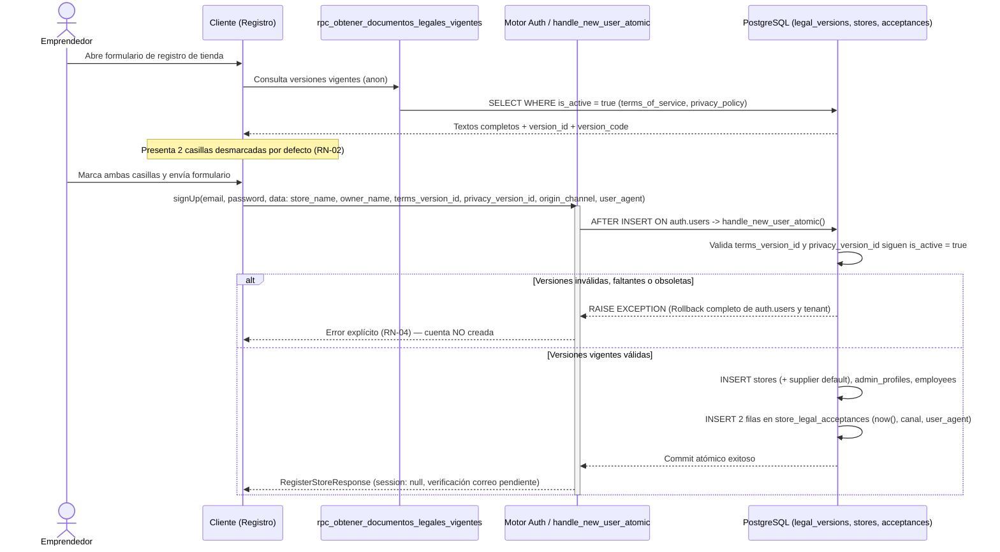
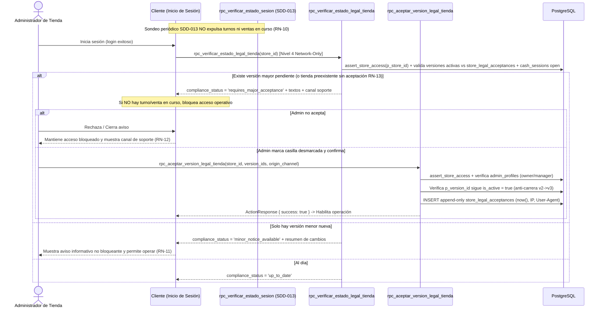
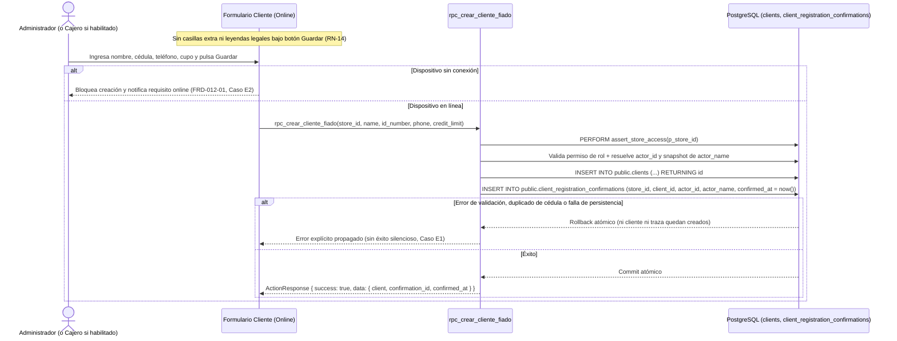
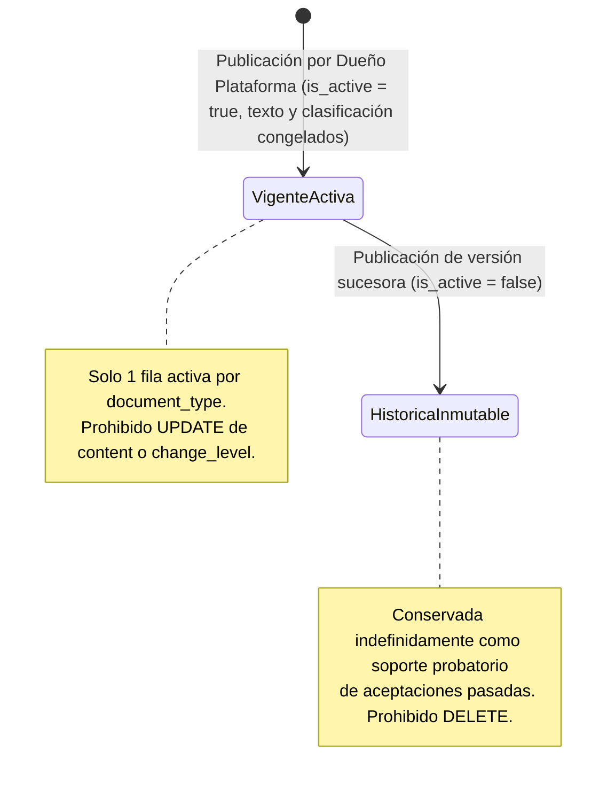
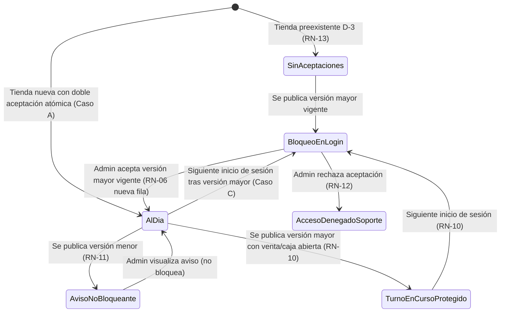
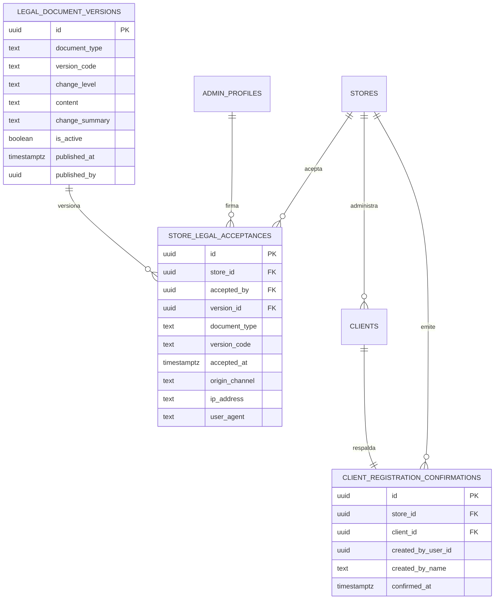

# SDD-029: Consentimiento Legal Versionado y Confirmación Probatoria

> **Asociado a:** [FRD-029: Consentimiento Legal Versionado](../FRD/FRD_029_CONSENTIMIENTO_LEGAL_VERSIONADO.md)  
> **Fase del Plan:** Gate 2 — Diseño Técnico SDD/UXD (Módulo 029)  
> **Estado:** 🟠 Aprobado con Deuda Técnica Documentada (PAC-SDD v2.0)  
> **Última Actualización:** 2026-11-11

---

## 0. Contexto y Restricciones Aplicables (PAC-SDD)

### 0.1 Políticas Globales Activadas (ARQ-002 / ARQ-003)

| Política ID | Dominio | Impacto Concreto en este SDD |
|---|---|---|
| **POL-PRIV-01** | Privacidad y Cumplimiento Legal | Exige trazabilidad probatoria e inmutable en servidor para toda entrada de datos personales: doble casilla desmarcada por defecto en autoregistro de tienda nueva (`RN-01` a `RN-05`), botón de guardado como clic de confirmación sin casillas extra al crear clientes de fiados (`RN-14`, `RN-15`), y exención absoluta en ventas de contado Consumidor Final RST `222222222222` (`RN-16`). |
| **POL-AUD-01** | Auditoría | Impone inmutabilidad estricta (`append-only`): prohibición total de `UPDATE` o `DELETE` por cualquier rol sobre versiones legales ya publicadas (`RN-08`), aceptaciones de tiendas (`RN-06`) y registros de confirmación de alta de clientes (`RN-15`). |
| **POL-AUD-02** | Auditoría | Obliga a registrar autoría completa (`actor_id`, instantánea histórica de nombre cuando aplique, marca temporal del servidor y metadatos técnicos de origen) en cada evento probatorio (`RN-05`, `RN-15`). |
| **POL-SEG-03** | Seguridad | Gobierna el control estricto por roles: autoridad exclusiva del Dueño de la Plataforma para publicar y clasificar versiones (`RN-09`), rol administrativo de tienda para aceptar versiones mayores (`RN-02`, `Caso C`), y aislamiento multi-tenant mediante funciones centralizadas en servidor. |
| **SPEC-011** *(heredado)* | Estándar Monetario | `SDD-029` no realiza aritmética financiera propia; en el alta atómica de cliente (`Caso E`) preserva la validación entera COP `>= 0` para `credit_limit` heredada de `SDD-009` / `FRD-009`. |

---

### 0.2 Contratos Vecinos que Limitan el Diseño

| SDD Vecino | Entidad / Operación Compartida | Restricción que Impone al Diseño de `SDD-029` |
|---|---|---|
| **SDD-002** (`§5.1`, `§5.2`, `§5.4`, `§5.5`) | `auth.users`, `stores`, `admin_profiles`, `employees`, `handle_new_user_atomic` | `§5.1` cierra raíz y `options.data` con `"additionalProperties": false` (solo `store_name`, `owner_name`) y `§5.2` retorna `session: null` en registro. Exige enmendar `SDD-002 §5.1` para transportar los IDs legales aceptados dentro de la misma transacción atómica de alta de cuenta. `§5.5` fija roles administrativos `'owner'|'manager'` en `admin_profiles`. |
| **SDD-001 / SDD-015 / SDD-013** (`§5.4`, `§5.6`) | `daily_passes`, `rpc_verificar_estado_sesion`, `get_employee_id_from_session` | `SDD-013 §5.6` tipifica exactamente 4 valores de `status` (`active`, `requires_login`, `requires_daily_pass`, `revoked_or_disabled`) en sondeo periódico. Para cumplir `RN-10` sin expulsar ni interrumpir turnos o ventas en curso, `SDD-029` no modifica el contrato de `SDD-013 §5.6` y expone un RPC legal dedicado evaluado al iniciar sesión / entrar a la aplicación. |
| **SDD-003** (`§5.1`) y **SDD-009** (`§3 RN-009-06`, `§4.1`, `§5.1–§5.3`) | `clients`, `employees` (`permissions`), `client_ledger` | `SDD-009 RN-009-06` restringe la creación de clientes al Administrador (`role IN ('admin', 'owner')`) y `SDD-003 §5.1` define `p_permissions` con `"additionalProperties": false` sin `canManageClients`, contrastando con la mención *"cajero o administrador"* de `FRD-029 RN-15 / Caso E`. Por decisión arquitectónica aprobada, la interfaz operativa conserva exclusividad de Administrador según `SDD-009`, mientras el RPC de `SDD-029` queda preparado para resolver autoría dual (`admin_profiles` o empleado autorizado) si se habilita permiso futuro; además reemplaza el `INSERT` directo por transacción atómica respetando `clients_name_check`, `clients_store_id_id_number_key` (`UNIQUE (store_id, id_number)`) y `clients_balance_check`. |
| **SDD-005** (`§0.3`, `§5.1`, `§5.2`) | `audit_logs`, `audit_seguridad`, `rpc_log_security_event` | `SDD-005 §5.1.2` limita `domain` a 6 valores (`caja`, `ventas`, `inventario`, `seguridad`, `precios`, `creditos`) y en BD real `audit_seguridad` restringe `event_type` a 12 valores mientras `audit_logs.actor_id` tiene `FK -> employees(id)` `NOT NULL`. Por ello `SDD-029` implementa sus propias bitácoras probatorias `append-only` dedicadas sin mutar `audit_logs`. |
| **SDD-007-01** (`§5.1`), **SDD-012** (`§5.1`, `§5.2`) y **SDD-024** (`§4.1`, `§4.3`, `§5.1–§5.3`) | `sales`, `clients`, cola offline `CREATE_SALE` | La cola offline solo admite `CREATE_SALE`, obligando a que el alta de clientes sea estrictamente en línea (`Caso E2` / `FRD-012-01`). `rpc_procesar_venta_v3` permite `p_client_id = NULL` en ventas de contado, garantizando exención absoluta (`RN-16`). |
| **SDD-028** (`§4.2`, `§4.5`, `§5.3`) y **SDD-011** (`§5.1`) | `ActionResponse`, política de caché `RN-CACHE-05` | Toda verificación de versión legal pendiente debe ejecutarse en **Nivel 4 (`Network-Only`, TTL 0s)** y nunca depender de persistencia local. Las respuestas RPC respetan la estructura `ActionResponse` `{ success, data, error, code }` sin propiedades `null` indebidas en fallo. |
| **RVC** (Líneas 23, 34, 40, 42, 47, 49, 50) | Contratos transversales | Rige la excepción documentada a `RVC` Línea 42 (`assert_store_access`): lectura pública pre-registro del catálogo legal (`RN-03`) y validación `assert_platform_owner()` exclusiva de plataforma (`RN-09`, `Caso B`). |

---

### 0.3 Auditoría de Base de Datos contra Realidad, Brechas y Deuda Técnica (Reglas 2, 4, 6 y 7)

1. **Brechas Críticas de Esquema Verificadas en Bloque 2 (BD Producción `TIENDA DE BARRIO`):**
   - **0 de 3 tablas nuevas existen hoy en `public`:** No existen tablas para (a) Catálogo de Versiones de Documentos Legales, (b) Registro Inmutable de Aceptaciones de Tiendas, ni (c) Registro Inmutable de Alta y Confirmación de Clientes de Crédito.
   - **Autoridad de Plataforma (`RN-09`) no aprovisionada:** En `auth.users`, `0/16` usuarios tienen `is_super_admin = true` o claim de plataforma en `raw_app_meta_data`. En `public.admin_profiles`, `role` es rol de **tienda** (`CHECK (role IN ('owner', 'manager'))`) y carece de columna `name`. **Colisión crítica detectada:** `handle_new_user_atomic()` asigna `'isSuperAdmin': true` dentro de `employees.permissions` a todos los dueños de tienda, por lo que queda **terminantemente prohibido** usar ese campo como permiso de plataforma.
   - **Discrepancias en tablas compartidas verificadas:** `clients` carece de RPC de creación y tiene política `clients_insert_store` (`store_id = get_current_store_id()`) abierta a `INSERT` directo; `audit_logs` tiene 12 columnas con `actor_id NOT NULL` (`FK -> employees(id)`, contradiciendo `RVC` Línea 50); `audit_seguridad` restringe `event_type` a 12 valores mediante `audit_seguridad_event_type_check` y `actor_id` referencia a `employees(id)`.

2. **Riesgos de Impacto Cruzado Verificados en Bloque 4:**
   - **`handle_new_user_atomic()` (`on_auth_user_created` en `auth.users`):** Actualmente tiene `proconfig = null` y `EXCEPTION WHEN OTHERS THEN RAISE WARNING 'ATOMIC REGISTRATION FAILED: %', SQLERRM; RETURN new;`, silenciando errores contra la Regla 3, `SDD-002 §3.1` y `FRD-029 RN-04`. Además `complete_Declaration_onboarding` citado en `RVC` Línea 34 no existe en `pg_proc`.
   - **`rpc_verificar_estado_sesion()`:** Actualmente tiene `proconfig = null`; no debe retornar `status != 'active'` por actualización legal durante turnos o ventas en curso (`RN-10`).
   - **Capa cliente actual incompatible:** El formulario de registro actual expone una sola casilla y un enlace muerto sin casilla para términos; la vista legal actual muestra texto estático sin versiones; el menú lateral de administrador tiene botón de términos sin acción; el adaptador genérico de persistencia de clientes atrapa excepciones de red y devuelve éxito local silencioso (prohibido por Regla 3 y `Caso E1/E2`).

3. **Registro Formal de Deuda Técnica y Trade-offs (Regla 7):**

| ID | Decisión / Hallazgo Documentado (Qué) | Justificación / Trade-off (Por qué) | Condición de Revisión (Cuándo) |
|---|---|---|---|
| **D-LEG-01** | **Creación pendiente de las 3 tablas nuevas y 5 RPCs/triggers legales (`🟠`):** El esquema `§7.2` especifica las tablas y funciones que aún no existen en producción. | `SDD-029` formaliza la arquitectura integrada antes de ejecutar la migración SQL/DSD para validar contratos y seguridad sin alterar tablas operativas en vivo. | Al aprobar y aplicar la migración DSD de `SDD-029` en Supabase. |
| **D-LEG-02** | **Aprovisionamiento del Dueño de Plataforma (`0/16` actuales en `auth.users`):** La validación `assert_platform_owner()` verificará `auth.users.is_super_admin IS TRUE` o claim firmado de plataforma, exigiendo aprovisionar explícitamente la cuenta del dueño SaaS y limpiar la interpretación de `employees.permissions->>'isSuperAdmin'`. | Ninguna tienda o administrador local puede tener privilegio de publicar documentos legales (`RN-09`). Separar por `auth.users.is_super_admin` / claim de servidor evita crear una tabla administrativa expuesta a multi-tenancy accidental. | Antes de habilitar el primer ambiente de administración legal / publicación de `v1.0`. |
| **D-LEG-03** | **Captura de IP HTTP en `Caso A` (Limitación GoTrue en `handle_new_user_atomic()`):** Al ejecutarse el trigger dentro de GoTrue (`INSERT INTO auth.users`), `current_setting('request.headers', true)` es `NULL` y la IP HTTP del cliente no está disponible en el trigger. | Se decide capturar `origin_channel` y `user_agent` suministrados en el registro inicial junto con `accepted_at = now()` del servidor, y capturar la IP HTTP real en el primer acceso autenticado PostgREST (y en toda re-aceptación `Caso C`), evitando introducir una Edge Function intermedia obligatoria para `signUp` en esta fase. | Revisar si una auditoría legal externa o incidente exige IP HTTP desde el instante previo a confirmar correo electrónico (en cuyo caso se enruta `signUp` vía Edge Function). |
| **D-LEG-04** | **Enmienda coordinada de `SDD-002 §5.1` y remediación de `handle_new_user_atomic()`:** Se extiende `options.data` de `SDD-002 §5.1` para recibir `accepted_terms_version_id`, `accepted_privacy_version_id` y origen, y se reemplaza `RAISE WARNING` por `RAISE EXCEPTION` en el trigger de alta. | `SDD-002 §5.2` mantiene `session: null` en registro; sin propagar el consentimiento y excepción atómica en el trigger existirían cuentas huérfanas sin prueba legal (`RN-04`). | Durante la migración SQL de `SDD-029` y sincronización documental de `SDD-002`. |
| **D-LEG-05** | **Conflicto de rol en alta de clientes (`SDD-009 RN-009-06` vs `FRD-029 RN-15 / Caso E`) y cierre de `clients_insert_store`:** La interfaz de usuarios mantiene creación exclusiva del Administrador según `SDD-009`, mientras `rpc_crear_cliente_fiado` resuelve identidad dual (`admin_profiles` o empleado autorizado) y revoca el `INSERT` directo por PostgREST (`clients_insert_store`) + elimina el `catch` silencioso del adaptador cliente. | Respeta las restricciones RBAC consolidadas de `FRD-009` / `SDD-009` / `SDD-003` sin romper permisos actuales, a la vez que blinda el requisito probatorio `RN-15` y deja el backend listo si en el futuro se habilita `canManageClients` a cajeros. | Si el dueño decide autorizar a cajeros crear clientes desde mostrador, bastará enmendar `SDD-009 RN-009-06` y agregar el permiso en `SDD-003 §5.1`. |
| **D-LEG-06** | **RPC legal dedicado (`rpc_verificar_estado_legal_tienda`) desacoplado de `SDD-013 §5.6`:** Se separa la verificación legal de la verificación continua de sesión (`rpc_verificar_estado_sesion`, cuya deuda `proconfig = null` también queda registrada). | Evita romper el contrato de 4 estados de `SDD-013 §5.6` y previene expulsiones o borrado de carrito en mitad de una venta o turno abierto (`RN-10`, `CA-029-06`). | En la integración de login/arranque de sesión y endurecimiento `SET search_path` en `rpc_verificar_estado_sesion`. |
| **D-LEG-07** | **Regularización de tiendas preexistentes (Decisión D-3 / `RN-13`):** Las tiendas creadas antes de este despliegue no tienen registros en la bitácora de aceptaciones hasta que se publique la siguiente versión mayor. | Evita bloquear comercios actualmente en operación; se regularizan obligatoriamente en el siguiente inicio de sesión tras publicarse una versión mayor (`RN-13`). | Al publicar la primera versión mayor vigente en producción o ante requerimiento regulatorio de la SIC. |

---

## 1. Glosario Local

- **Documento Legal:** Cada instrumento normativo oficial de la plataforma sujeto a aceptación y versionado: *Términos y Condiciones del Servicio* (`terms_of_service`) y *Política de Tratamiento de Datos Personales* (`privacy_policy`).
- **Versión Mayor (`major`):** Nueva versión publicada que modifica la finalidad del tratamiento, el responsable o las obligaciones contractuales; exige nueva aceptación bloqueante al iniciar sesión (`RN-09`, `RN-10`), incluyendo tiendas preexistentes (`RN-13`).
- **Versión Menor (`minor`):** Nueva versión con ajustes de redacción o aclaraciones sin impacto sustancial; se informa de forma visible sin bloquear la operación ni exigir casilla (`RN-09`, `RN-11`).
- **Versión Vigente Única:** Única versión con bandera activa (`is_active = true`) por cada tipo de documento legal en un instante dado (`RN-07`), cuyo texto y clasificación son inmutables tras publicarse (`RN-08`).
- **Dueño de la Plataforma:** Autoridad global del SaaS autorizada en servidor mediante `assert_platform_owner()` (`auth.users.is_super_admin` o claim de plataforma), estrictamente distinta de los propietarios de tienda en `admin_profiles` (`RN-09`).
- **Bitácora de Aceptaciones de Tiendas:** Registro `append-only` de consentimientos otorgados por el emprendedor o administrador de tienda ante la plataforma (`RN-05`, `RN-06`).
- **Clic de Confirmación en Cartera (Conducta Inequívoca):** Acción de presionar el botón de guardado al crear un cliente de crédito (fiado), que genera automáticamente sin casillas ni textos extra el registro inmutable de quién y cuándo lo dio de alta (`RN-14`, `RN-15`).
- **Consumidor Final RST:** Comprador en venta de contado (`efectivo`, `nequi`, `daviplata`, `bre`) con `client_id = NULL`, exento por ley y diseño de captura de datos personales y trazas de autorización (`RN-16`).

---

## 2. Diagramas de Secuencia (UML - Mermaid)

### 2.1 Flujo A: Consulta Pre-Registro y Creación Atómica de Tienda (`Caso A`, `RN-01` a `RN-05`)



### 2.2 Flujo B: Publicación Exclusiva por Dueño de Plataforma (`Caso B`, `RN-07` a `RN-09`)

```mermaid
sequenceDiagram
    actor Actor as Dueño Plataforma / Usuario Tienda
    participant RPC as rpc_publicar_version_legal
    participant Sec as assert_platform_owner()
    participant DB as PostgreSQL (legal_document_versions)

    Actor->>RPC: Solicita publicar nueva versión (doc_type, version_code, change_level, content, summary)
    RPC->>Sec: Verifica is_super_admin / claim plataforma
    alt Usuario de tienda (admin_profiles o employees) o sin autoridad
        Sec-->>RPC: RAISE EXCEPTION 'PLATFORM_OWNER_REQUIRED'
        RPC-->>Actor: Rechazo HTTP 403 / error explícito (CA-029-04)
    else Autorizado como Dueño de Plataforma
        RPC->>DB: Bloqueo por document_type (pg_advisory_xact_lock)
        RPC->>DB: UPDATE anterior SET is_active = false WHERE document_type = p_type AND is_active = true
        RPC->>DB: INSERT nueva versión (is_active = true, published_at = now())
        DB-->>Actor: ActionResponse { success: true, data: { version_id, version_code, change_level } }
    end
```

### 2.3 Flujo C y D: Verificación Legal en Inicio de Sesión y Aceptación de Versión Mayor (`RN-10` a `RN-13`)



### 2.4 Flujo E: Alta Atómica de Cliente en Cartera de Fiados (`Caso E`, `RN-14` a `RN-16`)



---

## 3. Diagramas de Estado

### 3.1 Ciclo de Vida de una Versión de Documento Legal (`RN-07`, `RN-08`)



### 3.2 Estado de Cumplimiento Legal de Tienda (`RN-10` a `RN-13`)



---

## 4. Especificación Detallada de Casos de Uso

### Caso A: Registro de Tienda Nueva con Doble Aceptación
- **Actor:** Emprendedor (nuevo dueño de tienda).
- **Precondición:** No posee cuenta; existen versiones activas (`is_active = true`) para `terms_of_service` y `privacy_policy`.
- **Flujo Principal:**
  1. El sistema obtiene las dos versiones vigentes vía `rpc_obtener_documentos_legales_vigentes()`.
  2. La interfaz presenta ambas casillas desmarcadas por defecto (`RN-02`) con acceso íntegro al texto vigente de cada documento (`RN-03`).
  3. Al enviar el registro con ambas casillas marcadas, el cliente incluye `accepted_terms_version_id`, `accepted_privacy_version_id`, `origin_channel` y `client_user_agent` en `options.data`.
  4. `handle_new_user_atomic()` valida ambas versiones vigentes e inserta atómicamente `stores`, `admin_profiles`, `employees` y las 2 filas en `store_legal_acceptances` con `now()`.
- **Flujos Alternativos:**
  - **A1 (Casilla sin marcar):** El cliente bloquea el envío e indica qué aceptación falta; si llegara petición incompleta al trigger, `handle_new_user_atomic()` aborta con `RAISE EXCEPTION`.
  - **A2 (Fallo en servidor o versión reemplazada en vuelo):** El trigger propaga `RAISE EXCEPTION` (rollback total en `auth.users` y tablas de negocio) y el usuario recibe error explícito (`RN-04`).
- **Postcondición:** Cuenta y tienda creadas con exactamente dos pruebas inmutables de aceptación vinculadas a las versiones vigentes.

### Caso B: Publicación de una Nueva Versión Legal
- **Actor:** Dueño de la plataforma.
- **Precondición:** Usuario autenticado autorizado mediante `assert_platform_owner()`.
- **Flujo Principal:**
  1. El Dueño de Plataforma invoca `rpc_publicar_version_legal` especificando tipo de documento, `version_code`, clasificación inmutable (`major` | `minor`), texto íntegro y resumen de cambios.
  2. El servidor serializa por tipo de documento, desactiva la versión vigente anterior (`is_active = false`) e inserta la nueva versión activa (`is_active = true`, `published_at = now()`).
- **Flujos Alternativos:**
  - **B1 (Intento por rol de tienda o usuario no autorizado):** `assert_platform_owner()` rechaza con `PLATFORM_OWNER_REQUIRED` (`CA-029-04`).
  - **B2 (Intento de mutar o borrar versión publicada):** Bloqueado por ausencia de políticas RLS de escritura y triggers de inmutabilidad (`RN-08`).
- **Postcondición:** Nueva versión única vigente activa y versiones históricas conservadas intactas.

### Caso C: Aceptación de una Versión Mayor al Iniciar Sesión
- **Actor:** Administrador de tienda (`owner` o `manager` en `admin_profiles`, incluidas tiendas preexistentes según `RN-13`).
- **Precondición:** Existe al menos un documento cuya versión activa (`change_level = 'major'`, o cualquier versión vigente si la tienda carece de historial bajo `RN-13`) no registra aceptación por esa tienda.
- **Flujo Principal:**
  1. Al iniciar sesión, el cliente consulta `rpc_verificar_estado_legal_tienda(p_store_id)` en modo `Network-Only`.
  2. Al recibir `compliance_status = 'requires_major_acceptance'`, se presenta el texto íntegro y resumen de la versión pendiente con casilla desmarcada por defecto.
  3. El administrador marca la casilla y confirma; `rpc_aceptar_version_legal_tienda` valida rol administrativo en `admin_profiles`, vigencia actual de la versión y registra nuevas filas `append-only` con IP, User-Agent y `now()`.
  4. El sistema habilita el ingreso operativo normal.
- **Flujos Alternativos:**
  - **C1 (Turno o venta en curso al momento de publicar):** El sondeo periódico de `SDD-013` no expulsa ni interrumpe la operación activa (`RN-10`); el bloqueo se exige en el siguiente inicio de sesión.
  - **C2 (Administrador no acepta):** No se habilita el panel operativo y se muestra el canal de atención para consultas o cierre de cuenta (`RN-12`).
  - **C3 (Versión mayor superada mientras estaba en pantalla):** Si se publicó `v3` mientras veía `v2`, el RPC rechaza la versión obsoleta (`LEGAL_VERSION_SUPERSEDED`) y recarga `v3`.
- **Postcondición:** Nuevas pruebas inmutables registradas conservando las anteriores (`RN-06`) y tienda habilitada.

### Caso D: Aviso de Versión Menor
- **Actor:** Administrador de tienda.
- **Precondición:** Se publicó una versión `minor` no vista/posterior sin requerir bloqueo.
- **Flujo Principal:**
  1. Al iniciar sesión, `rpc_verificar_estado_legal_tienda` devuelve `compliance_status = 'minor_notice_available'` con el resumen de cambios.
  2. La interfaz presenta un aviso informativo visible sin bloquear la operación ni exigir casilla (`RN-11`).
- **Postcondición:** Operación continua sin bloqueo.

### Caso E: Alta de un Cliente Nuevo en la Cartera de Fiados con Registro de Confirmación
- **Actor:** Administrador de tienda en la UI actual (`SDD-009 RN-009-06` / Decisión `A1`), con backend preparado para Administrador o Cajero autorizado si se habilita permiso futuro (`FRD-029 RN-15`).
- **Precondición:** Comprador solicita apertura de fiado entregando nombre, cédula, teléfono opcional y cupo; dispositivo conectado en línea (`FRD-012-01`).
- **Flujo Principal:**
  1. El operario diligencia el formulario y presiona **Guardar** (clic de confirmación `RN-14`, sin casillas ni leyendas adicionales).
  2. `rpc_crear_cliente_fiado` valida acceso, unicidad de cédula por tienda y crea atómicamente el registro en `public.clients` junto con el registro probatorio en `public.client_registration_confirmations` (tienda, cliente, ID del creador, instantánea del nombre visible del creador y `now()`).
- **Flujos Alternativos:**
  - **E1 (Fallo al guardar en servidor o cédula duplicada):** Transacción abortada con `RAISE EXCEPTION`; rollback total sin crear cliente ni confirmación huérfana y error visible en pantalla (prohibido retorno optimista o `catch` silencioso).
  - **E2 (Sin conexión a internet):** La operación queda bloqueada informando que el alta de clientes requiere conexión en línea (`FRD-012-01`).
- **Postcondición:** Cliente activo en cartera acompañado de su registro probatorio inmutable.

---

## 5. Contrato de Interfaz (RPC y JSON Schemas)

Todas las mutaciones se rigen por el formato canónico `ActionResponse` (`{ success, data, error, code }`) sin omitir errores reales (Regla 3). Los códigos de error de `SDD-029` extienden el catálogo operativo de `SDD-011` / `SDD-028`.

### 5.1 Consulta Pública de Versiones Vigentes: `rpc_obtener_documentos_legales_vigentes`
- **Tipo:** RPC PostgreSQL (`READ`, `SECURITY DEFINER`, `SET search_path = public`).
- **Acceso:** `anon, authenticated` (Excepción contractual a `RVC` L42 por `RN-03`). Cache `Nivel 4 (Network-Only)` al abrir registro.
- **Entrada:** `{}`
- **Salida Exitosa (`ActionResponse`):**
```json
{
  "success": true,
  "data": {
    "terms_of_service": {
      "version_id": "UUID",
      "document_type": "terms_of_service",
      "version_code": "1.0",
      "change_level": "major",
      "content": "Texto legal íntegro vigente...",
      "change_summary": "Versión inicial",
      "published_at": "2026-11-11T15:00:00Z"
    },
    "privacy_policy": {
      "version_id": "UUID",
      "document_type": "privacy_policy",
      "version_code": "1.0",
      "change_level": "major",
      "content": "Texto íntegro Política de Tratamiento...",
      "change_summary": "Versión inicial",
      "published_at": "2026-11-11T15:00:00Z"
    }
  }
}
```
- **Errores:** `MISSING_ACTIVE_LEGAL_DOCUMENTS` (si falta cualquiera de los 2 documentos activos — `RAISE EXCEPTION`).

---

### 5.2 Publicación Exclusiva de Plataforma: `rpc_publicar_version_legal`
- **Tipo:** RPC PostgreSQL (`WRITE`, `SECURITY DEFINER`, `SET search_path = public, auth`).
- **Acceso:** Exclusivo Dueño de Plataforma (`PERFORM public.assert_platform_owner();`). Rechaza `admin_profiles` y `employees`.
- **Entrada:**
```json
{
  "p_document_type": "terms_of_service | privacy_policy",
  "p_version_code": "2.0",
  "p_change_level": "major | minor",
  "p_content": "Texto legal íntegro inmutable",
  "p_change_summary": "Descripción clara de cambios para el usuario"
}
```
- **Salida Exitosa:**
```json
{
  "success": true,
  "data": {
    "version_id": "UUID",
    "document_type": "privacy_policy",
    "version_code": "2.0",
    "change_level": "major",
    "is_active": true,
    "published_at": "2026-11-11T15:00:00Z"
  }
}
```
- **Catálogo de Errores:** `PLATFORM_OWNER_REQUIRED` (`42501`), `INVALID_DOCUMENT_TYPE`, `INVALID_CHANGE_LEVEL`, `DUPLICATE_VERSION_CODE` (`23505`), `EMPTY_LEGAL_CONTENT`.

---

### 5.3 Contrato de Registro Extendido (Enmienda a `SDD-002 §5.1`) + `handle_new_user_atomic()`
- **Extensión de `options.data` en `signUp()`:**
```json
{
  "store_name": "string (2..50)",
  "owner_name": "string (2..100)",
  "accepted_terms_version_id": "UUID (obligatorio)",
  "accepted_privacy_version_id": "UUID (obligatorio)",
  "origin_channel": "web_register | mobile_pwa",
  "client_user_agent": "string (opcional)"
}
```
- **Comportamiento atómico del trigger (`auth.users`):**
  1. Preserva `IF new.is_anonymous IS TRUE THEN RETURN new; END IF;`.
  2. Verifica que ambos UUIDs existan en `legal_document_versions` con `is_active = true` y correspondan respectivamente a `terms_of_service` y `privacy_policy`.
  3. Inserta `stores`, `admin_profiles`, `employees` y 2 filas en `store_legal_acceptances` (`accepted_at = now()`, `ip_address = NULL` conforme a trade-off `D-LEG-03`).
  4. Cualquier fallo ejecuta `RAISE EXCEPTION` (sin `RETURN new;`), garantizando rollback completo (`RN-04`).
- **Respuesta (`SDD-002 §5.2`):** Conserva `"session": null`.
- **Errores Propagados:** `LEGAL_ACCEPTANCE_REQUIRED`, `LEGAL_VERSION_SUPERSEDED`, `ATOMIC_REGISTRATION_FAILED`.

---

### 5.4 Verificación de Estado Legal en Inicio de Sesión: `rpc_verificar_estado_legal_tienda`
- **Tipo:** RPC PostgreSQL (`READ`, `SECURITY DEFINER`, `SET search_path = public`).
- **Acceso:** `authenticated`. Primera instrucción: `PERFORM public.assert_store_access(p_store_id);`. Cache `Nivel 4 (Network-Only)`.
- **Entrada:** `{ "p_store_id": "UUID" }`
- **Salida Exitosa (`ActionResponse`):**
```json
{
  "success": true,
  "data": {
    "store_id": "UUID",
    "compliance_status": "up_to_date | requires_major_acceptance | minor_notice_available",
    "has_open_cash_session": false,
    "pending_major_documents": [
      {
        "version_id": "UUID",
        "document_type": "terms_of_service",
        "version_code": "2.0",
        "change_level": "major",
        "change_summary": "...",
        "content": "...",
        "published_at": "2026-11-11T15:00:00Z"
      }
    ],
    "pending_minor_notices": [],
    "support_channel": {
      "contact": "Canal de atención oficial configurado por la plataforma",
      "message": "Canal de atención para consultas o solicitud de cierre de cuenta (RN-12)"
    },
    "checked_at": "2026-11-11T15:05:00Z"
  }
}
```
- **Reglas:** Si una tienda preexistente (`D-3` / `RN-13`) no tiene aceptaciones y existe una versión mayor publicada desde su fecha de creación o vigente al regularizar, se incluye en `pending_major_documents` sin aceptar automáticamente.

---

### 5.5 Aceptación de Actualización Legal en Sesión: `rpc_aceptar_version_legal_tienda`
- **Tipo:** RPC PostgreSQL (`WRITE`, `SECURITY DEFINER`, `SET search_path = public`).
- **Acceso:** `PERFORM public.assert_store_access(p_store_id);` + verificación explícita `EXISTS (SELECT 1 FROM public.admin_profiles WHERE id = auth.uid() AND store_id = p_store_id AND role IN ('owner', 'manager'))`.
- **Entrada:**
```json
{
  "p_store_id": "UUID",
  "p_version_ids": ["UUID"],
  "p_origin_channel": "web_login_gate | mobile_login_gate"
}
```
- **Salida Exitosa:**
```json
{
  "success": true,
  "data": {
    "store_id": "UUID",
    "acceptance_ids": ["UUID"],
    "accepted_at": "2026-11-11T15:06:00Z"
  }
}
```
- **Catálogo de Errores:** `STORE_ACCESS_DENIED`, `UNAUTHORIZED` (si intenta un empleado sin perfil en `admin_profiles`), `EMPTY_VERSION_LIST`, `LEGAL_VERSION_SUPERSEDED` (si alguna versión dejó de ser `is_active = true`).

---

### 5.6 Alta Atómica de Cliente de Crédito con Confirmación: `rpc_crear_cliente_fiado`
- **Tipo:** RPC PostgreSQL (`WRITE`, `SECURITY DEFINER`, `SET search_path = public`).
- **Acceso:** `PERFORM public.assert_store_access(p_store_id);`. Según Decisión `A1` (`SDD-009 RN-009-06`), valida rol en `admin_profiles` (`'owner'|'manager'`), y resuelve `v_actor_id` / `v_actor_name` soportando también `get_employee_id_from_session()` + `employees.name` (con fallback a `auth.users.raw_user_meta_data->>'owner_name'`) para trazabilidad inmutable `RN-15`.
- **Entrada:**
```json
{
  "p_store_id": "UUID",
  "p_name": "María García",
  "p_id_number": "1098765432",
  "p_phone": "3109876543 | null",
  "p_credit_limit": 100000
}
```
- **Salida Exitosa:**
```json
{
  "success": true,
  "data": {
    "client": {
      "id": "UUID",
      "store_id": "UUID",
      "name": "María García",
      "id_number": "1098765432",
      "phone": "3109876543",
      "credit_limit": 100000,
      "balance": 0,
      "created_at": "2026-11-11T15:10:00Z"
    },
    "confirmation": {
      "id": "UUID",
      "created_by_user_id": "UUID",
      "created_by_name": "YAMIR",
      "confirmed_at": "2026-11-11T15:10:00Z"
    }
  }
}
```
- **Catálogo de Errores:** `STORE_ACCESS_DENIED`, `UNAUTHORIZED` (si empleado sin autorización), `INVALID_CLIENT_NAME` (`length < 3`), `DUPLICATE_CLIENT_ID_NUMBER` (`23505` en `clients_store_id_id_number_key`), `INVALID_CREDIT_LIMIT` (`< 0`), `CLIENT_CREATION_FAILED`.

---

## 6. Análisis de Seguridad y Permisos

1. **Aislamiento Multi-Tenant Centralizado (Regla 4 `AGENTS.md`):**
   - Todos los RPCs de tienda (`rpc_verificar_estado_legal_tienda`, `rpc_aceptar_version_legal_tienda`, `rpc_crear_cliente_fiado`) invocan `PERFORM public.assert_store_access(p_store_id);` como primera instrucción.
   - Las nuevas tablas multi-tenant (`store_legal_acceptances`, `client_registration_confirmations`) habilitan RLS y definen políticas `SELECT` utilizando exclusivamente `store_id = public.get_current_store_id()`, quedando prohibido reimplementar `EXISTS`/`JOIN` ad-hoc sobre `admin_profiles` o `employees`.
2. **Separación Estricta entre Plataforma y Tienda (`RN-09`):**
   - `public.assert_platform_owner()` (`SECURITY DEFINER`, `SET search_path = public, auth`) valida exclusivamente `auth.users.is_super_admin IS TRUE` o claim de plataforma firmado en servidor / `service_role`.
   - Queda prohibido autorizar con `admin_profiles.role` o `employees.permissions->>'isSuperAdmin'` (debido a la colisión verificada en `handle_new_user_atomic()`).
3. **Control Administrativo Estricto de Aceptaciones (`RN-02`):**
   - Porque `assert_store_access()` autoriza también a colaboradores vía `daily_passes`, `rpc_aceptar_version_legal_tienda` valida además `public.admin_profiles WHERE id = auth.uid() AND store_id = p_store_id AND role IN ('owner', 'manager')`.
4. **Inmutabilidad Física y Cierre de Vectores de Bypass (`RN-06`, `RN-08`, `RN-15`):**
   - **Prohibición de anti-patrones RLS:** En las tablas nuevas no existirán políticas de `UPDATE` ni `DELETE` para `anon` o `authenticated`, ni políticas permisivas `INSERT WITH CHECK (true)` como en tablas legadas. La inserción se canaliza únicamente vía triggers o RPCs `SECURITY DEFINER`.
   - **Triggers `BEFORE UPDATE OR DELETE`:** Las bitácoras `store_legal_acceptances` y `client_registration_confirmations` rechazarán con `RAISE EXCEPTION` cualquier mutación o borrado; `legal_document_versions` permitirá únicamente conmutar `is_active` de `true -> false` durante una publicación controlada, bloqueando cualquier modificación sobre `content`, `change_level`, `version_code`, `document_type` o `published_at` y cualquier `DELETE`.
   - **Cierre de inserción directa en `clients`:** Se deberá revocar/reemplazar `clients_insert_store` para impedir `INSERT` directo por PostgREST sin registro probatorio en `client_registration_confirmations`.
5. **Privilegios Base en Tablas Nuevas (Regla 8 `AGENTS.md`):**
   - Toda tabla nueva deberá incluir `GRANT ALL ON TABLE <tabla> TO anon, authenticated, service_role;` (o los roles mínimos aplicables en coordinación con RLS habilitado) para evitar errores `42501` en Supabase Cloud.

---

## 7. Modelo de Datos Lógico

### 7.1 Entidades Físicas Existentes Verificadas en Producción (Bloque 2 PAC-SDD)

Solo se listan tablas y columnas cuya existencia exacta fue verificada contra `information_schema.columns`:

| Tabla Física | Columnas Verificadas Relevantes para `SDD-029` | Restricciones Verificadas |
|---|---|---|
| **`public.stores`** | `id` (`uuid`, NO), `name` (`text`, NO), `slug` (`text`, NO), `subscription_plan` (`text`, YES), `created_at` (`timestamptz`, NO), `updated_at` (`timestamptz`, NO) *(+ `store_pin_hash`, `pin_hash`, `crypto_salt`)* | `stores_pkey`, `stores_slug_key` (`UNIQUE (slug)`), `stores_subscription_plan_check`. |
| **`public.admin_profiles`** | `id` (`uuid`, NO), `store_id` (`uuid`, NO), `role` (`text`, NO), `is_verified` (`boolean`, YES), `created_at` (`timestamptz`, NO) | `admin_profiles_role_check` (`'owner'`, `'manager'`), FKs a `auth.users(id)` y `stores(id)`. |
| **`public.employees`** | `id` (`uuid`, NO), `store_id` (`uuid`, NO), `name` (`text`, NO), `username` (`text`, NO), `pin_hash` (`text`, NO), `is_active` (`boolean`, YES), `permissions` (`jsonb`, YES), `created_at` (`timestamptz`, NO), `updated_at` (`timestamptz`, NO) | `employees_username_key` (`UNIQUE (username)`), FK a `stores(id)`. |
| **`public.daily_passes`** | `id` (`uuid`, NO), `employee_id` (`uuid`, NO), `pass_date` (`date`, NO), `status` (`text`, NO), `store_id` (`uuid`, YES), `auth_user_id` (`uuid`, YES), `requested_at`, `approved_at`, `approved_by`, `resolved_at`, `resolved_by`, `retry_count`, `device_fingerprint`, `updated_at` | `daily_passes_status_check`, `UNIQUE (employee_id, pass_date)`, `retry_count 0..3`. |
| **`public.clients`** | `id` (`uuid`, NO), `store_id` (`uuid`, NO), `name` (`text`, NO), `id_number` (`text`, NO), `phone` (`text`, YES), `credit_limit` (`numeric`, NO), `balance` (`numeric`, YES), `is_deleted` (`boolean`, YES), `deleted_at` (`timestamptz`, YES), `created_at` (`timestamptz`, NO), `updated_at` (`timestamptz`, NO) | `clients_store_id_id_number_key` (`UNIQUE (store_id, id_number)`), `clients_name_check` (`length(name) >= 3`), `clients_balance_check` (`balance >= 0`). |
| **`public.cash_sessions`** | `id` (`uuid`, NO), `store_id` (`uuid`, NO), `opened_by` (`uuid`, NO), `closed_by` (`uuid`, YES), `status` (`text`, NO), `opened_at` (`timestamptz`, NO), `closed_at` (`timestamptz`, YES), `forced_close` (`boolean`, NO) *(+ columnas monetarias)* | `idx_cash_sessions_one_open` (`UNIQUE (store_id) WHERE status = 'open'`). |
| **`public.sales`** | `id` (`uuid`, NO), `store_id` (`uuid`, NO), `ticket_number` (`integer`, NO), `employee_id` (`uuid`, NO), `client_id` (`uuid`, YES), `payment_method` (`text`, NO), `sync_status` (`text`, YES) *(+ columnas de totales/anulación)* | `sales_payment_method_check` (`'efectivo'`, `'nequi'`, `'daviplata'`, `'fiado'`, `'bre'`). Frontera de exención `RN-16` (`client_id IS NULL`). |
| **`auth.users`** | `id` (`uuid`, NO), `email`, `raw_app_meta_data` (`jsonb`), `raw_user_meta_data` (`jsonb`), `is_super_admin` (`boolean`, YES), `is_anonymous` (`boolean`, NO), `email_confirmed_at`, `created_at`, `updated_at` *(35 columnas verificadas)* | Trigger `on_auth_user_created` ejecuta `handle_new_user_atomic()`. |

### 7.2 Nuevas Entidades Especificadas para Migración DSD (Brechas Críticas `D-LEG-01`)

Estas 3 tablas constituyen el entregable de diseño nuevo derivado de `FRD-029` (pendientes de creación vía DSD SQL):



1. **`public.legal_document_versions` (Catálogo de Versiones de Documentos Legales):**
   - `id` (`uuid`, PK, `gen_random_uuid()`), `document_type` (`text`, NO — `CHECK (document_type IN ('terms_of_service', 'privacy_policy'))`), `version_code` (`text`, NO), `change_level` (`text`, NO — `CHECK (change_level IN ('major', 'minor'))`), `content` (`text`, NO), `change_summary` (`text`, NO), `is_active` (`boolean`, NO, default `false`), `published_at` (`timestamptz`, NO, default `now()`), `published_by` (`uuid`, YES, FK `auth.users(id)`).
   - Índices únicos: `UNIQUE (document_type, version_code)` y índice único parcial `UNIQUE (document_type) WHERE (is_active = true)` (`RN-07`).

2. **`public.store_legal_acceptances` (Registro Inmutable de Aceptaciones de Tiendas — Append-Only):**
   - `id` (`uuid`, PK, `gen_random_uuid()`), `store_id` (`uuid`, NO, FK `public.stores(id)`), `accepted_by` (`uuid`, NO, FK `auth.users(id)`), `version_id` (`uuid`, NO, FK `public.legal_document_versions(id)`), `document_type` (`text`, NO), `version_code` (`text`, NO), `accepted_at` (`timestamptz`, NO, default `now()`), `origin_channel` (`text`, NO), `ip_address` (`text`, YES — capturada por servidor en PostgREST; `NULL` permitido en trigger GoTrue según `D-LEG-03`), `user_agent` (`text`, YES).
   - Sin restricción `UNIQUE (store_id, version_id)` para preservar el carácter append-only acumulativo exigido por `RN-06`.

3. **`public.client_registration_confirmations` (Registro Inmutable de Alta y Confirmación de Clientes de Crédito — Append-Only):**
   - `id` (`uuid`, PK, `gen_random_uuid()`), `store_id` (`uuid`, NO, FK `public.stores(id)`), `client_id` (`uuid`, NO, FK `public.clients(id)`), `created_by_user_id` (`uuid`, NO — identificador resuelto del administrador o cajero), `created_by_name` (`text`, NO — instantánea histórica del nombre visible del usuario creador al momento del guardado), `confirmed_at` (`timestamptz`, NO, default `now()`).
