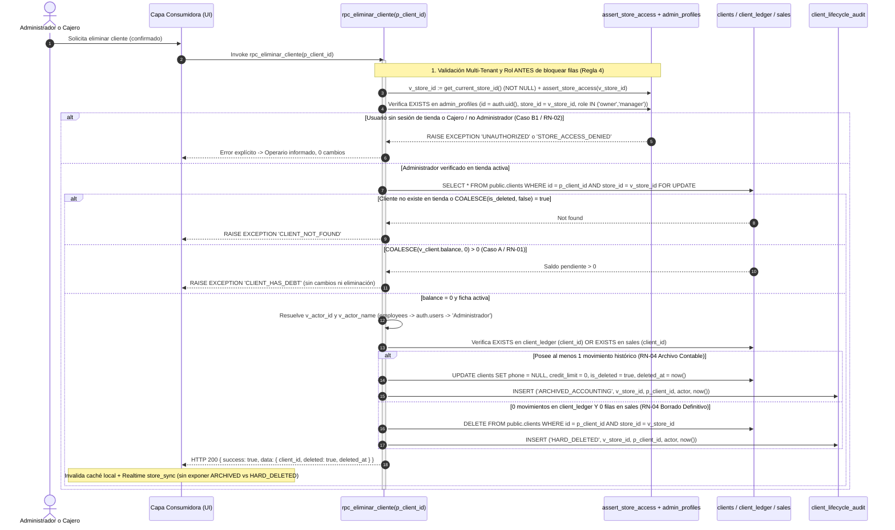
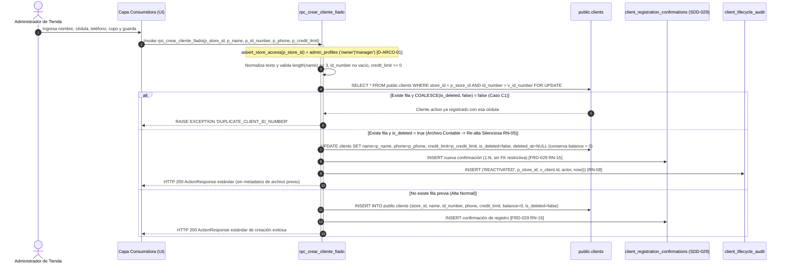
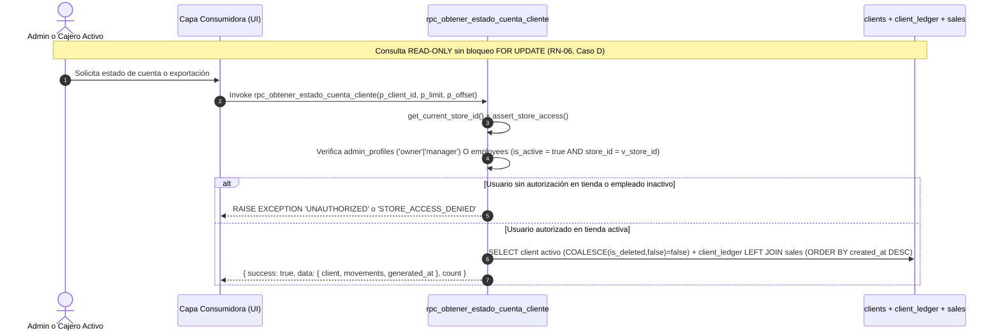
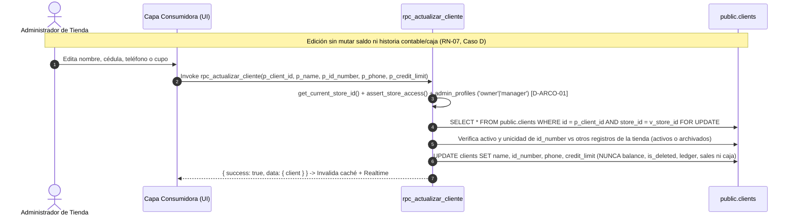
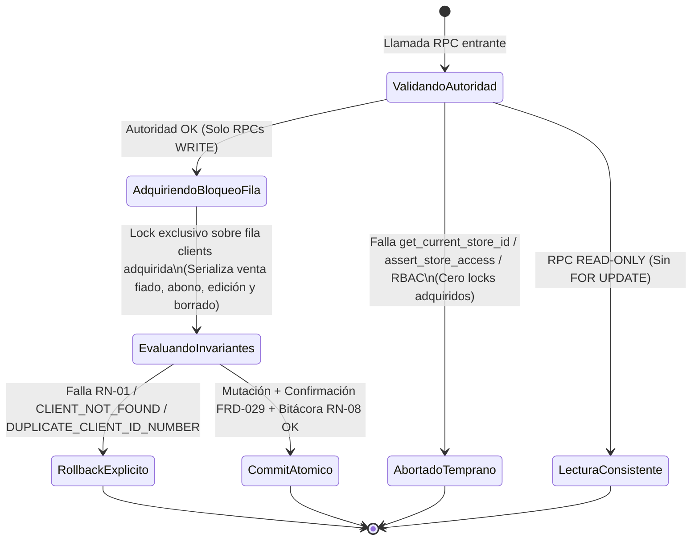
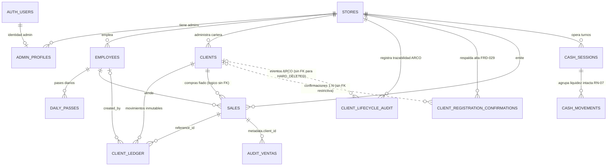

# SDD-030: Derechos del Titular y Eliminación Contable Protegida en Cartera

> **Asociado a:** [FRD-030 (Derechos del Titular y Archivo Contable Protegido)](../FRD/FRD_030_DERECHOS_TITULAR_Y_ARCHIVO_CONTABLE.md)  
> **Módulo:** Cartera de Clientes, Privacidad ARCO y Cumplimiento Contable  
> **Versión:** 1.0.0  
> **Estado:** 🟠 Aprobado con Deuda Técnica Documentada (Protocolo PAC-SDD v2.0)  
> **Fecha:** 2026-11-11  
> **Estándares Activados:** ARQ-002 (`POL-PRIV-02`, `POL-PRIV-01`, `POL-AUD-01`, `POL-AUD-02`, `POL-SEG-03`), `AGENTS.md` (Reglas 2–9), `SPEC-001` (Autoridad del Servidor), `SPEC-011` (Moneda Entera COP)

---

## 0. Contexto y Restricciones Aplicables (PAC Bloques 0–6)

Este documento se construye integralmente sobre las evidencias verificadas contra la base de datos en producción (`ihtjocmhzuliwwvdzfnz`), el estándar normativo [ARQ_002](../STANDARDS/ARQ_002_POLITICAS_GLOBALES_NEGOCIO.md), la matriz [ARQ_003](../STANDARDS/ARQ_003_MATRIZ_TRAZABILIDAD_POLITICAS.md) y los contratos SDD vecinos aprobados. Conforme al Gate `L251` (`PAC-SDD`) y la Regla 7 de `AGENTS.md`, las brechas reales en producción, riesgos de impacto cruzado y conflictos contractuales entre SDDs vecinos quedan formalizados explícitamente como **Deuda Técnica Documentada** para su ejecución coordinada en la fase DSD/SQL.

### 0.1 Políticas Globales Activadas (`ARQ-002` v1.3 y `ARQ-003` v1.3 L75)

Las **5 políticas oficiales vinculadas directamente a `FRD-030`** en `ARQ_003` (v1.3, L75) y `FRD-030` (L3) son:

| Política Oficial | Dominio | Reglas FRD-030 Gobernadas | Aplicación Concreta en `SDD-030` |
|---|---|---|---|
| **POL-PRIV-02** | Privacidad | `RN-01`, `RN-02`, `RN-03`, `RN-04`, `RN-05`, `RN-08` | Eliminación protegida sin destruir historia contable; resguardo silencioso (`phone = NULL`, `credit_limit = 0`, `is_deleted = true`, `deleted_at = now()`) cuando hay movimientos, borrado físico definitivo cuando existen `0` movimientos, prohibición absoluta de exponer distinciones internas inactivar/borrar al usuario y reactivación transparente ante re-alta con la misma cédula. |
| **POL-PRIV-01** | Privacidad | `RN-05` (+ frontera contado `FRD-029 RN-16`) | Obliga que toda re-alta de un cliente desde Archivo Contable estampe una nueva confirmación de registro personal (`FRD-029 RN-14/15`) en `client_registration_confirmations`, manteniendo exentas de registro personal las ventas de contado / Consumidor Final. |
| **POL-AUD-01** | Auditoría | `RN-04`, `RN-06`, `RN-07`, `RN-08` | Inmutabilidad histórica: ninguna eliminación, actualización ni re-alta puede alterar saldos históricos, asientos de `client_ledger`, comprobantes en `sales`, cierres/movimientos en `cash_sessions`/`cash_movements` ni entradas pasadas de bitácoras *Append-Only*. |
| **POL-AUD-02** | Auditoría | `RN-08`, `FRD-030 §2` | Trazabilidad universal: toda eliminación con resguardo, eliminación definitiva y re-alta registra tienda, cliente, actor (`actor_id` + `actor_name`), tipo de evento y fecha/hora del servidor en bitácora dedicada inviolable. |
| **POL-SEG-03** | Seguridad | `RN-02`, `RN-05`, `RN-06`, `RN-07`, `Caso B1`, `Caso C`, `Caso D` | Control de acceso estricto por rol en el servidor (`SDD-003-01`): crear, reactivar, editar datos/cupos y eliminar clientes es **100% exclusivo del Administrador** (`owner` / `manager` en `admin_profiles`); consultar y exportar el estado de cuenta de clientes activos está habilitado exclusivamente para el Administrador o un Empleado activo con permiso explícito **`canFiar` (`Fiar y cobrar abonos`)**. |

**Aclaraciones Normativas Adicionales (Sin Fusión Documental):**
- **Aislamiento Multi-Tenant:** La etiqueta `POL-AUTH-01` citada en algunos SDDs heredados **no existe** en `ARQ_002` (v1.3) ni en `ARQ_003` (v1.3). El aislamiento multi-tenant obligatorio de este módulo se sustenta normativamente en la **Regla 4 de `AGENTS.md`** (`get_current_store_id()` y `assert_store_access()`) en conjunto con **`POL-SEG-03`**.
- **Alcance de `POL-FIN-03`:** En `ARQ_002` (L79–87) y `ARQ_003` (L29), **`POL-FIN-03` (*Política de Aislamiento de Promesas de Pago*)** gobierna `FRD-024, FRD-027, FRD-019, FRD-007` (separar fiados de la liquidez real de caja). La invariante física `clients.balance >= 0` (`clients_balance_check`) no proviene de `POL-FIN-03` sino de `FRD-030 RN-01` / `POL-PRIV-02` y `SDD-009 RN-009-01`; `POL-FIN-03` aplica a `SDD-030` únicamente por referencia transversal sobre promesas de pago, cupos y no afectación de sesiones/movimientos de caja en módulos vecinos (`SDD-009`, `SDD-024`, `SDD-020`, `SDD-023`).
- **Estándares Técnicos (`SPEC-001` y `SPEC-011`):** Toda validación de saldo pendiente `> $0` (`RN-01`), fijación de `credit_limit = 0` (`RN-04`), cálculo y paginación del estado de cuenta (`RN-06`) y protección transaccional ante modificaciones simultáneas recae exclusivamente en PostgreSQL (`SPEC-001`) bajo representación monetaria entera COP con `0` decimales (`SPEC-011`).

---

### 0.2 Contratos Vecinos que Limitan el Diseño y Conflictos Detectados (Bloque 5 + Adenda Bloque 6)

Se auditaron literalmente las Secciones pertinentes de los **18 SDDs vecinos con impacto o fricción directa**, más **2 lectores/frontera pasivos (`SDD-008`, `SDD-027-01`)** y [`RVC_registro_vivo_contratos.md`](../REGISTRO/RVC_registro_vivo_contratos.md) (`L24, L38, L40, L42, L43, L47, L48, L49, L50, L58`), en partición disjunta:

1. **Grupo Conflicto / Fricción Directa (`10` SDDs):** `SDD-009`, `SDD-029`, `SDD-007`, `SDD-007-01`, `SDD-014`, `SDD-024`, `SDD-023`, `SDD-012`, `SDD-005`, `SDD-003`.
2. **Grupo Extensión / Sincronización Coordinada (`4` SDDs):** `SDD-011`, `SDD-028`, `SDD-013` (`§3.3, §5.4, §5.6`), `SDD-020`.
3. **Grupo Compatibles / Lectores Pasivos bajo `RN-07` (`6` SDDs):** `SDD-002` (`§5.5`), `SDD-007-02` (`§5.1, §5.2`), `SDD-018` (`§1.2, §4.2, §5.1.2`), `SDD-021` (`§5.1`), `SDD-008` (`get_daily_summary` leyendo `sales.payment_method = 'fiado'` como `'credit'` sin depender de `clients.is_deleted`), `SDD-027-01` (`POL-FIN-01` / `RN-027-01-04` flujo puro de caja sin alterar históricos ni cartera).

#### Conflictos de Contratos Registrados (`CONFLICTO-01` a `CONFLICTO-06`)

| ID Conflicto | Contratos / Fuentes Implicadas | Discrepancia Verificada vs `FRD-030` / BD Real | Resolución en `SDD-030` y Deuda DSD Asociada |
|---|---|---|---|
| **CONFLICTO-01** | `SDD-009` (`§1.4`, `RN-009-05`, `§5.2`, `§6 L312`, `§7 D-4`) | (1) `SDD-009` solo especifica *Soft Delete* (`rpc_soft_delete_client`, inexistente en BD), mientras `FRD-030 RN-04` impone bifurcación automática (archivar limpiando `phone`/`credit_limit` si hay movimientos vs `DELETE` físico definitivo si hay `0` movimientos en `client_ledger` y `sales`). (2) `rpc_admin_get_clients` expone `p_include_deleted`, `is_deleted` y `deleted_at`, violando `RN-03` y `RN-04`. (3) `DUPLICATE_ID_NUMBER` aborta cualquier `23505`, contradiciendo la re-alta silenciosa `RN-05`. | `SDD-030` define `rpc_eliminar_cliente` (payload uniforme sin exponer archivado vs borrado), especifica enmienda a `rpc_admin_get_clients` para ocultar archivados y omitir banderas internas, y reconcilia unicidad en `rpc_crear_cliente_fiado` / `rpc_actualizar_cliente`. |
| **CONFLICTO-02** | `SDD-029` (`§5.6`, `§6.4`, `§7.2 #3 client_registration_confirmations`) | (1) `rpc_crear_cliente_fiado` en `SDD-029 §5.6` mapea todo `23505` a `DUPLICATE_CLIENT_ID_NUMBER` sin contemplar reactivación desde Archivo Contable (`RN-05`). (2) `client_registration_confirmations.client_id` fue diseñado en `SDD-029` con `FK -> public.clients(id)`, trigger *append-only* y cardinalidad `1:1`, lo que causaría error `23503` al ejecutar `HARD_DELETED` (`RN-04`) y bloquearía re-altas sucesivas (`1:N`). | `SDD-030 §5.2` reconcilia el contrato de `rpc_crear_cliente_fiado` (rechazar activo; reactivar silenciosamente si archivado + nueva confirmación `FRD-029` + evento `'REACTIVATED'`). En `§7.2`, `client_registration_confirmations` se coordina en DSD **sin FK restrictiva** hacia `clients(id)` y con cardinalidad **`1:N`** por `(store_id, client_id)`. |
| **CONFLICTO-03** | `SDD-007` (`§0.1, §2.2, §5.1–§5.2, §7.2`), `SDD-007-01` (`§5.1, §5.3`), `SDD-014` (`§5.1`), `SDD-024` (`§5.1–§5.3, §6`), `SDD-023` (`§5.2 rpc_procesar_venta_v3, rpc_registrar_abono`), `SDD-012` (`§5.1–§5.2`), `SDD-009` (`§5.1, §6`) | (1) `rpc_anular_venta` resta `clients.balance = balance - v_sale.total` sin comprobar saldo suficiente ni estado `is_deleted`, colisionando contra `clients_balance_check >= 0` (`23514`) si una venta fiada ya pagada pertenece a un cliente archivado (`balance = 0`). *(También diverge `SDD-007 §5.2` L310/335 `>= 5` / `INSUFFICIENT_FUNDS_IN_CHANNEL` vs BD `>= 10` / `INSUFFICIENT_CHANNEL_FUNDS`).* (2) Ni `rpc_procesar_venta_v3`, ni `rpc_force_sale` (que delega en `v3` con `p_client_id`/`'fiado'`), ni `rpc_registrar_abono` validan hoy en BD `COALESCE(is_deleted, false) = false`; además `get_client_credit_status` (`SDD-007-01`) no existe en `pg_proc` y proyecta `is_blocked`. (3) `sales.client_id` en BD carece de FK hacia `clients(id)` (a diferencia de `SDD-007 §0.1/§7.2`), y el Paso 8 de `rpc_procesar_venta_v3` inserta `p_client_id` incondicionalmente incluso en ventas de contado (violando exención de datos personales en contado y contaminando la guarda `sales` de `HARD_DELETED`). (4) `SDD-012 CREATE_SALE` `'fiado'` offline puede llegar después de eliminar/archivar al cliente (sumado a incompatibilidad actual de clave de idempotencia no-UUID `22P02` y falta de resolución de `CLIENT_NOT_FOUND` en cola de errores). | Se documenta como ajuste coordinado DSD sobre `rpc_procesar_venta_v3`, `rpc_registrar_abono`, `rpc_anular_venta`, `rpc_force_sale` y cola de sincronización: filtrar `COALESCE(is_deleted, false) = false`, rechazar/anular `p_client_id` cuando `p_payment_method <> 'fiado'`, proteger anulaciones sobre saldo `0` / archivados sin provocar `23514` silencioso ni alterar históricos pagados, y propagar `CLIENT_NOT_FOUND` explícitamente en sincronización offline (`Regla 3`). |
| **CONFLICTO-04** | `RVC L50` y `SDD-005` (`§0.3.1, §3.2, §4, §5.1–§5.2, §6.3, §7.2–§7.3`) vs `audit_logs` real y `RN-08` | `RVC L50` describe erróneamente `audit_logs.user_id FK -> auth.users`; `SDD-005` declara `9` columnas (`FK -> profiles.id`), pero en BD real `audit_logs` tiene **`12` columnas** con `actor_id NOT NULL FK -> employees(id) ON DELETE SET NULL`, política permisiva `INSERT WITH CHECK (true)` y ausencia de `actor_name`. Asimismo, `SDD-005 §5.1` (`'creditos'`) apunta solo a `client_ledger` (y contiene valores incompatibles `'cargo_fiado'`/`'anulacion_abono'`). | `SDD-030` **descarta** `audit_logs` y `audit_seguridad` para `RN-08`, creando la bitácora dedicada inviolable `public.client_lifecycle_audit` (sin FK hacia `employees(id)` ni `clients(id)`), dejando trazada su futura federación en el dominio `'creditos'` de `SDD-005`. |
| **CONFLICTO-05** | Taxonomía Admin: `SDD-009 RN-009-06`, `SDD-003 §0.1`, `SDD-005 §6.3` y RPCs `rpc_anular_venta`/`rpc_force_sale` vs `SDD-002 §5.5`, `SDD-029 §5.6`, `admin_profiles_role_check` y `FRD-030 Casos C/D` | (1) El constraint físico real `admin_profiles_role_check` admite `('owner', 'manager')`, mientras `rpc_anular_venta`, `rpc_force_sale` y políticas heredadas de `audit_logs`/`audit_seguridad` verifican `role IN ('admin', 'owner')` bloqueando a `'manager'`. (2) `FRD-030 Caso C` y `Caso D` mencionan *"Cajero / Administrador"*, chocando con `SDD-009 RN-009-06` y `SDD-003 §5.1` (`additionalProperties: false` sin permiso `canManageClients`). | En `SDD-030`, todos los controles de administrador validan `admin_profiles.role IN ('owner', 'manager')` (`store_id = v_store_id`). Siguiendo la **Decisión `A1` / `SDD-029 D-LEG-05`**, creación (`rpc_crear_cliente_fiado`) y actualización (`rpc_actualizar_cliente`) se mantienen en servidor como facultad Admin hasta una futura enmienda de `SDD-003`/`SDD-009` (`D-ARCO-01`); la eliminación es 100% Admin por `RN-02` y la consulta de estado de cuenta (`RN-06`) queda abierta a Admin y Cajero activo (`D-ARCO-02`). |
| **CONFLICTO-06** | `SDD-009` (`§0.3/§7 D-5, D-6`), `SDD-024` (`§7 D-5, D-6`), `SDD-028` (`§3, §4.5`), `SDD-013` (`§3.3`) vs RLS real, vista legada y cierre de sesión | (1) En BD real, `clients_update_store`, `clients_insert_store`, `ledger_read_store` y `GRANT ALL` a `anon`/`authenticated` permiten a cajeros o llamadas directas PostgREST evadir reglas `RN-01`..`RN-08`. (2) `get_client_ledger_summary` carece de `assert_store_access` y `SET search_path`. (3) La vista `public.client_transactions` (objeto legado no especificado en `SDD-009`) oculta `store_id`, `previous_balance`/`new_balance` y codifica descripciones fijas. (4) Mientras `SDD-013 RN-013-03` ordena conservar `clients` en almacenamiento local al cerrar sesión y `SDD-028` limita la supervivencia en logout a `tienda-sync-db` (cola offline), el comportamiento actual observado en runtime limpia la caché de clientes y almacenamiento del navegador en logout, y en sesiones activas omite invalidar caché en memoria/dispositivo tras eliminar clientes (`RN-04`). | Remediaciones RLS/privilegios obligatorias en DSD (`§6.3`), reemplazo de la lectura operativa sobre `client_transactions` por `rpc_obtener_estado_cuenta_cliente`, parche de seguridad en `get_client_ledger_summary`, invalidación obligatoria en memoria/almacenamiento local y notificación Realtime `store_sync:{storeId}` tras mutaciones de ciclo de vida (`§5.5`). |

---

### 0.3 Auditoría de Base de Datos Real e Impacto Cruzado (`Bloques 2, 3 y 4`)

#### A. Objetos Verificados en Producción (`ihtjocmhzuliwwvdzfnz`)
Inspección directa sobre `information_schema.columns`, `pg_constraint`, `pg_indexes`, `pg_policies`, `pg_class`, `pg_views`, `pg_proc`, `pg_trigger`, `table_privileges` y `routine_privileges`:

1. **Tablas/Vistas Existentes Inspeccionadas (14 objetos):**
   - `public.clients` (`11` cols; 5 constraints: `clients_pkey`, `clients_store_id_fkey`, `clients_name_check`, `clients_balance_check`, `clients_store_id_id_number_key`; 2 índices parciales: `idx_clients_store`, `idx_clients_debtors`; RLS activo con 3 políticas y `0` políticas `DELETE`).
   - `public.client_ledger` (`10` cols incl. `new_balance GENERATED ALWAYS AS (previous_balance + amount) STORED`; FK `client_ledger_client_id_fkey -> clients(id)` sin `ON DELETE CASCADE`; `transaction_type IN ('venta_fiado','abono','anulacion_fiado')`; `created_by FK -> employees(id)`; RLS `ledger_read_store`).
   - `public.client_transactions` (`VIEW`, `7` cols, `security_invoker=true`, legado no documentado en `SDD-009`).
   - `public.sales` (`19` cols; `client_id uuid` nullable **sin FK física** hacia `clients(id)`).
   - `public.cash_movements` (`11` cols) y `public.cash_sessions` (`12` cols) — frontera intocable (`RN-07`).
   - `public.stores` (`9` cols), `public.admin_profiles` (`5` cols: `CHECK role IN ('owner','manager')`, **sin columna `name`**), `public.employees` (`9` cols), `public.daily_passes` (`14` cols), `auth.users` (`35` cols, fallback de `actor_name`).
   - `public.audit_logs` (`12` cols, `actor_id NOT NULL FK -> employees(id) ON DELETE SET NULL`, `INSERT WITH CHECK (true)`), `public.audit_seguridad` (`8` cols, `CHECK` cerrado de 12 eventos + FK `employees(id)`), `public.audit_ventas` (`7` cols, `fn_audit_sale_created` escribe `metadata.client_id`).
2. **Brechas Críticas y Nuevas Entidades (`Gap B2-01` a `Gap B2-04`):**
   - **`Gap B2-01`:** Inexistencia de tabla inmutable *Append-Only* para auditoría de cartera (`public.client_lifecycle_audit`), diseñada en `§7.2` sin FKs restrictivas hacia `clients(id)` ni `employees(id)`.
   - **`Gap B2-02`:** Ausencia en producción de `public.client_registration_confirmations` (`SDD-029 D-LEG-01`) y colisión física de su diseño previo (`FK -> clients(id)` + `1:1` + append-only) contra `HARD_DELETED` (`RN-04`) y múltiples re-altas (`1:N`, `RN-05`).
   - **`Gap B2-03`:** Ausencia total en `pg_proc` de los RPCs de ciclo de vida del titular (`rpc_eliminar_cliente`, `rpc_crear_cliente_fiado`, `rpc_obtener_estado_cuenta_cliente`, `rpc_actualizar_cliente`, y del antiguo `rpc_soft_delete_client` de `SDD-009`), además de vectores RLS directos abiertos en `public.clients` (`clients_update_store` con `with_check=null`, `clients_insert_store`, `clients_select_store`).
   - **`Gap B2-04`:** Nulabilidad indebida en BD real de `clients.is_deleted` (`YES`) y `clients.balance` (`YES`), ausencia de FK en `sales.client_id`, y limitaciones estructurales de la vista legada `client_transactions` frente a `RN-06`.

#### B. Hallazgos Críticos de Seguridad Centralizada (`Bloque 3` — Reglas 3, 4 y 8)
- **Funciones centralizadas disponibles en `public`:** `get_current_store_id()`, `assert_store_access(p_store_id uuid)`, `get_employee_id_from_session()`, `is_authorized_employee()`, `rpc_log_security_event(...)`.
- **Defecto detectado en `get_employee_id_from_session()`:** su rama de `daily_passes` aprobados no valida `employees.is_active = true`; todo RPC de lectura que autorice cajeros (`rpc_obtener_estado_cuenta_cliente`) debe ejecutar un `JOIN` explícito verificando `employees.is_active = true AND employees.store_id = v_store_id`.
- **Exposición de tabla sin restricción a `anon`:** `information_schema.table_privileges` confirma privilegios `SELECT, INSERT, UPDATE, DELETE` otorgados al rol **`anon`** sobre `clients`, `client_ledger`, `admin_profiles`, `sales` y `SELECT` sobre `client_transactions`, junto a `proacl = PUBLIC` en funciones clave.
- **Oráculo / bloqueo inter-tenant en `rpc_registrar_abono`:** ejecuta `FOR UPDATE` sobre `clients WHERE id = p_client_id` **antes** de invocar `assert_store_access(v_client.store_id)`.
- **Fuga multi-tenant total en `get_client_ledger_summary(p_store_id)`:** es `SECURITY DEFINER` con `proconfig = NULL`, `proacl = PUBLIC` y **sin `assert_store_access`**.
- **Escalamiento horizontal / auto-edición en `admin_profiles_update_self`:** `with_check = null`, permitiendo teóricamente alterar `store_id` o `role` sin validar claims firmados (`0/16` usuarios tienen `store_id` en `app_metadata`).
- **Mismatch de rol `'admin'` vs `'manager'`:** en `rpc_anular_venta`, `rpc_force_sale` y políticas `SELECT` de `audit_logs`/`audit_seguridad`.
- **Exposición de archivados y ausencia de check Admin en `rpc_admin_get_clients`:** filtra `c.is_deleted = false` sin `COALESCE`, omite validar `admin_profiles` y acepta `p_include_deleted`.

#### C. Universo de Impacto Cruzado (`Bloque 4` — `64` Funciones Únicas + `N = 9` Riesgos)
- **Inventario cerrado `pg_proc` + `pg_trigger` (`7 + 9 + 48 = 64` firmas únicas sobre 10 triggers):**
  - **Grupo A (`7` afectadas funcionalmente por `SDD-030`):** `rpc_admin_get_clients`, `rpc_procesar_venta_v3`, `rpc_force_sale`, `rpc_procesar_venta_v2`, `procesar_venta` (legacy sin `assert_store_access` ni filtro `is_deleted`), `rpc_registrar_abono`, `registrar_abono`.
  - **Grupo B (`9` con resguardo histórico/contable/trigger):** `rpc_anular_venta`, `get_history_creditos`, `get_history_ventas`, `get_sale_detail`, `fn_audit_sale_created`, `get_client_ledger_summary`, `rpc_get_comprehensive_financial_report`, `get_financial_summary`, `update_timestamp()` (`trg_clients_updated` actualiza `updated_at = now()` al archivar/reactivar con `balance = 0`, inocuo frente al umbral de mora `balance > 0`).
  - **Grupo C (`48` sin impacto funcional de `SDD-030`):** `44` funciones operativas restantes de `pg_proc` + `4` funciones trigger restantes (`create_default_supplier`, `fn_audit_cash_closed`, `fn_audit_cash_opened`, `update_updated_at_column`).
  - **Dimensión de seguridad ortogonal (`64` funciones):** `34` con `proacl IS NULL` (`PUBLIC`) y `21` con `proconfig IS NULL` (incluyendo `19` `SECURITY DEFINER`).
- **Resumen de los `N = 9` Riesgos de Impacto Cruzado (`RIESGO-01` a `RIESGO-09`):**
  1. **`RIESGO-01`:** Carrera concurrente y sincronización diferida de ventas fiadas (`rpc_procesar_venta_v3`, `rpc_force_sale`) sobre clientes archivados/eliminados + escritura incondicional en Paso 8 de `p_client_id` residual en ventas de contado + falla `22P02` de clave de idempotencia no-UUID y ausencia de resolución en cola de errores offline.
  2. **`RIESGO-02`:** Colisión de `rpc_anular_venta` (`balance - v_sale.total < 0`, error `23514`) en ventas pagadas de clientes archivados + necesidad imperativa de verificar `sales.client_id` además de `client_ledger` antes de `HARD_DELETED` (`sales` carece de FK).
  3. **`RIESGO-03`:** `rpc_registrar_abono` carece de filtro `COALESCE(is_deleted, false) = false`, ejecuta `FOR UPDATE` antes de validar tienda, y su fallback `auth.uid()` hacia `client_ledger.created_by FK employees(id)` falla (`23503`) si el ejecutor es Admin sin fila en `employees`.
  4. **`RIESGO-04`:** `rpc_admin_get_clients` expone `p_include_deleted`, `is_deleted` y `deleted_at`, violando `RN-03`/`RN-04`.
  5. **`RIESGO-05`:** Lectura actual mediante la vista legada `client_transactions` pierde `previous_balance`, `new_balance`, signo neto y `store_id`, impidiendo exportación fiel (`RN-06`).
  6. **`RIESGO-06`:** Doble colisión con `SDD-029` (FK restrictiva `1:1` de `client_registration_confirmations` bloqueando `HARD_DELETED`/`1:N`, y mapeo `23505` directo de `rpc_crear_cliente_fiado` impidiendo re-alta `RN-05`).
  7. **`RIESGO-07`:** RLS `clients_update_store` abierta a empleados y ruta actual de edición/alta directa por tabla que fallará con `42501` en cuanto se revoque escritura directa si no se migra a los RPCs `SDD-030`, más inconsistencia por `clients.is_deleted` nullable.
  8. **`RIESGO-08`:** Contradicción estructural en `audit_logs` (`actor_id NOT NULL` FK `employees(id) ON DELETE SET NULL`, `INSERT WITH CHECK (true)`) impidiendo reutilizarlo en `RN-08`.
  9. **`RIESGO-09`:** Borrado directo actual en cliente retorna éxito optimista falso (`true` tras `0` filas borradas en PostgREST por `0` políticas `DELETE`, dejando el cliente vivo en BD — violación Regla 3), desincronización de caché SWR en memoria/almacenamiento local por falta de invalidación e impacto en selección residual de cliente en pagos de contado (`36` archivos cliente / `21` SQL / `15` SDDs + `RVC L24, L38, L43, L47, L48, L58`).

#### D. Matriz Formal de Deuda Técnica y Trade-Offs (Regla 7 de `AGENTS.md`)

| ID Deuda | Qué se Decidió | Por qué (Trade-Off Concreto) | Condición de Revisión Futura |
|---|---|---|---|
| **D-ARCO-01** | **Invariante Definitiva Admin-Only en creación, reactivación, actualización y eliminación (`rpc_crear_cliente_fiado`, `rpc_actualizar_cliente`, `rpc_eliminar_cliente`):** Restringir el 100% del CRUD y gestión de cupos al Administrador (`admin_profiles`: `'owner'` / `'manager'`) mediante `assert_store_admin`. | Alineado de forma definitiva con `FRD-030` (`RN-02`, `RN-05`, `RN-07`), `FRD-009`, `FRD-003-01` y `ARQ-002 POL-PRIV-01`; evita que empleados alteren fichas, cupos o reactiven registros archivados. Se conserva resolución de actor (`resolve_actor_snapshot()`) en `client_lifecycle_audit` y `client_registration_confirmations`. | Permanente / Invariante definitiva de negocio (`ARQ-002` v1.4). |
| **D-ARCO-02** | **Lectura/exportación de estado de cuenta sujeta a `canFiar` (`rpc_obtener_estado_cuenta_cliente`):** Habilitar consulta y exportación únicamente al Administrador o a un Empleado operativo activo con Pase Diario `<24h` y permiso **`canFiar = true`** en `employees.permissions` (sin `FOR UPDATE`). | Cumple `FRD-030 RN-06 / Caso D` y `FRD-009` protegiendo la privacidad de cartera frente a empleados sin permiso `Fiar y cobrar abonos`, y subsana el defecto de `get_employee_id_from_session()` validando `employees.is_active = true` y `permissions->>'canFiar' = 'true'`. | Permanente en Fase 3 mediante `assert_employee_permission(v_store_id, 'canFiar')`. |
| **D-ARCO-03** | **Nueva Bitácora `client_lifecycle_audit` y desacople FK/1:N de `client_registration_confirmations` (`Gap B2-01` + `Gap B2-02`):** Crear tabla dedicada sin FK hacia `clients(id)` ni `employees(id)` y coordinar ajuste en `SDD-029` antes de migrar SQL. | Evita el fallo `23503` al ejecutar `HARD_DELETED` (`RN-04`), permite registrar autoría de administradores sin fila en `employees`, admite `1:N` confirmaciones al reactivar un tercero (`RN-05`) y blinda trazabilidad *Append-Only* ante `UPDATE`/`DELETE`/`TRUNCATE`. | En el DSD unificado del bloque legal/privacidad (`SDD-029` + `SDD-030`), previo al paso de certificación legal externa. |
| **D-ARCO-04** | **Migración diferida de endurecimiento sobre BD y contratos vecinos (`Gap B2-03`, `Gap B2-04`, Bloque 3 y `CONFLICTO-03`):** Registrar en `SDD-030` todas las remediaciones necesarias (`REVOKE anon`, cierre RLS en `clients`, reordenar `assert_store_access` previo al `FOR UPDATE` en `rpc_registrar_abono`, parches de `get_client_ledger_summary`/`rpc_admin_get_clients`/`admin_profiles_update_self`/`procesar_venta`/`rpc_anular_venta`/`rpc_force_sale`) sin alterar aún producción en fase SDD. | Cumple PAC-SDD diseñando contratos completos y seguros antes de tocar DDL en producción, evitando rupturas en caliente mientras la capa cliente migra del acceso directo PostgREST hacia los RPCs atómicos. | Al redactar y desplegar las migraciones SQL del DSD correspondiente a `SDD-030` y su orden de trabajo integrada. |
| **D-ARCO-05** | **Preservación de nombre histórico en `audit_ventas` / `sales` / `get_history_*` tras `ARCHIVED_ACCOUNTING` vs exclusividad en `HARD_DELETED` (`POL-AUD-01` vs `POL-PRIV-02`):** Mantener la ficha mínima archivada (`name`, `id_number`) sin `phone` y con `credit_limit = 0` únicamente cuando existan movimientos en `client_ledger` o `sales`. | Cumple la colisión legal/contable normada en `FRD-030 RN-04` (`POL-AUD-01` sobre facturación/cartera histórica vs supresión total solo cuando no hubo vida contable). Impide `HARD_DELETED` si `sales.client_id` referencia al cliente, evitando nombres nulos o huérfanos en comprobantes pasados. | Revisar únicamente ante nueva ley o política que exija anonimización criptográfica tras prescripción fiscal de 5/10 años (`alcance diferido FRD-030`). |
| **D-ARCO-06** | **Sincronización Caché Local, Selección Residual Contado y Cola Offline (`RIESGO-01/09`, `CONFLICTO-03/06`):** Normar invalidación obligatoria en caché local + Realtime tras mutar cartera, limpieza/rechazo de `p_client_id` en ventas no fiadas, y mapeo estricto `CLIENT_NOT_FOUND` en sincronización diferida. | Elimina inconsistencias de caché (`SDD-028`), impide vincular clientes en ventas de contado (`FRD-029 RN-16` y limpieza `HARD_DELETED`) y erradica los fallos silenciosos prohibidos por Regla 3. | En la ejecución integrada de las tareas de migración SQL (`rpc_procesar_venta_v3`) y actualización de repositorios cliente. |

---

## 1. Glosario Local

- **Titular de Datos / Cliente de Cartera (`public.clients`):** Persona física registrada en una tienda (`store_id`) para acceder a compras fiadas (`credit_limit`), cuyo estado operativo interno es **`Activo`** (`COALESCE(is_deleted, false) = false`) o **`Archivado Contablemente`** (`is_deleted = true`).
- **Eliminación con Resguardo Contable (`ARCHIVED_ACCOUNTING`):** Transición ejecutada exclusivamente en servidor (`RN-04`) cuando un cliente con saldo `balance = 0` posee al menos un registro histórico en `public.client_ledger` o `public.sales`. Limpia teléfono de contacto (`phone = NULL`), anula cupo de crédito (`credit_limit = 0`), fija `is_deleted = true` y `deleted_at = now()`, y conserva identidad contable mínima (`name`, `id_number`) oculta de listados operativos.
- **Eliminación Física Definitiva (`HARD_DELETED`):** Borrado irrevocable (`DELETE FROM public.clients`) ejecutado en servidor (`RN-04`) únicamente cuando un cliente con `balance = 0` registra `0` movimientos tanto en `public.client_ledger` como en `public.sales`.
- **Principio de Opacidad Operativa (`RN-03`):** Regla inviolable de contrato según la cual el servidor devuelve un resultado uniforme de eliminación al usuario final, ocultando internamente si ocurrió resguardo contable o borrado físico definitivo y omitiendo campos técnicos de archivado en las respuestas operativas.
- **Re-alta Silenciosa (`REACTIVATED`):** Reactivación transparente en sitio de una ficha en estado `Archivado Contablemente` cuando el usuario registra nuevamente la misma cédula (`id_number`) en la misma tienda (`RN-05`). Restaura `is_deleted = false` y `deleted_at = NULL`, actualiza `name`, `phone` y `credit_limit`, conserva saldo `$0` y movimientos contables previos intactos, genera una nueva confirmación (`FRD-029`) y sienta evento `'REACTIVATED'` sin alertas sobre archivado previo.
- **Estado de Cuenta Fiel (`RN-06`):** Consulta paginada y exportable construida exclusivamente desde PostgreSQL (`public.client_ledger` + `public.sales.ticket_number` + `public.clients`) para clientes activos, garantizando signos reales, saldo previo, saldo nuevo generado (`new_balance`) y trazabilidad de cada compra fiada, abono y anulación sin depender de la vista legada `client_transactions`.
- **Bitácora de Auditoría de Cartera (`public.client_lifecycle_audit`):** Registro *Append-Only* dedicado en servidor (`FRD-030 §2`, `RN-08`) que almacena en forma inmutable tienda, identificador de cliente (sin FK restrictiva para sobrevivir a `HARD_DELETED`), evento (`ARCHIVED_ACCOUNTING`, `HARD_DELETED`, `REACTIVATED`), actor (`actor_id`, `actor_name`, `actor_role`) y `created_at` del servidor.

---

## 2. Diagramas de Secuencia

### 2.1 Flujo A y B / B1: Eliminación Protegida de Cliente (`rpc_eliminar_cliente`)

Cubre bloqueo por deuda (`Caso A`, `RN-01`), denegación de rol (`Caso B1`, `RN-02`), bifurcación silenciosa entre resguardo contable y borrado físico (`Caso B`, `RN-03`, `RN-04`) y registro en bitácora (`RN-08`).



### 2.2 Flujo C y C1: Alta Normal, Duplicado Activo y Re-Alta Silenciosa (`rpc_crear_cliente_fiado`)

Contrato unificado y reconciliado con `SDD-029 §5.6`, cumpliendo `FRD-030 RN-05`, `RN-03`, `RN-08` y `FRD-029 RN-14/15`.



### 2.3 Flujo D1: Consulta y Exportación Fiel de Estado de Cuenta (`rpc_obtener_estado_cuenta_cliente`)



### 2.4 Flujo D2: Actualización Segura de Datos del Titular (`rpc_actualizar_cliente`)



---

## 3. Diagramas de Estado

### 3.1 Ciclo de Vida Legal y Contable del Titular en Cartera (`public.clients`)

```mermaid
stateDiagram-v2
    [*] --> Activo : Alta nueva o reactivación\n[balance = 0, is_deleted = false, deleted_at = NULL]

    state Activo {
        [*] --> SaldoCero : balance = 0 (Elegible para eliminación)
        SaldoCero --> ConDeuda : Venta fiado (+client_ledger)
        ConDeuda --> ConDeuda : Nuevos fiados o abonos parciales (balance > 0)
        ConDeuda --> SaldoCero : Abono total o anulación sin deuda restante (balance = 0)
    }

    Activo --> Activo : rpc_actualizar_cliente\n[Solo name, id_number, phone, credit_limit]
    Activo --> Activo : Intento eliminar con balance > 0\n[Rechazo CLIENT_HAS_DEBT (RN-01)]
    Activo --> Activo : Intento eliminar por no-Admin\n[Rechazo UNAUTHORIZED (RN-02)]

    Activo --> ArchivadoContablemente : rpc_eliminar_cliente con balance = 0\nY movimientos > 0 en (client_ledger OR sales)\n[phone = NULL, credit_limit = 0, is_deleted = true,\ndeleted_at = now(), Audit = ARCHIVED_ACCOUNTING]

    Activo --> EliminadoDefinitivo : rpc_eliminar_cliente con balance = 0\nY 0 movimientos en (client_ledger AND sales)\n[DELETE FROM clients, Audit = HARD_DELETED]

    ArchivadoContablemente --> Activo : rpc_crear_cliente_fiado con igual (store_id, id_number)\n[is_deleted = false, deleted_at = NULL, balance = 0,\nnueva confirmación FRD-029, Audit = REACTIVATED (RN-05)]

    ArchivadoContablemente --> ArchivadoContablemente : Consultas operativas / fiados / abonos / re-eliminación\n[Oculto o rechazado con CLIENT_NOT_FOUND]

    EliminadoDefinitivo --> [*] : Registro suprimido físicamente de clients;\nsubsiste únicamente traza en client_lifecycle_audit
```



### 3.2 Secuencia de Serialización Concurrencia (`FOR UPDATE`) en Operaciones de Cartera



---

## 4. Casos de Uso y Matriz de Casos Límite

### 4.1 Especificación de Casos de Uso (`FRD-030 Casos A–D`)

- **Caso A — Bloqueo de eliminación por deuda activa (`RN-01`, `CA-030-01`):**
  - **Actor:** Administrador autenticado (`owner` o `manager` en `admin_profiles`).
  - **Precondición:** Cliente activo en la tienda con `COALESCE(balance, 0) > 0`.
  - **Flujo:** El servidor valida sesión/tienda/rol, bloquea la fila del cliente, detecta `balance > 0`, aborta la transacción y retorna `CLIENT_HAS_DEBT`. El cliente, su saldo, sus movimientos y su historia permanecen intactos.
- **Caso B — Eliminación ejecutada por administrador con saldo en cero (`RN-03`, `RN-04`, `RN-08`, `CA-030-02`, `CA-030-03`, `CA-030-06`):**
  - **Actor:** Administrador autenticado (`owner` o `manager`).
  - **Precondición:** Cliente activo en la tienda con `COALESCE(balance, 0) = 0`.
  - **Flujo:** El servidor evalúa existencia en `client_ledger` y `sales` (`client_id = p_client_id`). Si existe al menos un movimiento histórico, limpia `phone = NULL`, fija `credit_limit = 0`, marca `is_deleted = true` y `deleted_at = now()`, e inserta `'ARCHIVED_ACCOUNTING'` en `client_lifecycle_audit`. Si hay `0` movimientos en ambas tablas, ejecuta `DELETE FROM public.clients` e inserta `'HARD_DELETED'` en `client_lifecycle_audit`. En ambos casos devuelve la misma estructura exitosa sin revelar si hubo archivado contable o borrado físico.
- **Caso B1 — Denegación por usuario sin permisos administrativos (`RN-02`, `CA-030-01`):**
  - **Actor:** Cajero / empleado operativo o usuario fuera de `admin_profiles` de la tienda.
  - **Flujo:** El servidor verifica `admin_profiles` inmediatamente tras `assert_store_access()`, rechaza con `UNAUTHORIZED` antes de bloquear o mutar `clients`, garantizando `0` cambios en BD.
- **Caso C — Re-alta de cliente con cédula previamente archivada contablemente (`RN-03`, `RN-05`, `RN-08`, `CA-030-04`, `CA-030-06`):**
  - **Actor:** Administrador de la tienda (bajo Deuda formalizada `D-ARCO-01` frente a `FRD-030 Caso C`).
  - **Precondición:** Existe una fila en `clients` con el mismo `(store_id, id_number)` e `is_deleted = true` (`balance = 0`).
  - **Flujo:** `rpc_crear_cliente_fiado` reactiva el registro único limpiando `deleted_at = NULL`, establece `is_deleted = false`, actualiza `name`, `phone` y `credit_limit`, conserva saldo `$0` e historial contable previo intactos, genera nueva confirmación probatoria en `client_registration_confirmations` (`FRD-029`) e inserta `'REACTIVATED'` en `client_lifecycle_audit`, retornando respuesta normal de creación sin exponer antecedente archivado.
- **Caso C1 — Bloqueo de cédula duplicada activa (`RN-05`, `CA-030-04`):**
  - **Actor:** Administrador de la tienda.
  - **Precondición:** Existe un cliente activo (`COALESCE(is_deleted, false) = false`) con el mismo `(store_id, id_number)`.
  - **Flujo:** `rpc_crear_cliente_fiado` aborta con error `DUPLICATE_CLIENT_ID_NUMBER` (sin crear duplicados ni sobrescribir al titular existente).
- **Caso D — Consulta/exportación de estado de cuenta y actualización de datos básicos (`RN-06`, `RN-07`, `CA-030-05`):**
  - **Actores:**
    - *Consulta y exportación:* Administrador (`owner` / `manager`) **o** Cajero activo (`employees.is_active = true` en `v_store_id`).
    - *Actualización:* Administrador (`owner` / `manager` bajo `D-ARCO-01`).
  - **Flujo:** La consulta devuelve cabecera del cliente activo y sus movimientos completos (`client_ledger` + `sales.ticket_number`) ordenados cronológicamente con paginación y resumen autoritativo para visualización o exportación fiel. La actualización modifica exclusivamente `name`, `id_number`, `phone` y `credit_limit` tras validar unicidad, sin alterar jamás `balance`, movimientos históricos ni sesiones o movimientos de caja.

### 4.2 Matriz de Casos Límite y Concurrencia (`Regla 5 de AGENTS.md`)

| ID | Escenario Límite / Concurrencia | Comportamiento Autoritativo en Servidor | Código / Excepción Real |
|---|---|---|---|
| **CL-030-01** | Venta fiado o abono simultáneo con `rpc_eliminar_cliente` | `FOR UPDATE` sobre `public.clients` serializa ambas operaciones; si la venta deja `balance > 0` antes, eliminar aborta `CLIENT_HAS_DEBT`; si elimina antes (`is_deleted=true` o borrado), venta/abono ve el nuevo estado y rechaza `CLIENT_NOT_FOUND`. | `CLIENT_HAS_DEBT` / `CLIENT_NOT_FOUND` |
| **CL-030-02** | Dos altas simultáneas con la misma cédula (activa o archivada) | El bloqueo transaccional + constraint único `clients_store_id_id_number_key` impiden crear dos filas; la segunda transacción falla `DUPLICATE_CLIENT_ID_NUMBER` al encontrar la ficha ya activa. | `DUPLICATE_CLIENT_ID_NUMBER` |
| **CL-030-03** | Venta fiado diferida offline llega tras `HARD_DELETED` o `ARCHIVED_ACCOUNTING` | `rpc_procesar_venta_v3` rechaza la transacción porque el cliente no existe o tiene `COALESCE(is_deleted, false) = true`. El adaptador offline **no puede** ignorar el fallo ni drenarlo en silencio; debe mover a cola de error para gestión explícita (`Regla 3`). | `CLIENT_NOT_FOUND` |
| **CL-030-04** | Intento de eliminar cliente sin asientos en `client_ledger`, pero referenciado en `sales.client_id` | La doble verificación `EXISTS (client_ledger) OR EXISTS (sales)` detecta el comprobante en `sales` (cuya columna carece de FK en BD), forzando `ARCHIVED_ACCOUNTING` en lugar de `HARD_DELETED` (`RN-04` + `POL-AUD-01`). | `ARCHIVED_ACCOUNTING` silencioso |
| **CL-030-05** | Actualización de `id_number` en `rpc_actualizar_cliente` colisionando con cédula de cliente archivado | La consulta de unicidad revisa toda la tienda (sin filtrar `is_deleted = false`). Si pertenece a otra fila (incluso archivada), aborta `DUPLICATE_CLIENT_ID_NUMBER` para impedir fusión ilegal de historiales de dos personas distintas. | `DUPLICATE_CLIENT_ID_NUMBER` |
| **CL-030-06** | Anulación posterior (`rpc_anular_venta`) de venta fiado ya pagada de cliente archivado (`balance = 0`) | Condición protegida contra `23514` (`clients_balance_check >= 0`): se documenta conflicto en `CONFLICTO-03` para que en DSD la anulación evalúe saldo/estado sin provocar resta negativa ni violar integridad financiera. | Documentado en DSD (`CONFLICTO-03`) |
| **CL-030-07** | Llamada con cliente de otra tienda o `p_client_id` inexistente (`Oráculo inter-tenant`) | `get_current_store_id()` + `assert_store_access()` y `admin_profiles` corren **antes** del `FOR UPDATE`. Cualquier UUID ajeno a `v_store_id` responde de forma uniforme `CLIENT_NOT_FOUND` o `STORE_ACCESS_DENIED` sin bloquear filas de otro tenant. | `STORE_ACCESS_DENIED` / `CLIENT_NOT_FOUND` |
| **CL-030-08** | Intento de `UPDATE`, `DELETE` o `TRUNCATE` sobre `client_lifecycle_audit` o `client_registration_confirmations` | Triggers `BEFORE UPDATE OR DELETE` (`FOR EACH ROW`) y `BEFORE TRUNCATE` (`FOR EACH STATEMENT`) abortan cualquier manipulación destructiva (`Regla 8` y `POL-AUD-01`). | `AUDIT_LOG_IMMUTABLE` (`P0001` / `42501`) |

---

## 5. Contratos de Interfaz (Payloads y Esquemas)

Todos los RPCs de mutación adoptan la envoltura `ActionResponse` (`SDD-011`) extendida en códigos específicos del dominio, con `additionalProperties: false` en sus esquemas de respuesta. Toda cifra monetaria viaja como entero/numérico COP (`0` decimales en presentación `SPEC-011`), calculada y validada exclusivamente en PostgreSQL (`SPEC-001`).

### 5.1 Procedimiento Almacenado: `rpc_eliminar_cliente`

- **Tipo de Operación:** RPC PostgreSQL (`WRITE`, `SECURITY DEFINER`, `SET search_path TO 'public'`).
- **Privilegios de Ejecución:** `REVOKE ALL ON FUNCTION public.rpc_eliminar_cliente(uuid) FROM PUBLIC, anon; GRANT EXECUTE ON FUNCTION public.rpc_eliminar_cliente(uuid) TO authenticated, service_role;`
- **Autorización Obligatoria:** `get_current_store_id()` no nulo -> `assert_store_access(v_store_id)` -> `EXISTS` en `admin_profiles` (`id = auth.uid() AND store_id = v_store_id AND role IN ('owner', 'manager')`).

#### 5.1.1 Input JSON Schema (`rpc_eliminar_cliente`)

```json
{
  "$schema": "https://json-schema.org/draft/2020-12/schema",
  "title": "RpcEliminarClienteInput",
  "type": "object",
  "required": ["p_client_id"],
  "additionalProperties": false,
  "properties": {
    "p_client_id": {
      "type": "string",
      "format": "uuid",
      "description": "Identificador único del cliente activo en la tienda a eliminar."
    }
  }
}
```

#### 5.1.2 Output Success JSON Schema (`RN-03` — Respuesta Uniforme Opaca)

> **Invariante `RN-03`:** El payload exitoso **NO** incluye ni `archive_mode`, ni `is_deleted`, ni `'ARCHIVED_ACCOUNTING'`, ni `'HARD_DELETED'`, ni conteos de movimientos internos. Ambos desenlaces retornan exactamente el mismo contrato.

```json
{
  "$schema": "https://json-schema.org/draft/2020-12/schema",
  "title": "RpcEliminarClienteSuccess",
  "type": "object",
  "required": ["success", "data"],
  "additionalProperties": false,
  "properties": {
    "success": { "type": "boolean", "const": true },
    "data": {
      "type": "object",
      "required": ["client_id", "deleted", "deleted_at"],
      "additionalProperties": false,
      "properties": {
        "client_id": { "type": "string", "format": "uuid" },
        "deleted": { "type": "boolean", "const": true },
        "deleted_at": { "type": "string", "format": "date-time" }
      }
    }
  }
}
```

---

### 5.2 Procedimiento Almacenado Reconciliado con `SDD-029`: `rpc_crear_cliente_fiado`

Reconcilia el contrato de [`SDD_029 §5.6`](SDD_029_CONSENTIMIENTO_LEGAL_VERSIONADO.md) para incorporar la lógica de **re-alta silenciosa (`RN-05`)** e integración con `client_lifecycle_audit` (`RN-08`), manteniendo compatibilidad de firma y formato con `FRD-029 RN-14/15`.

- **Tipo de Operación:** RPC PostgreSQL (`WRITE`, `SECURITY DEFINER`, `SET search_path TO 'public'`).
- **Privilegios:** `REVOKE ALL ... FROM PUBLIC, anon; GRANT EXECUTE ... TO authenticated, service_role;`
- **Autorización Obligatoria (`D-ARCO-01`):** `assert_store_access(p_store_id)` + validación `admin_profiles` (`role IN ('owner', 'manager')` en `p_store_id`); resolución estructural de actor compatible con `employees.name` / `auth.users` / fallback `'Administrador'`.
- **Lógica Transaccional Estricta (`RN-05`):**
  1. Bloquea por `(store_id, id_number)` (`SELECT * FROM public.clients WHERE store_id = p_store_id AND id_number = v_id_number FOR UPDATE`).
  2. Si existe con `COALESCE(is_deleted, false) = false`: `RAISE EXCEPTION 'DUPLICATE_CLIENT_ID_NUMBER'`.
  3. Si existe con `is_deleted = true`: actualiza `name = v_name, phone = v_phone, credit_limit = p_credit_limit, is_deleted = false, deleted_at = NULL` (conservando `balance = 0`), inserta nueva fila en `client_registration_confirmations` (`FRD-029`, soporte `1:N`) y registra `'REACTIVATED'` en `client_lifecycle_audit`.
  4. Si no existe: inserta nuevo cliente con `balance = 0, is_deleted = false, deleted_at = NULL` e inserta confirmación en `client_registration_confirmations`.
  5. En creación y reactivación retorna el mismo objeto estándar de cliente activo (`is_deleted` y `deleted_at` **omitidos** del payload operativo hacia UI, cumpliendo `RN-03`).

#### 5.2.1 Input / Output JSON Schema (`rpc_crear_cliente_fiado`)

```json
{
  "$schema": "https://json-schema.org/draft/2020-12/schema",
  "title": "RpcCrearClienteFiadoRequest",
  "type": "object",
  "required": ["p_store_id", "p_name", "p_id_number", "p_credit_limit"],
  "additionalProperties": false,
  "properties": {
    "p_store_id": { "type": "string", "format": "uuid" },
    "p_name": { "type": "string", "minLength": 3 },
    "p_id_number": { "type": "string", "minLength": 1 },
    "p_phone": { "type": ["string", "null"] },
    "p_credit_limit": { "type": "number", "minimum": 0 }
  }
}
```

```json
{
  "$schema": "https://json-schema.org/draft/2020-12/schema",
  "title": "RpcCrearClienteFiadoSuccess",
  "type": "object",
  "required": ["success", "data"],
  "additionalProperties": false,
  "properties": {
    "success": { "type": "boolean", "const": true },
    "data": {
      "type": "object",
      "required": ["client", "confirmation_id", "confirmed_at"],
      "additionalProperties": false,
      "properties": {
        "client": {
          "type": "object",
          "required": ["id", "store_id", "name", "id_number", "phone", "credit_limit", "balance", "created_at", "updated_at"],
          "additionalProperties": false,
          "properties": {
            "id": { "type": "string", "format": "uuid" },
            "store_id": { "type": "string", "format": "uuid" },
            "name": { "type": "string" },
            "id_number": { "type": "string" },
            "phone": { "type": ["string", "null"] },
            "credit_limit": { "type": "number", "minimum": 0 },
            "balance": { "type": "number", "const": 0 },
            "created_at": { "type": "string", "format": "date-time" },
            "updated_at": { "type": "string", "format": "date-time" }
          }
        },
        "confirmation_id": { "type": "string", "format": "uuid" },
        "confirmed_at": { "type": "string", "format": "date-time" }
      }
    }
  }
}
```

---

### 5.3 Procedimiento Almacenado: `rpc_obtener_estado_cuenta_cliente`

Reemplaza la consulta operativa actual basada en la vista legada `public.client_transactions` para entregar el estado de cuenta y base de exportación fiel (`RN-06`, `CA-030-05`), manteniendo consistencia de signos, saldo acumulado generado y número de ticket origen.

- **Tipo de Operación:** RPC PostgreSQL (`READ-ONLY`, `STABLE` o `SECURITY DEFINER`, `SET search_path TO 'public'`). **Prohibido usar `FOR UPDATE`.**
- **Privilegios:** `REVOKE ALL ... FROM PUBLIC, anon; GRANT EXECUTE ... TO authenticated, service_role;`
- **Autorización Obligatoria (`D-ARCO-02`):** `get_current_store_id()` + `assert_store_access(v_store_id)` + autorización verificada para:
  - Administrador en `public.admin_profiles` (`id = auth.uid() AND store_id = v_store_id AND role IN ('owner', 'manager')`), **O**
  - Cajero/empleado activo verificado mediante `JOIN public.employees e` con **`e.is_active = true AND e.store_id = v_store_id`** junto a sesión/pase vigente (sin depender del defecto de `get_employee_id_from_session()` en `daily_passes`).
- **Filtro Mandatorio:** `WHERE c.id = p_client_id AND c.store_id = v_store_id AND COALESCE(c.is_deleted, false) = false`. Nunca retorna estado de cuenta de clientes archivados contablemente por consulta operativa directa.

#### 5.3.1 Input / Output JSON Schema (`rpc_obtener_estado_cuenta_cliente`)

```json
{
  "$schema": "https://json-schema.org/draft/2020-12/schema",
  "title": "RpcObtenerEstadoCuentaClienteInput",
  "type": "object",
  "required": ["p_client_id"],
  "additionalProperties": false,
  "properties": {
    "p_client_id": { "type": "string", "format": "uuid" },
    "p_limit": { "type": "integer", "minimum": 1, "maximum": 500, "default": 20 },
    "p_offset": { "type": "integer", "minimum": 0, "default": 0 }
  }
}
```

```json
{
  "$schema": "https://json-schema.org/draft/2020-12/schema",
  "title": "RpcObtenerEstadoCuentaClienteSuccess",
  "type": "object",
  "required": ["success", "data", "count"],
  "additionalProperties": false,
  "properties": {
    "success": { "type": "boolean", "const": true },
    "data": {
      "type": "object",
      "required": ["client", "movements", "generated_at"],
      "additionalProperties": false,
      "properties": {
        "client": {
          "type": "object",
          "required": ["id", "name", "id_number", "phone", "credit_limit", "balance", "credit_available"],
          "additionalProperties": false,
          "properties": {
            "id": { "type": "string", "format": "uuid" },
            "name": { "type": "string" },
            "id_number": { "type": "string" },
            "phone": { "type": ["string", "null"] },
            "credit_limit": { "type": "number", "minimum": 0 },
            "balance": { "type": "number", "minimum": 0 },
            "credit_available": { "type": "number" }
          }
        },
        "movements": {
          "type": "array",
          "items": {
            "type": "object",
            "required": ["id", "transaction_type", "amount", "previous_balance", "new_balance", "reference_id", "ticket_number", "created_at"],
            "additionalProperties": false,
            "properties": {
              "id": { "type": "string", "format": "uuid" },
              "transaction_type": { "type": "string", "enum": ["venta_fiado", "abono", "anulacion_fiado"] },
              "amount": { "type": "number" },
              "previous_balance": { "type": "number", "minimum": 0 },
              "new_balance": { "type": "number", "minimum": 0 },
              "reference_id": { "type": ["string", "null"], "format": "uuid" },
              "ticket_number": { "type": ["integer", "null"] },
              "created_at": { "type": "string", "format": "date-time" }
            }
          }
        },
        "generated_at": { "type": "string", "format": "date-time" }
      }
    },
    "count": { "type": "integer", "minimum": 0 }
  }
}
```

---

### 5.4 Procedimiento Almacenado: `rpc_actualizar_cliente`

Reemplaza las mutaciones directas `UPDATE` sobre `public.clients` desde el consumidor tras el cierre de `clients_update_store`, blindando `RN-07` (`CA-030-05`).

- **Tipo de Operación:** RPC PostgreSQL (`WRITE`, `SECURITY DEFINER`, `SET search_path TO 'public'`).
- **Privilegios:** `REVOKE ALL ... FROM PUBLIC, anon; GRANT EXECUTE ... TO authenticated, service_role;`
- **Autorización Obligatoria (`D-ARCO-01`):** `get_current_store_id()` + `assert_store_access(v_store_id)` + `admin_profiles` (`role IN ('owner', 'manager')` en `v_store_id`).
- **Invariantes Inviolables (`RN-07`):**
  - Bloquea con `FOR UPDATE` al cliente por `id` y `store_id`; falla `CLIENT_NOT_FOUND` si no existe o `COALESCE(is_deleted, false) = true`.
  - Si cambia `id_number`, verifica que ningún otro registro en `public.clients` de la tienda (`id <> p_client_id`, incluyendo archivados) posea esa cédula -> si colisiona, falla `DUPLICATE_CLIENT_ID_NUMBER`.
  - Valida `length(trim(p_name)) >= 3` (`INVALID_CLIENT_NAME`) y `p_credit_limit >= 0` (`INVALID_CREDIT_LIMIT`).
  - Actualiza **exclusivamente** `name`, `id_number`, `phone`, `credit_limit`. Prohibido modificar `balance`, `is_deleted`, `deleted_at`, `client_ledger`, `sales`, `cash_sessions` o `cash_movements`.

#### 5.4.1 Input / Output JSON Schema (`rpc_actualizar_cliente`)

```json
{
  "$schema": "https://json-schema.org/draft/2020-12/schema",
  "title": "RpcActualizarClienteInput",
  "type": "object",
  "required": ["p_client_id", "p_name", "p_id_number", "p_credit_limit"],
  "additionalProperties": false,
  "properties": {
    "p_client_id": { "type": "string", "format": "uuid" },
    "p_name": { "type": "string", "minLength": 3 },
    "p_id_number": { "type": "string", "minLength": 1 },
    "p_phone": { "type": ["string", "null"] },
    "p_credit_limit": { "type": "number", "minimum": 0 }
  }
}
```

```json
{
  "$schema": "https://json-schema.org/draft/2020-12/schema",
  "title": "RpcActualizarClienteSuccess",
  "type": "object",
  "required": ["success", "data"],
  "additionalProperties": false,
  "properties": {
    "success": { "type": "boolean", "const": true },
    "data": {
      "type": "object",
      "required": ["client"],
      "additionalProperties": false,
      "properties": {
        "client": {
          "type": "object",
          "required": ["id", "store_id", "name", "id_number", "phone", "credit_limit", "balance", "updated_at"],
          "additionalProperties": false,
          "properties": {
            "id": { "type": "string", "format": "uuid" },
            "store_id": { "type": "string", "format": "uuid" },
            "name": { "type": "string" },
            "id_number": { "type": "string" },
            "phone": { "type": ["string", "null"] },
            "credit_limit": { "type": "number", "minimum": 0 },
            "balance": { "type": "number", "minimum": 0 },
            "updated_at": { "type": "string", "format": "date-time" }
          }
        }
      }
    }
  }
}
```

---

### 5.5 Enmiendas Coordinadas sobre Contratos Vecinos (`SDD-009`, `SDD-007`, `SDD-012`, `SDD-024`, `SDD-028`)

Como parte de la coherencia sistémica documentada en Bloque 4 y Bloque 5 (`D-ARCO-04` a `D-ARCO-06`), el DSD integrado deberá aplicar las siguientes alineaciones sobre contratos existentes:

1. **`rpc_admin_get_clients` (`SDD-009 §5.2`):** Retirar la exposición hacia UI de `p_include_deleted`, `is_deleted` y `deleted_at`, filtrar invariablemente `COALESCE(c.is_deleted, false) = false`, validar acceso mediante `assert_store_access(p_store_id)` + rol autorizado y revocar `EXECUTE` a `PUBLIC`/`anon`.
2. **`get_client_ledger_summary` (`SDD-009 D-6`):** Añadir `PERFORM public.assert_store_access(p_store_id);` en la línea #1 ejecutable, establecer `SET search_path TO 'public'` y ejecutar `REVOKE ALL ... FROM PUBLIC, anon`.
3. **`rpc_procesar_venta_v3` y `rpc_registrar_abono` (`SDD-007`, `SDD-014`, `SDD-023`, `SDD-024`):**
   - Agregar filtro explícito `AND COALESCE(is_deleted, false) = false` al seleccionar `clients` (`FOR UPDATE`).
   - En `rpc_procesar_venta_v3`: cuando `p_payment_method <> 'fiado'`, forzar obligatoriamente `v_client_id := NULL` al insertar en `public.sales` (descartando todo `p_client_id` residual) y limpiar la selección en la capa consumidora, impidiendo vincular datos personales a ventas de contado (`FRD-029 RN-16` / `CONFLICTO-03`).
   - En `rpc_registrar_abono`: reordenar `assert_store_access(v_store_id)` **antes** de `FOR UPDATE`, y corregir el fallback de `client_ledger.created_by` cuando el ejecutor sea un Admin sin fila en `employees`.
   - Descontinuar `procesar_venta(...)` legado (sin `assert_store_access` y con `proconfig = NULL`).
4. **Caché en Cliente, Broadcast Realtime y Cola Offline (`SDD-028`, `SDD-012`, `SDD-013`):**
   - Todo éxito en `rpc_eliminar_cliente`, `rpc_crear_cliente_fiado` o `rpc_actualizar_cliente` obliga a invalidar el espacio de caché de clientes en memoria/almacenamiento local y emitir evento de sincronización `store_sync:{storeId}` para los demás dispositivos de la tienda.
   - Si la cola offline envía una venta `'fiado'` cuyo cliente fue archivado o borrado (`CLIENT_NOT_FOUND`), el error debe propagarse explícitamente a la cola de fallos persistentes (DLQ) — jamás drenarse ni enmascararse en silencio (`Regla 3`).

---

### 5.6 Catálogo Completo de Errores del Módulo (Sin Fallos Silenciosos — Regla 3)

| Código Canónico | Condición de Activación | HTTP / SQLSTATE | Acción Requerida en Consumidor |
|---|---|---|---|
| `STORE_ACCESS_DENIED` | Sesión ausente o `p_store_id` distinto a `get_current_store_id()`. | `403` / `P0001` | Bloquear operación, forzar verificación de sesión / tienda activa. |
| `UNAUTHORIZED` | Usuario sin membresía `'owner'|'manager'` en `admin_profiles` (en `rpc_eliminar_cliente`, `rpc_actualizar_cliente`, `rpc_crear_cliente_fiado`), o empleado inactivo/sin pase en lectura. | `403` / `42501` / `P0001` | Informar explícitamente falta de privilegios administrativos (`RN-02`); cero cambios optimistas en memoria. |
| `CLIENT_NOT_FOUND` | El `p_client_id` no pertenece a `v_store_id` o ya tiene `is_deleted = true`. | `404` / `P0001` | Refrescar catálogo de clientes desde servidor e invalidar caché local stale. |
| `CLIENT_HAS_DEBT` | Intento de eliminar cliente con `COALESCE(balance, 0) > 0` (`RN-01`). | `409` / `P0001` | Informar saldo pendiente bloqueante e impedir eliminación. |
| `DUPLICATE_CLIENT_ID_NUMBER` | Cédula colisiona en `rpc_crear_cliente_fiado` contra titular **activo**, o en `rpc_actualizar_cliente` contra **cualquier otro registro** de la tienda. | `409` / `23505` / `P0001` | Alertar duplicidad sin crear ni fusionar registros. |
| `INVALID_CLIENT_NAME` | `p_name` nulo o `length(trim(p_name)) < 3` (`clients_name_check`). | `400` / `23514` / `P0001` | Solicitar corrección del nombre (>= 3 caracteres). |
| `INVALID_ID_NUMBER` | `p_id_number` nulo o vacío tras normalización (`trim`). | `400` / `P0001` | Solicitar cédula válida no vacía. |
| `INVALID_CREDIT_LIMIT` | `p_credit_limit` nulo o `< 0`. | `400` / `P0001` | Exigir cupo entero `>= 0` COP. |
| `AUDIT_LOG_IMMUTABLE` | Intento de `UPDATE`, `DELETE` o `TRUNCATE` sobre `client_lifecycle_audit` o `client_registration_confirmations`. | `403` / `42501` / `P0001` | Rechazo duro e incondicional de auditoría; registrar alerta de integridad. |

---

## 6. Análisis de Seguridad, RLS y Remediaciones Inventariadas

### 6.1 Guardia Multi-Tenant y Orden Seguro Pre-Bloqueo (`AGENTS.md` Reglas 3 y 4)

1. Todo RPC de `SDD-030` se declara `SECURITY DEFINER SET search_path TO 'public'` (prohibido `proconfig = NULL` o `SET search_path` ausente).
2. En el cuerpo de **cada** RPC, las primeras instrucciones ejecutables antes de leer ni bloquear (`FOR UPDATE`) cualquier fila en `public.clients` son invariablemente:
   ```sql
   v_store_id := public.get_current_store_id();
   IF v_store_id IS NULL THEN
       RAISE EXCEPTION 'STORE_ACCESS_DENIED';
   END IF;
   PERFORM public.assert_store_access(v_store_id);
   ```
   Esto impide el ataque de bloqueo/oráculo de existencia inter-tenant detectado actualmente en `rpc_registrar_abono`.
3. Toda falla técnica inesperada relanza `RAISE;` (`Regla 3`); queda prohibido cualquier `EXCEPTION WHEN OTHERS` que retorne valores simulados o éxito falso.

### 6.2 Control Administrativo y Autorización Operativa

- **`rpc_eliminar_cliente`, `rpc_actualizar_cliente`, `rpc_crear_cliente_fiado`:** Exigen en servidor `EXISTS (SELECT 1 FROM public.admin_profiles ap WHERE ap.id = auth.uid() AND ap.store_id = v_store_id AND ap.role IN ('owner', 'manager'))` (alineado a `admin_profiles_role_check`, `SDD-002 §5.5` y `SDD-029 §5.6`).
- **`rpc_obtener_estado_cuenta_cliente`:** Autoriza al Administrador en `admin_profiles` **o** al empleado activo verificado explícitamente con **`public.employees` (`e.is_active = true AND e.store_id = v_store_id`)**, sin depender exclusivamente de `get_employee_id_from_session()` mientras su rama `daily_passes` omita dicho filtro.
- **Privilegios sobre Funciones:** Todas las funciones nuevas y remediadas del módulo revocan `PUBLIC` y `anon`, otorgando `EXECUTE` únicamente a `authenticated` y `service_role`.

### 6.3 Políticas RLS, Privilegios Mínimos (`Regla 8`) y Cierre de Vectores en Producción (`G-7`)

Las siguientes acciones forman parte indivisible del estándar de seguridad DSD de `SDD-030`:

1. **Bitácora `public.client_lifecycle_audit` (Tabla Nueva — Inviolable y de Mínimo Privilegio):**
   - `ALTER TABLE public.client_lifecycle_audit ENABLE ROW LEVEL SECURITY;`
   - Privilegios base alineados a `Regla 8` (*"roles relevantes"* sin exposición anónima): `REVOKE ALL ON TABLE public.client_lifecycle_audit FROM PUBLIC, anon; GRANT SELECT ON TABLE public.client_lifecycle_audit TO authenticated; GRANT ALL ON TABLE public.client_lifecycle_audit TO service_role;`
   - Política única `SELECT`:
     ```sql
     USING (
       store_id = public.get_current_store_id()
       AND EXISTS (
         SELECT 1 FROM public.admin_profiles ap
         WHERE ap.id = auth.uid()
           AND ap.store_id = client_lifecycle_audit.store_id
           AND ap.role IN ('owner', 'manager')
       )
     )
     ```
     (Ningún empleado/cajero ni usuario anónimo puede leer o mutar trazas de eliminación o reactivación.)
   - Cero políticas `INSERT`, `UPDATE` o `DELETE` para `anon` o `authenticated`; inserción exclusiva desde funciones `SECURITY DEFINER` propietarias.
   - Triggers inmutables obligatorios: `BEFORE UPDATE OR DELETE FOR EACH ROW` y **`BEFORE TRUNCATE FOR EACH STATEMENT`** lanzando excepción `AUDIT_LOG_IMMUTABLE`.
2. **Revocación Inmediata a `anon` en Tablas Existentes Afectadas (`table_privileges`):**
   - Ejecutar `REVOKE ALL ON TABLE public.clients, public.client_ledger, public.admin_profiles, public.sales, public.client_transactions FROM anon;` (elimina los `SELECT, INSERT, UPDATE, DELETE` heredados sobre el esquema público hacia usuarios no autenticados).
3. **Cierre de Vectores RLS Directos sobre `public.clients` y `public.client_ledger`:**
   - Retirar `clients_update_store` y `clients_insert_store` de `authenticated` (canalizando `100%` de altas, actualizaciones y eliminaciones a través de `rpc_crear_cliente_fiado`, `rpc_actualizar_cliente` y `rpc_eliminar_cliente`).
   - Endurecer `clients_select_store`: `(store_id = public.get_current_store_id()) AND (COALESCE(is_deleted, false) = false)`.
   - Revisar/acotar `ledger_read_store` en `client_ledger` para evitar lectura PostgREST directa de fichas ya archivadas contablemente fuera del canal oficial de auditoría o `rpc_obtener_estado_cuenta_cliente`.
   - Endurecer en BD `ALTER TABLE public.clients ALTER COLUMN is_deleted SET NOT NULL, ALTER COLUMN is_deleted SET DEFAULT false;` y `ALTER COLUMN balance SET NOT NULL, ALTER COLUMN balance SET DEFAULT 0;` (`Gap B2-04`).
4. **Remediaciones de Seguridad Inventariadas en Objetos Vecinos Compartidos:**
   - **`admin_profiles_update_self`:** añadir `WITH CHECK` estricto impidiendo cambiar `store_id` o `role`.
   - **`rpc_registrar_abono`:** reordenar `assert_store_access` **antes** del `FOR UPDATE` sobre `clients`, e impedir `23503` si un administrador sin fila en `employees` registra un abono.
   - **`get_client_ledger_summary`:** añadir `assert_store_access(p_store_id)`, `SET search_path TO 'public'` y `REVOKE ALL FROM PUBLIC, anon`.
   - **`rpc_anular_venta`, `rpc_force_sale`, `audit_logs` y `audit_seguridad`:** documentado el desfase **`'admin'` vs `'manager'`** que bloquea hoy a administradores con rol `'manager'` y la falta de filtro `store_id` en lecturas heredadas de `audit_*`, para su corrección integrada en migración de endurecimiento.
   - **`get_employee_id_from_session()`:** documentado el defecto donde la rama `daily_passes` omite `employees.is_active = true`, mitigado activamente en `SDD-030` mediante `JOIN` explícito y listado para corrección global en DSD.

---

## 7. Modelo de Datos Lógico y Diccionario Verificado

### 7.1 Diagrama Entidad-Relación (`SDD-030` + Entidades Compartidas Verificadas)



### 7.2 Diccionario de Datos Físico Verificado y Nuevos Objetos (`Bloque 2`)

> **Compromiso PAC-SDD (Regla 2):** Todas las tablas y columnas existentes abajo reflejan estrictamente la estructura real verificada en `information_schema.columns` y `pg_constraint` de `ihtjocmhzuliwwvdzfnz`. Las columnas/tablas marcadas `🟡` corresponden exclusivamente a las brechas formalizadas (`Gap B2-01`–`B2-04`) para creación/ajuste en DSD.

#### 1. `public.clients` (`🟢 Existente — 11 columnas verificadas + 🟡 endurecimiento nullable`)

| Columna | Tipo PostgreSQL | Nullable | Default / Restricción Real | Papel en `SDD-030` |
|---|---|---|---|---|
| `id` | `uuid` | `NO` | `gen_random_uuid()`, PK `clients_pkey` | Identificador inmutable del titular. |
| `store_id` | `uuid` | `NO` | FK `clients_store_id_fkey -> stores(id) ON DELETE CASCADE` | Anclaje multi-tenant obligado en `assert_store_access`. |
| `name` | `text` | `NO` | `clients_name_check CHECK (length(name) >= 3)` | Conservado en `ARCHIVED_ACCOUNTING` (`POL-AUD-01`), editable en `RN-05`/`RN-07`. |
| `id_number` | `text` | `NO` | `clients_store_id_id_number_key UNIQUE (store_id, id_number)` | Llave única por tienda para bloquear activos (`C1`) o reactivar archivados (`RN-05`). |
| `phone` | `text` | `YES` | `NULL` | Limpiado obligatoriamente a **`NULL`** al ejecutar `ARCHIVED_ACCOUNTING` (`RN-04`). |
| `credit_limit` | `numeric` | `NO` | `100000` (sin `CHECK > 0`) | Fijado en **`0`** al ejecutar `ARCHIVED_ACCOUNTING` (`RN-04`); editable `>= 0`. |
| `balance` | `numeric` | `YES` *(🟡 a `NO`)* | `0`, `clients_balance_check CHECK (balance >= 0)` | Debe ser `0` (`COALESCE(balance, 0) = 0`) para habilitar `rpc_eliminar_cliente` (`RN-01`). |
| `is_deleted` | `boolean` | `YES` *(🟡 a `NO`)* | `false`; índices `idx_clients_store`, `idx_clients_debtors` | `false` = Activo, `true` = Archivado Contablemente; **nunca** expuesto en UI (`RN-03`). |
| `deleted_at` | `timestamptz` | `YES` | `NULL` | `now()` al archivar (`RN-04`); limpiado a `NULL` en re-alta `RN-05`; omitido en respuestas operativas (`RN-03`). |
| `created_at` | `timestamptz` | `NO` | `now()` | Fecha de creación original del registro. |
| `updated_at` | `timestamptz` | `NO` | `now()`, trigger `trg_clients_updated -> update_timestamp()` | Actualizado automáticamente por trigger en archivo contable, edición y re-alta. |

#### 2. `public.client_ledger` (`🟢 Existente — 10 columnas verificadas`)

| Columna | Tipo PostgreSQL | Nullable | Restricción / Rol en `SDD-030` |
|---|---|---|---|
| `id` | `uuid` | `NO` | PK (`gen_random_uuid()`). |
| `client_id` | `uuid` | `NO` | FK `client_ledger_client_id_fkey -> clients(id)` **sin `ON DELETE CASCADE`** (bloquea `DELETE` físico si tiene movimientos `RN-04`). |
| `store_id` | `uuid` | `NO` | FK -> `stores(id)`. |
| `amount` | `numeric` | `NO` | Monto con signo (+ deuda fiada / - abonos y anulaciones) leído por `rpc_obtener_estado_cuenta_cliente` (`RN-06`). |
| `previous_balance` | `numeric` | `NO` | Saldo previo (`default 0`), proyectado en estado de cuenta `RN-06`. |
| `new_balance` | `numeric` | `NO` | **`GENERATED ALWAYS AS (previous_balance + amount) STORED`** — prohibido en `INSERT`/`UPDATE`. |
| `reference_id` | `uuid` | `YES` | Enlaza con `sales.id` para recuperar `ticket_number` en `RN-06`. |
| `transaction_type` | `text` | `NO` | `CHECK IN ('venta_fiado', 'abono', 'anulacion_fiado')`. |
| `created_at` | `timestamptz` | `YES` | Fecha/hora del asiento (`default now()`). |
| `created_by` | `uuid` | `YES` | FK -> `employees(id)`. |

#### 3. Entidades Existentes de Soporte y Contabilidad Intocable (`🟢 Verificadas en Bloque 2`)

- **`public.client_transactions` (`VIEW`, `7` cols, `security_invoker=true`):** `id, client_id, transaction_type ('compra'|'pago'|'otro'), amount (abs), description, sale_id, created_at`. Objeto legado ausente en `SDD-009` e insuficiente para `RN-06`; sustituido por `rpc_obtener_estado_cuenta_cliente` (`§5.3`) y sujeto a `REVOKE anon`.
- **`public.sales` (`19` cols):** `id, store_id, ticket_number, employee_id, client_id (uuid nullable SIN FK), total, rounding_difference, payment_method, amount_received, change_given, sync_status, local_id, is_voided, voided_by, void_reason, created_at, idempotency_key, void_session_id, voided_at`. Evaluada junto a `client_ledger` antes de `HARD_DELETED` (`RN-04`) y limpiada de `p_client_id` residual en contado (`CONFLICTO-03`).
- **`public.cash_sessions` (`12` cols) y `public.cash_movements` (`11` cols):** Registros de apertura, cierre, arqueo e ingresos/egresos protegidos íntegramente contra cualquier alteración desde `SDD-030` (`RN-07`).
- **`public.admin_profiles` (`5` cols):** `id (FK auth.users), store_id (FK stores), role ('owner'|'manager'), is_verified, created_at`. No posee columna `name`; se combina con `employees` / `auth.users` (`35` cols, `raw_user_meta_data` y `email`) para resolver `actor_name`.
- **`public.employees` (`9` cols) y `public.daily_passes` (`14` cols):** Identifican cajeros activos (`employees.is_active = true`) para consulta `RN-06` y bloquean acciones exclusivas de Administrador (`RN-02`).
- **`public.audit_ventas` (`7` cols):** Trigger `fn_audit_sale_created` persiste `'client_id'` dentro de `metadata` (`jsonb`), reforzando prohibir `HARD_DELETED` cuando existan ventas en `sales`.
- **Tablas descartadas explícitamente para `RN-08`:** `public.audit_logs` (`12` cols, `actor_id NOT NULL FK -> employees(id) ON DELETE SET NULL`, sin `actor_name`) y `public.audit_seguridad` (`8` cols, `CHECK` cerrado + FK `employees(id)`).

#### 4. Entidad Nueva Propuesta: `public.client_lifecycle_audit` (`🟡 Nueva — Gap B2-01`)

Bitácora *Append-Only* dedicada para el cumplimiento de `FRD-030 Requisitos de Datos §2` y `RN-08`:

| Columna | Tipo PostgreSQL | Nullable | Default / Restricciones de Diseño DSD |
|---|---|---|---|
| `id` | `uuid` | `NO` | `gen_random_uuid()`, `PRIMARY KEY`. |
| `store_id` | `uuid` | `NO` | `REFERENCES public.stores(id)` (anclaje multi-tenant). |
| `client_id` | `uuid` | `NO` | UUID del titular afectado (**SIN `FOREIGN KEY` restrictiva ni `ON DELETE CASCADE` hacia `public.clients(id)`**, permitiendo `HARD_DELETED` sin error `23503` y conservando el UUID tras desaparecer la fila). |
| `event_type` | `text` | `NO` | `CHECK (event_type IN ('ARCHIVED_ACCOUNTING', 'HARD_DELETED', 'REACTIVATED'))`. |
| `actor_id` | `uuid` | `NO` | Identificador del usuario ejecutor (`auth.uid()` o identificador resuelto; **SIN `FOREIGN KEY` hacia `employees(id)`** para soportar Admins `'owner'|'manager'` sin fila en `employees`). |
| `actor_name` | `text` | `NO` | Nombre resuelto en servidor (`employees.name` -> `auth.users.raw_user_meta_data->>'owner_name'` -> `full_name` -> `split_part(email,'@',1)` -> `'Administrador'`). |
| `actor_role` | `text` | `NO` | `CHECK (actor_role IN ('owner', 'manager', 'employee'))`. |
| `created_at` | `timestamptz` | `NO` | `now()` del servidor (inmutable, nunca provisto por cliente). |

- **Índices recomendados:** `(store_id, created_at DESC)` y `(store_id, client_id, created_at DESC)`.
- **Protección de inmutabilidad:** RLS habilitado + privilegios descritos en `§6.3` + triggers `BEFORE UPDATE OR DELETE FOR EACH ROW` y `BEFORE TRUNCATE FOR EACH STATEMENT` con `RAISE EXCEPTION 'AUDIT_LOG_IMMUTABLE'`.

#### 5. Enmendación Coordinada en `public.client_registration_confirmations` (`🟡 Pendiente DSD — Gap B2-02`)

La tabla `public.client_registration_confirmations` especificada en [`SDD-029 §7.2`](SDD_029_CONSENTIMIENTO_LEGAL_VERSIONADO.md) (`id`, `store_id`, `client_id`, `actor_id`, `actor_name`, `actor_role`, `confirmed_at`) se ajusta en su DDL definitivo del DSD integrado con dos reglas obligatorias para compatibilidad con `SDD-030`:
1. **`client_id uuid NOT NULL`** **sin `FOREIGN KEY` restrictiva** hacia `public.clients(id)` (evita error `23503` al ejecutar `HARD_DELETED` de un cliente confirmado con `0` movimientos).
2. **Cardinalidad `1:N` sobre `(store_id, client_id)`** (evita colisión de unicidad cuando un titular archivado vuelve a registrarse bajo `RN-05` generando una nueva prueba probatoria de alta `FRD-029 RN-15`).
