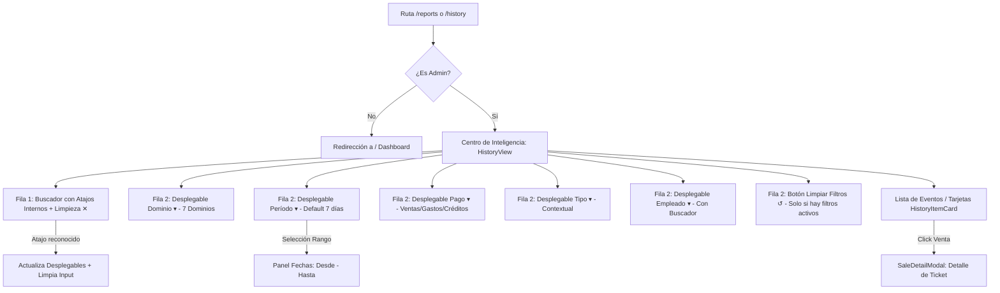

# UXD-005: Interfaz de Historial y Auditoría (Evidence Hub)

> **Asociado a:** [FRD-005](../FRD/FRD_005_AUDITORIA_TRAZABILIDAD.md) | [FRD-021](../FRD/FRD_021_HISTORIALES_MULTICANAL.md) | [FRD-027-01](../FRD/FRD_027_01_REPORTES_DE_CAJA.md) | [SDD-005](../SDD/SDD_005_AUDITORIA_TRAZABILIDAD.md) | [SDD-021](../SDD/SDD_021_HISTORIALES_MULTICANAL.md)  
> **Orquestación:** [WO_011_FILTROS_HISTORIAL_A_C.md](../../04_dev_orchestration/WO_011_FILTROS_HISTORIAL_A_C.md)  
> **Estado:** 🟢 Aprobado (v3 — Filtros Compactos Opción A + C, Admin-Only)  
> **Última Actualización:** 2026-10-29  

---

## 1. Principios de Experiencia y Seguridad (@user_global)

1. **Acceso Restringido a Administradores (Admin-Only):**
   - El módulo del **Centro de Inteligencia** (`/reports`, `/history`) es de acceso exclusivo para usuarios con rol `ADMIN`.
   - El guardia global de navegación (`router.beforeEach`) bloquea el acceso a usuarios no-administradores redirigiéndolos al Dashboard operativo.
   - Dado que el usuario siempre es Administrador, tiene acceso irrestricto a los 7 dominios del sistema y la supervisión de todos los empleados de la tienda es un caso de uso prioritario.
2. **Backend Authority sobre Totales Financieros (`SPEC-010/011`):**
   - El frontend **nunca calcula totales financieros** mediante agregaciones en memoria (`.reduce()`). Se elimina la barra de suma monetaria en cliente para respetar la autoridad del backend.
3. **Gobernanza Temporal y Rango por Defecto (`FRD-005` Regla 6):**
   - Al entrar al Evidence Hub, el período **inicia por defecto en `Últimos 7 días` (`week`)**, evitando pantallas vacías al inicio de jornada.
   - Los atajos temporales (`Hoy`, `Ayer`, `Últimos 7 días`, `Últimos 30 días`) y el rango personalizado (`Desde–Hasta`) aplican de forma consistente sobre todos los dominios.
4. **Diseño Compacto Opción A + C (Cero Torre de Píldoras):**
   - Se reemplazan las 5 filas horizontales apiladas por:
     - **Fila 1:** Buscador universal con atajos internos silenciosos (`Enter`).
     - **Fila 2:** Barra horizontal de desplegables compactos (`BaseDropdown.vue`) para Dominio, Período, Medio de Pago, Tipo de Evento y Empleado.

---

## 2. Mapa de Navegación y Flujo de Interacción

---

## 3. Especificación de Componentes y Comportamientos

### 3.1 Fila 1: Buscador con Atajos Internos (`historyShortcutParser.ts`)
- **Texto Libre en Tiempo Real:** Coincidencia en vivo sobre ID de ticket, cliente, producto, proveedor o detalle de auditoría.
- **Atajos Silenciosos al Presionar Enter / Buscar:**
  - **Dominios:** `ventas`, `caja`, `compras`, `gastos`, `creditos`, `precios`, `auditoria`.
  - **Períodos:** `hoy`, `ayer`, `semana` (`7d`), `mes` (`30d`).
  - **Medios de Pago:** `efectivo`, `digital` / `digitales`, `nequi`, `daviplata`, `fiado`.
  - **Subtipos:** `anuladas`, `creaciones`, `entradas`, `ajustes`, `apertura`, `cierre`.
  - **Empleados:** `empleado:<nombre>` o `cajero:<nombre>` (coincidencia parcial insensible a acentos).
  - Al detectar atajos, actualiza los desplegables correspondientes y extrae los tokens del input, dejando solo el texto libre.

### 3.2 Fila 2: Desplegables Compactos (`BaseDropdown.vue`)
1. **Dominio:** `🛒 Ventas`, `🏛️ Caja`, `📦 Compras`, `💵 Gastos`, `📒 Créditos`, `🏷️ Precios`, `🛡️ Auditoría`.
2. **Período:** `Últimos 7 días` (default), `Hoy`, `Ayer`, `Últimos 30 días`, `Rango personalizado...`.
3. **Medio de Pago (`FRD-021` / `SDD-021` §6):** Menú desplegable cerrado con `Pago: Todos`, `💵 Efectivo`, `📱 Digitales (Todos)`, `📱 Nequi`, `📱 Daviplata` (+ `📋 Fiado` en Créditos).
4. **Tipo de Evento:** Contextual según el dominio activo (`Creaciones`/`Anulaciones` en Ventas; `Entradas`/`Ajustes` en Compras; `Aperturas`/`Cierres` en Caja; etc.).
5. **Empleado:** Desplegable con buscador integrado para tiendas con más de 6 empleados (`Todos los empleados` + lista de empleados activos).
6. **Botón Limpiar:** Visible solo cuando los filtros difieren del estado inicial (`Período !== 'week'`, `Pago !== 'all'`, `Tipo !== 'all'`, `Empleado !== null`, o búsqueda activa).

### 3.3 Estados de la Interfaz
- ⏳ **Cargando:** Spinner central con mensaje sobrio.
- ❌ **Error:** Tarjeta de advertencia con botón explícito de reintento.
- 📭 **Vacío (`FRD-005` Regla 6):**
  - Informa el período activo aplicado (ej. *"No hay movimientos registrados en: Hoy"*).
  - Si el período es `today`, `yesterday` o `week`, ofrece el botón de acción rápida **`[Ver últimos 30 días]`** para ampliar el horizonte temporal.
  - Ofrece el botón **`[Restablecer filtros]`** si hay filtros restrictivos activos.

---

## 4. Registro de Trade-offs y Decisiones de Alcance (Regla 7)

| Decisión | Justificación Técnica | Condición de Revisión Futura |
|---|---|---|
| **Eliminación de Suma Financiera en Cliente** | Obligatorio por `SPEC-010/011` y Regla Global 2.1 (Backend Authority). El frontend no suma montos con `.reduce()` en memoria. | Si el backend provee un RPC específico de consolidación financiera paginada para History. |
| **Default en `Últimos 7 días`** | Exigido por `FRD-005` Regla 6 y `FRD-027-01` Regla 6. Previene que el tendero vea pantallas vacías al inicio del día. | Si una futura especificación define preferencias temporales por usuario. |
| **Acceso Restringido a Admin** | Requerimiento expreso del negocio para el Centro de Inteligencia y Auditoría. | Si en el futuro se crea un rol específico de auditor externo con permisos de lectura. |
