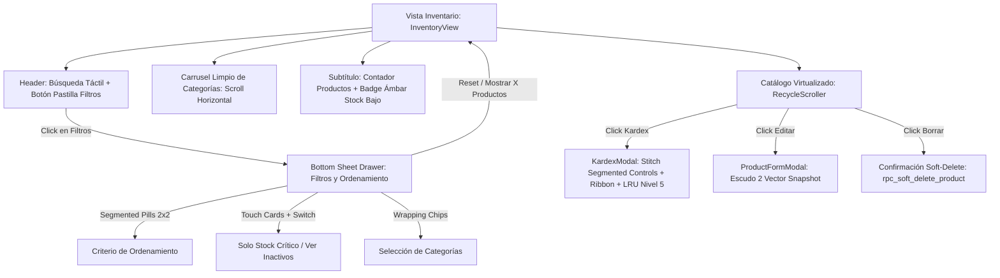

# UXD-006: Interfaz de Gestión de Inventario y Catálogo

> **Asociado a:** [FRD-006](../FRD/FRD_006_INVENTARIO.md) | [SDD-006](../SDD/SDD_006_NUCLEO_INVENTARIO_PADRE.md)  
> **Gobernanza:** [SDD-028 (Caché y Concurrencia)](../SDD/SDD_028_GOBERNANZA_CACHE_CONCURRENCIA.md)  
> **Design System:** Stitch MCP (`projects/10235152326752652299` - *Tienda Control*)  
> **Pantalla Stitch:** `projects/10235152326752652299/screens/bed87e32eaae4f0f8dec5981f3e28351` (*Filtros y Bottom Sheet de Inventario*)  
> **Estado:** 🟢 Aprobado (Rediseño Stitch Mobile-First 2026-10-26)  
> **Última Actualización:** 2026-10-26  

---

## 1. Principios de Experiencia y Arquitectura (@user_global)

1. **Frontend Authority sobre Presentación y Filtros:** El catálogo reside en memoria del cliente bajo la estrategia SWR Nivel 2 (`inventoryStore.products`). El filtrado por texto, categoría, stock crítico, inactivos y ordenamiento se ejecuta 100% en el cliente mediante el composable reactivo `useInventoryFilter` y renderizado virtualizado (`RecycleScroller`). Esto garantiza latencia de 0ms en búsquedas y continuidad operativa offline en el POS.
2. **Backend Authority sobre Datos e Integridad:** El frontend nunca calcula existencias netas ni totales de venta. Las mutaciones de atributos comerciales se canalizan exclusivamente por `rpc_actualizar_producto_catalogo` bajo los Escudos 1 y 2.
3. **Gestión de la Espera (Skeletons y Spinners):** Durante la carga inicial o revalidación en segundo plano, se presentan skeletons que imitan la lista virtualizada. Durante la apertura del Kardex, se visualiza spinner y estado táctil mientras PostgREST resuelve la consulta bajo caché LRU Nivel 5 (`MAX_ENTRIES = 10`).
4. **Diseño Mobile-First Stitch (Ergonomía Táctil):** Eliminación completa de elementos de escritorio invasivos (`<select>` HTML nativos sin estilizar, checkboxes pequeños, botones de advertencia intercalados en carruseles). Adopción de controles táctiles: Bottom Sheet Drawers con curvatura `rounded-t-[32px]`, botones de filtro en pastilla con micro-insignias, controles segmentados `p-1 rounded-full`, tarjetas de toque con switch animado y botones CTA pegajosos a ancho completo.

---

## 2. Mapa de Navegación e Interacción

---

## 3. Especificación de Componentes y Pantallas (Stitch Mobile-First)

### 3.1 Barra de Búsqueda y Cinta de Categorías (`InventoryView.vue`)
- **Búsqueda Instantánea (`searchQuery`):**
  - Input `BaseInput` con icono `Search` (`lucide-vue-next`).
  - Coincidencia insensible a mayúsculas/minúsculas sobre nombre de producto y código `PLU`.
  - Latencia 0ms en memoria del cliente.
- **Botón de Filtros en Pastilla (`SlidersHorizontal`):**
  - Botón táctil ergonómico `rounded-full` con etiqueta "Filtros".
  - Estado inactivo: `bg-gray-100 dark:bg-slate-800 text-slate-600 dark:text-slate-300`.
  - Estado activo: `bg-primary text-white shadow-md shadow-primary/25 border border-primary` acompañado de badge circular con el conteo de filtros aplicados (`activeFiltersCount`).
- **Carrusel Limpio de Categorías (Horizontal Scroll):**
  - Dedicado exclusivamente a navegación taxonómica del catálogo.
  - Píldoras con curvatura `rounded-full`, micro-animación `active:scale-95`.
  - Activo: `bg-primary text-white shadow-sm`. Inactivo: `bg-gray-100 dark:bg-slate-800/80 border`.
- **Insignia Discreta de Stock Bajo:**
  - Desacoplada del carrusel de categorías; reubicada en el subtítulo junto a `Productos (X)`.
  - Botón pastilla ámbar suave con punto pulsante (`animate-pulse`) que activa/desactiva instantáneamente el filtro de existencias críticas.

---

### 3.2 Bottom Sheet Drawer de Filtros y Orden (`BaseModal` Stitch Pattern)
Sustituye los desplegables de escritorio por una interfaz táctil deslizante con curvatura de 32px y cierre intuitivo:

1. **Encabezado Táctil:**
   - Título "Filtros y Orden" con badge `X activos`.
   - Botón de restablecimiento rápido con icono `RotateCcw` y micro-interacción.
2. **Segmented Pills 2x2 de Ordenamiento:**
   - Contenedor `grid grid-cols-2 p-1 bg-gray-100 dark:bg-slate-900 rounded-2xl`.
   - 4 opciones segmentadas de acceso directo:
     - 🕒 `Recientes` (`created_desc`)
     - 🔤 `Nombre A-Z` (`name_asc`)
     - 📦 `Menor Stock` (`stock_asc`)
     - 🏷️ `Menor Precio` (`price_asc`)
3. **Tarjetas Táctiles Interactivas con Switch Animado:**
   - **Solo Stock Crítico:** Tarjeta táctil con icono ámbar de alerta (`AlertTriangle`), descripción clara y pastilla switch interactiva (`translate-x-5` con icono `Check`).
   - **Ver Inactivos (Admin Only):** Tarjeta táctil con icono índigo (`EyeOff`), badge distintivo "ADMIN" y switch interactivo. Restringida bajo `v-if="isAdmin"`.
4. **Selector de Categorías en Chips Envolventes (`flex-wrap`):**
   - Distribución fluida de chips táctiles con icono `Check` integrado en el elemento seleccionado.
5. **Botón de Acción Pegajoso (Sticky Footer CTA):**
   - Botón a ancho completo `rounded-full` con fondo `primary` y texto dinámico:
     `"Mostrar X Productos"`.

---

### 3.3 Historial Kardex Rediseñado (`KardexModal.vue`)
- **Gobernanza LRU Nivel 5:** Conexión reactiva a PostgREST con almacenamiento en `SystemCacheManager` bajo namespace `reports:kardex` (acotado a 10 productos en memoria).
- **Controles Táctiles Mobile-First:**
  - **Ventana Temporal Segmentada:** Pastillas `rounded-full` de selección directa: `[ 7 días | 30 días | Histórico ]`.
  - **Cinta de Tipos de Movimiento (Horizontal Ribbon):** Carrusel deslizante de pastillas táctiles:
    `[ Todos | Entradas | Salidas | Ventas | Mermas | Ajustes | Devoluciones | Correcciones ]`.
- **Tarjetas de Movimiento con Semántica Stitch:**
  - Fondo `bg-white dark:bg-slate-800/80 rounded-2xl p-3.5 border border-gray-100 dark:border-slate-700/60 shadow-soft`.
  - Iconos vectoriales `lucide-vue-next` de alta legibilidad:
    - 📥 `ArrowDownLeft` (Entradas) - Esmeralda
    - 📤 `ArrowUpRight` (Salidas) - Rosa
    - 🛒 `ShoppingCart` (Ventas) - Azul
    - ↩️ `RotateCcw` (Devoluciones) - Púrpura
    - 🗑️ `Trash2` (Mermas) - Naranja
    - 🎚️ `Sliders` (Ajustes) - Ámbar
    - 🔧 `Wrench` (Corrección de Sistema) - Cian
  - Cantidades formateadas con signo explícito (`+`, `-`) y color semántico en tipografía monoespaciada.
  - Motivo de movimiento formateado en caja de texto suave con cursiva.

---

### 3.4 Matriz de Verificación y Rendimiento

| Requisito UX / UI | Componente | Verificación | Estado |
|---|---|---|---|
| Latencia de filtrado 0ms en cliente | `useInventoryFilter.ts` | Pruebas unitarias de composable y SWR Nivel 2 | ✅ Aprobado |
| Drawer táctil Mobile-First Stitch | `InventoryView.vue` | Inspección visual en servidor de desarrollo y build de producción | ✅ Aprobado |
| Segmented Pills de Ordenamiento | `InventoryView.vue` | 4 botones segmentados sin `<select>` nativos | ✅ Aprobado |
| Switches animados táctiles | `InventoryView.vue` | Tarjetas táctiles `rounded-2xl` con micro-animaciones | ✅ Aprobado |
| Cinta Kardex y ventana temporal | `KardexModal.vue` | Controles segmentados + carrusel horizontal con LRU Nivel 5 | ✅ Aprobado |
| Compatibilidad con tema claro y oscuro | Ambos componentes | Clases Tailwind con prefijo `dark:` y variables semánticas | ✅ Aprobado |
| Suite Vitest completa | `npm test` | 17/17 archivos de prueba, 101/101 tests aprobados | ✅ Aprobado |
| Compilación de producción | `npm run build` | Cero errores de TypeScript/Vite | ✅ Aprobado |
