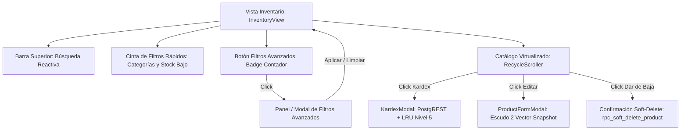

# UXD-006: Interfaz de Gestión de Inventario y Catálogo

> **Asociado a:** [FRD-006](../FRD/FRD_006_INVENTARIO.md) | [SDD-006](../SDD/SDD_006_NUCLEO_INVENTARIO_PADRE.md)  
> **Gobernanza:** [SDD-028 (Caché y Concurrencia)](../SDD/SDD_028_GOBERNANZA_CACHE_CONCURRENCIA.md)  
> **Estado:** 🟢 Aprobado (PAC-UXD 2026-10-26)  
> **Última Actualización:** 2026-10-26  

---

## 1. Principios de Experiencia y Arquitectura (@user_global)

1. **Frontend Authority sobre Presentación y Filtros:** El catálogo reside en memoria del cliente bajo la estrategia SWR Nivel 2 (`inventoryStore.products`). El filtrado por texto, categoría, stock bajo, inactivos y ordenamiento se ejecuta 100% en el cliente mediante el composable reactivo `useInventoryFilter` y renderizado virtualizado (`RecycleScroller`). Esto garantiza latencia de 0ms en búsquedas y continuidad operativa offline en el POS.
2. **Backend Authority sobre Datos e Integridad:** El frontend nunca calcula existencias netas ni totals de venta. Las mutaciones de atributos comerciales se canalizan exclusivamente por `rpc_actualizar_producto_catalogo` bajo los Escudos 1 y 2.
3. **Gestión de la Espera (Skeletons y Spinners):** Durante la carga inicial o revalidación en segundo plano, se presentan skeletons que imitan la lista virtualizada. Durante la apertura del Kardex, se visualiza skeleton de tabla mientras PostgREST resuelve la consulta bajo caché LRU Nivel 5 (`MAX_ENTRIES = 10`).

---

## 2. Mapa de Navegación e Interacción

---

## 3. Especificación de Componentes y Pantallas

### 3.1 Barra de Búsqueda y Filtros Rápidos (`InventoryView.vue`)
- **Búsqueda Instantánea (`searchTerm`):**
  - Input con icono `Search` y botón de limpieza rápida (`X`).
  - Coincidencia insensible a mayúsculas/minúsculas sobre `name` y `plu`.
  - Mínimo 2 caracteres para activar filtrado por texto. Latencia: 0ms.
- **Cinta de Categorías (Horizontal Scroll):**
  - Chip "Todas las categorías".
  - Chips dinámicos para cada categoría existente en el catálogo cacheado.
  - Chip crítico "Stock Bajo": Fondo ámbar/rojo con contador de productos en alerta (`stock <= minStock`).
- **Botón de Filtros Avanzados (`Filter` Icon):**
  - Incluye badge numérico (`activeFiltersCount`) cuando hay filtros activos más allá de la búsqueda por defecto.
  - Al hacer click abre el panel/modal de filtros avanzados (`showFilterModal = true`).

---

### 3.2 Panel de Filtros Avanzados (`FilterModal` / Drawer)
Permite afinar la vista sin sobrecargar la pantalla principal en dispositivos móviles o terminales POS:

| Control | Tipo | Comportamiento |
|---------|------|----------------|
| **Solo Stock Bajo** | Switch / Toggle | Filtra productos donde `product.stock <= product.minStock`. |
| **Incluir Inactivos** | Switch / Toggle | **Restringido a Administrador (`v-if="isAdmin"`).** Muestra productos dados de baja lógica (`is_active = false`). |
| **Categoría** | Selector / Chips | Filtrado por categoría específica o "Todas". |
| **Criterio de Ordenamiento** | Select | Opciones: `name_asc` (Nombre A-Z), `name_desc` (Nombre Z-A), `stock_asc` (Menor Stock), `stock_desc` (Mayor Stock), `price_asc` (Menor Precio), `price_desc` (Mayor Precio). |
| **Acciones** | Botones | "Limpiar Filtros" (restaura defaults) y "Cerrar / Aplicar". |

---

### 3.3 Tarjetas Resumen y KPIs de Encabezado
1. **Total de Productos:** Cantidad total de productos activos en la tienda.
2. **Alertas de Stock Bajo:** Contador reactivo calculado estrictamente como:
   $$\text{StockBajo} = \sum [p.\text{stock} \le p.\text{minStock} \land p.\text{isActive} \ne \text{false}]$$
   *(Corrige la discrepancia anterior que evaluaba erróneamente `notifiedLowStock`).*
3. **Valorización de Inventario (Solo Admin):** Sumatoria de costo/precio de inventario disponible. Oculto para cajeros y empleados sin permisos financieros.

---

### 3.4 Catálogo Virtualizado (`RecycleScroller`)
- **Rendimiento:** Soporta renderizado de 10 a 5,000+ ítems con 60 FPS continuos mediante reciclaje de nodos DOM.
- **Filas de Producto:**
  - Nombre del producto y categoría.
  - Badge de PLU numérico.
  - Precio de venta formateado en COP (`$X.XXX`).
  - Stock actual con badge semántico:
    - 🟢 Verde: Stock normal (`stock > minStock`).
    - 🟡 Ámbar: Stock bajo (`stock <= minStock && stock > 0`).
    - 🔴 Rojo: Agotado (`stock === 0`).
    - ⚪ Gris: Inactivo (`isActive === false`).
  - Acciones: Botón Kardex (`History`), Botón Editar (`Edit`), Botón Borrar (`Trash2`).
- **Estado Vacío (Empty State):**
  - Si no hay coincidencias con los filtros activos: Ilustración con mensaje *"No se encontraron productos que coincidan con los filtros aplicados"*, acompañado de un botón principal *"Limpiar Filtros"*.

---

### 3.5 Historial Kardex (`KardexModal.vue`)
- **Caché LRU Nivel 5:** Conecta con PostgREST y almacena resultados en `SystemCacheManager` bajo namespace `kardex:${productId}` con política LRU (máximo 10 productos en memoria simultáneos).
- **Controles de Filtrado en Modal:**
  - **Rango de Fechas:** Selector de fecha inicial (`start_date`) y final (`end_date`). Por defecto: últimos 7 días.
  - **Tipo de Movimiento:** Dropdown con opciones: Todos, Entrada, Salida, Venta, Merma, Ajuste, Devolución, Corrección de Sistema.
  - **Usuario / Empleado:** Dropdown opcional de autoría.
- **Estados de Carga y Error:**
  - Muestra skeleton de 5 filas mientras la promesa PostgREST está pendiente.
  - Si la consulta falla, muestra alerta de error clara con código técnico y botón de reintento.
