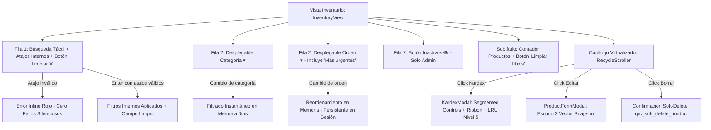

# UXD-006: Interfaz de Gestión de Inventario y Catálogo

> **Asociado a:** [FRD-006](../FRD/FRD_006_INVENTARIO.md) | [SDD-006](../SDD/SDD_006_NUCLEO_INVENTARIO_PADRE.md)  
> **Gobernanza:** [SDD-028 (Caché y Concurrencia)](../SDD/SDD_028_GOBERNANZA_CACHE_CONCURRENCIA.md)  
> **Orquestación:** [WO_010_FILTROS_INVENTARIO_A_C.md](../../04_dev_orchestration/WO_010_FILTROS_INVENTARIO_A_C.md)  
> **Estado:** 🟢 Aprobado (v3 — Filtros Compactos Opción A + C)  
> **Última Actualización:** 2026-10-29  

---

## 1. Principios de Experiencia y Arquitectura (@user_global)

1. **Frontend Authority sobre Presentación y Filtros:** El catálogo reside en memoria del cliente bajo la estrategia SWR Nivel 2 (`inventoryStore.products`). El filtrado por texto libre, atajos internos, categoría, inactivos y ordenamiento se ejecuta 100% en el cliente mediante el composable reactivo `useInventoryFilter` y renderizado virtualizado (`RecycleScroller`). Esto garantiza latencia de 0ms en búsquedas y continuidad operativa offline en el POS.
2. **Backend Authority sobre Datos e Integridad:** El frontend nunca calcula existencias netas ni totales de venta. Las mutaciones de atributos comerciales se canalizan exclusivamente por `rpc_actualizar_producto_catalogo` bajo los Escudos 1 y 2.
3. **Cero Duplicación de Controles (Anti-Fricción):** Cada dimensión de filtrado tiene **un único punto de control** en la pantalla. Se eliminan el Bottom Sheet drawer y el carrusel redundante de categorías.
4. **Búsqueda Táctil con Atajos Internos (Opción A + C):** El campo de búsqueda acepta texto libre ordinario en vivo y atajos estructurados (`bajo`, `agotado`, `stock<10`, `precio>=5000`, `marca:diana`, `plu:1001`, `inactivo`). Al presionar Buscar/Enter, los atajos válidos se activan en el estado interno del composable y se retiran del campo, dejándolo limpio para búsquedas adicionales.

---

## 2. Mapa de Navegación e Interacción

---

## 3. Especificación de Componentes y Pantallas (Opción A + C)

### 3.1 Barra de Búsqueda con Atajos Internos (`InventorySearchBar.vue`)
- **Texto Libre en Tiempo Real:**
  - Coincidencia insensible a mayúsculas y acentos sobre `name`, `plu`, `brand` y `category` (con lógica `AND` para múltiples palabras).
  - Botón de limpieza rápida `✕` visible al escribir.
- **Atajos Internos al Pulsar Enter / Buscar (`enterkeyhint="search"`):**
  - `bajo`: Activa filtro `onlyLowStock` (`stock <= minStock`).
  - `agotado`: Activa regla `stock = 0`.
  - `stock<N`, `stock<=N`, `stock>N`, `stock>=N`, `stock=N`: Comparador numérico.
  - `precio<N`, `precio<=N`, `precio>N`, `precio>=N`: Comparador numérico (admite puntos de miles ej. `12.000`).
  - `marca:<nombre>` o `marca:"dos palabras"`: Filtro de marca.
  - `plu:<codigo>`: Filtro por prefijo de código PLU.
  - `inactivo`: Requiere rol administrador. Si el usuario no es admin, emite advertencia explícita.
- **Ramas de Error Explícito:**
  - Sintaxis inválida (ej. `stok<5`, `marca:` vacía, comillas sin cerrar) genera mensaje inline en rojo bajo el input y **no filtra en silencio**.

### 3.2 Desplegables Compactos (`BaseDropdown.vue`)
- **Desplegable de Categoría:**
  - Opciones dinámicas alimentadas por `categories` del store (sin conteos numéricos superfluos).
  - Mini buscador interno si la lista supera 8 categorías.
  - **Auto-restablecimiento Reactivo:** Si la categoría seleccionada deja de existir (por eliminación o soft-delete de sus productos), se restablece automáticamente a `'Todas'` y notifica al usuario vía Toast.
- **Desplegable de Orden:**
  - 8 opciones: Más recientes (default), **Más urgentes primero (Reponer: `stock - minStock` ascendente)**, Nombre A-Z, Nombre Z-A, Stock menor, Stock mayor, Precio menor, Precio mayor.
  - **Persistencia de Sesión (D4):** La selección de orden se conserva en memoria durante la sesión del usuario al navegar entre vistas.
  - El criterio de ordenamiento **no incrementa `activeFiltersCount`**.
- **Botón de Inactivos (`EyeOff`):**
  - Exclusivo para administradores (`isAdmin`). Permite alternar la visibilidad de artículos dados de baja lógica en un solo toque.

---

## 4. Registro de Trade-offs y Decisiones de Alcance (Regla 7)

| Decisión | Justificación Técnica | Condición de Revisión Futura |
|---|---|---|
| **Ausencia de Indicador `⚡N`** | Decisión expresa del usuario: priorizar máxima limpieza visual en el campo de texto; el riesgo de filtro oculto se mitiga con el botón "Limpiar filtros" en el subtítulo y en el empty state. | Si usuarios finales reportan confusión creyendo que faltan productos en catálogo. |
| **Exclusión de `cat:` en atajos** | Evitar duplicidad conceptual con el desplegable visible de Categoría. | Si usuarios intensivos solicitan soporte full-keyboard. |
| **"Más urgentes" prioriza sin excluir** | Un criterio de ordenamiento no debe ocultar productos válidos; el filtrado restrictivo exacto se realiza con el atajo `bajo`. | Si se solicita un toggle de exclusión directo en el desplegable. |
| **Orden por Ventas diferido a Fase 2** | Requiere backend RPC sobre tablas compartidas (`sales`, `sale_items`) con auditoría de impacto y gobernanza RLS. | Inicio de la Fase 2 del plan de inventario. |

---

## 5. Matriz de Verificación y Calidad

| Criterio | Componente / Capa | Evidencia | Estado |
|---|---|---|---|
| Parser TDD de atajos | `inventoryShortcutParser.spec.ts` | 16/16 tests unitarios aprobados | ✅ Aprobado |
| Lógica reactiva de filtros y SWR N2 | `useInventoryFilter.spec.ts` | 12/12 tests unitarios aprobados | ✅ Aprobado |
| Suite completa de pruebas Vitest | `npm test` | 18/18 archivos, 119/119 tests aprobados | ✅ Aprobado |
| Compilación de Producción | `npm run build` | 0 errores Vite/TS (`built in 22.18s`) | ✅ Aprobado |
| Escaneo de Impacto Estructural | Ecógrafo Regla 10 | Sello activo en `.git/.impact_scan_stamp` | ✅ Aprobado |
