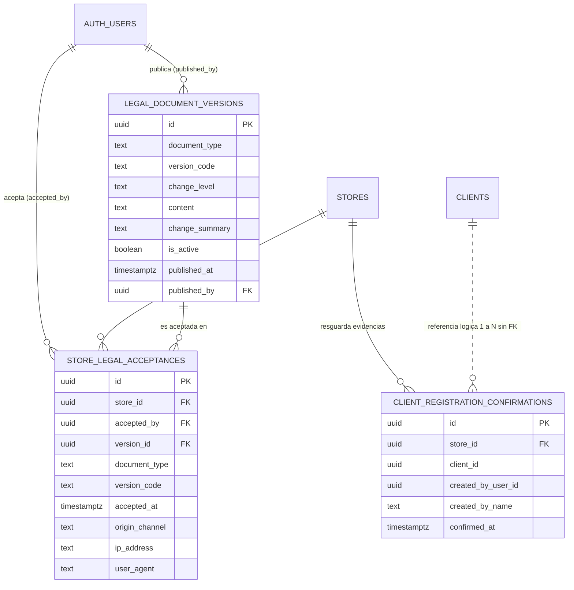

# DSD-029: Consentimiento Legal Versionado, Bloqueo de Vigencia y Confirmación de Alta

| Atributo | Valor |
|----------|-------|
| **ID Documento** | `DSD-029` |
| **FRD Origen** | [FRD-029](../01_requirements/FRD/FRD_029_CONSENTIMIENTO_LEGAL_VERSIONADO.md) |
| **SDD Técnico** | [SDD-029 v1.0.0](../01_requirements/SDD/SDD_029_CONSENTIMIENTO_LEGAL_VERSIONADO.md) |
| **Políticas (`ARQ-002`)** | `POL-PRIV-01`, `POL-AUD-01`, `POL-AUD-02`, `POL-SEG-03` |
| **Migración Canónica** | [`20261111172500_sdd_029_legal_consent_versioning.sql`](../../supabase/migrations/20261111172500_sdd_029_legal_consent_versioning.sql) |
| **Fecha / Versión** | 2026-11-11 — `v1.0.0` |
| **Estado** | 🧪 Verificado en Docker (`supabase_db_prueba`) — Pendiente promoción a Cloud y capa Frontend |

---

## 1. Explicación Lógica y Decisiones de Arquitectura

### 1.1 Propósito y Principio de Autoridad
Este diseño materializa en PostgreSQL / Supabase la trazabilidad probatoria exigida por la Ley 1581 de 2012 (`POL-PRIV-01`) y las bitácoras inmutables (`POL-AUD-01`, `POL-AUD-02`) con separación estricta entre **Dueño de Plataforma SaaS** y **Administradores de Tienda (`owner` / `manager`)**:

1. **Identidad de Dueño de Plataforma (`D-LEG-02`):** Se introduce `assert_platform_owner()` (`SECURITY DEFINER`), que evalúa exclusivamente `auth.users.is_super_admin = true` y `is_anonymous = false`. Nunca lee ni confía en llaves del JSON `employees.permissions->>'isSuperAdmin'`, y `handle_new_user_atomic()` omite generar `isSuperAdmin` en tiendas nuevas.
2. **Catálogo Versionado e Inmutable (`legal_document_versions`):** Permite múltiples versiones históricas de `terms_of_service` y `privacy_policy`, garantizando mediante el índice único parcial `uq_legal_document_versions_single_active` como máximo una fila con `is_active = true` por `document_type`. Los triggers `BEFORE UPDATE OR DELETE` y `BEFORE TRUNCATE` prohíben cualquier borrado o alteración del contenido histórico (`LEGAL_LOG_IMMUTABLE` / `AUDIT_LOG_IMMUTABLE`), autorizando únicamente la transición transaccional controlada `is_active: true -> false` cuando `rpc_publicar_version_legal` desactiva la versión saliente bajo `pg_advisory_xact_lock` y `app.allow_version_deactivation = 'on'`.
3. **Consentimiento Atómico en Registro (`handle_new_user_atomic`, `D-LEG-03`/`D-LEG-04`):** Todo registro público (`signUp`) debe aportar `accepted_terms_version_id` y `accepted_privacy_version_id` en `raw_user_meta_data` correspondientes a versiones actualmente vigentes (`is_active = true` y `document_type` coincidente). Si falta cualquiera o ya fue superada (`LEGAL_ACCEPTANCE_REQUIRED` / `LEGAL_VERSION_SUPERSEDED`), el trigger `AFTER INSERT ON auth.users` falla y relanza la excepción (`RAISE`), ejecutando rollback atómico de `auth.users`, `stores`, `admin_profiles`, `employees` y `store_legal_acceptances` sin dejar registros huérfanos. Para cuentas de servicio interno (`is_anonymous = true`, `is_super_admin = true` o `raw_app_meta_data->>'account_kind' IN ('platform_owner', 'store_member')`), se omite la autocreación de tienda.
4. **Continuidad Operativa y Vigencia (`RN-10` a `RN-13`):** La sesión activa no se expulsa ante nuevas publicaciones (`rpc_verificar_estado_sesion()` mantiene `active` y opera con `SET search_path TO 'public'`). En cambio, `rpc_verificar_estado_legal_tienda(p_store_id)` compara las aceptaciones de la tienda contra las versiones vigentes y detecta también versiones `major` históricas no aceptadas (`v_has_unaccepted_major`), garantizando que una tienda preexistente sin historial (`RN-13`) reciba `requires_major_acceptance` incluso si la última publicación fue `minor`.
5. **Coordinación con `SDD-030` en Confirmaciones de Clientes (`client_registration_confirmations`, `D-ARCO-03`):**
   - `client_id` **no** posee llave foránea restrictiva hacia `public.clients(id)` para preservar la prueba histórica del alta cuando un cliente sin movimientos es eliminado físicamente (`HARD_DELETED` en `SDD-030`).
   - Se omite restricción `UNIQUE(store_id, client_id)` para admitir cardinalidad **1:N**: cada re-alta silenciosa desde Archivo Contable (`REACTIVATED` en `rpc_crear_cliente_fiado`) genera una nueva evidencia de confirmación de datos.
   - `created_by_user_id` **no** impone FK hacia `employees(id)` para tolerar administradores (`manager` / `owner`) registrados únicamente en `admin_profiles`.

### 1.2 Trade-offs y Alcance Diferido (`AGENTS.md` Regla 7)
| Decisión / Alcance | Trade-off Concreto | Condición de Revisión Futura |
|--------------------|--------------------|------------------------------|
| Aceptaciones en registro dependen de `raw_user_meta_data` validadas por trigger `handle_new_user_atomic()` | Mantiene compatibilidad nativa con el flujo `auth.signUp` de Supabase GoTrue sin Edge Function intermedia, trasladando la verificación de vigencia al motor transaccional de Postgres. | Revisar si el registro pasa a Edge Function o si GoTrue cambia restricciones sobre `raw_user_meta_data`. |
| `client_registration_confirmations.client_id` y `created_by_user_id` sin FK física hacia `clients` / `employees` | Permite conservación probatoria post-`HARD_DELETED` (RN-04 `FRD-030`) y autoría de administradores sin fila en `employees`, sacrificando `ON DELETE CASCADE` automática en clientes archivados/borrados. | La creación y enlace se controla exclusivamente vía `SECURITY DEFINER` (`rpc_crear_cliente_fiado`). No habilitar inserción directa cliente. |
| Captura de `ip_address` / `user_agent` vía `current_setting('request.headers', true)` | En llamadas PostgREST en sesión está disponible en cabeceras HTTP; durante el trigger de `auth.users` GoTrue no propaga cabeceras IP a Postgres (`ip_address` queda `NULL` y `user_agent` se lee de `raw_user_meta_data->>'client_user_agent'`). | Revisar si el registro migra a un proxy Edge que inyecte IP verificada de cliente. |

---

## 2. Diagrama Entidad-Relación (ERD)



---

## 3. Diccionario de Datos (`CA-DSD-03`)

### 3.1 `public.legal_document_versions`
| Columna | Tipo | Nulabilidad | Default | Restricciones / FK | Descripción |
|---------|------|-------------|---------|--------------------|-------------|
| `id` | `uuid` | `NOT NULL` | `gen_random_uuid()` | `PRIMARY KEY` | Identificador único de la versión legal publicada. |
| `document_type` | `text` | `NOT NULL` | — | `CHECK (document_type IN ('terms_of_service', 'privacy_policy'))` | Tipo de documento legal regulado. |
| `version_code` | `text` | `NOT NULL` | — | `CHECK (length(trim(version_code)) > 0)`, `UNIQUE (document_type, version_code)` | Código legible de versión (ej. `'1.0'`, `'1.1'`, `'2.0'`). |
| `change_level` | `text` | `NOT NULL` | — | `CHECK (change_level IN ('major', 'minor'))` | Severidad del cambio normativo; determina si bloquea ingreso hasta reaceptación. |
| `content` | `text` | `NOT NULL` | — | `CHECK (length(trim(content)) > 0)` | Texto completo vigente del documento legal. |
| `change_summary` | `text` | `NOT NULL` | — | `CHECK (length(trim(change_summary)) > 0)` | Resumen ejecutivo de cambios respecto a la versión anterior. |
| `is_active` | `boolean` | `NOT NULL` | `false` | Índice único parcial `uq_legal_document_versions_single_active` `WHERE is_active = true` | Marca la única versión actualmente vigente por cada `document_type`. |
| `published_at` | `timestamptz` | `NOT NULL` | `now()` | — | Marca temporal exacta de publicación oficial. |
| `published_by` | `uuid` | `NULL` | — | `REFERENCES auth.users(id)` | UUID del usuario Dueño de Plataforma que publicó la versión. |

### 3.2 `public.store_legal_acceptances`
| Columna | Tipo | Nulabilidad | Default | Restricciones / FK | Descripción |
|---------|------|-------------|---------|--------------------|-------------|
| `id` | `uuid` | `NOT NULL` | `gen_random_uuid()` | `PRIMARY KEY` | Identificador único del acta de aceptación legal. |
| `store_id` | `uuid` | `NOT NULL` | — | `REFERENCES public.stores(id) ON DELETE CASCADE`, `UNIQUE (store_id, version_id)` | Tienda que otorga la aceptación legal (registro idempotente por versión). |
| `accepted_by` | `uuid` | `NOT NULL` | — | `REFERENCES auth.users(id)` | Usuario administrador que ejecutó la aceptación. |
| `version_id` | `uuid` | `NOT NULL` | — | `REFERENCES public.legal_document_versions(id) ON DELETE RESTRICT` | Versión exacta aceptada en el instante del consentimiento. |
| `document_type` | `text` | `NOT NULL` | — | `CHECK (document_type IN ('terms_of_service', 'privacy_policy'))` | Desnormalización probatoria del tipo de documento aceptado. |
| `version_code` | `text` | `NOT NULL` | — | `CHECK (length(trim(version_code)) > 0)` | Desnormalización probatoria del código de versión aceptado. |
| `accepted_at` | `timestamptz` | `NOT NULL` | `now()` | Índice `(store_id, document_type, accepted_at DESC)` | Fecha y hora UTC inmutable de la aceptación. |
| `origin_channel` | `text` | `NOT NULL` | — | `CHECK (length(trim(origin_channel)) > 0)` | Canal técnico de origen (`'web_register'`, `'web_login_gate'`, etc.). |
| `ip_address` | `text` | `NULL` | — | — | Dirección IP de origen reportada en cabecera cuando aplica. |
| `user_agent` | `text` | `NULL` | — | — | Agente de usuario HTTP / metadata de cliente registrada. |

### 3.3 `public.client_registration_confirmations`
| Columna | Tipo | Nulabilidad | Default | Restricciones / FK | Descripción |
|---------|------|-------------|---------|--------------------|-------------|
| `id` | `uuid` | `NOT NULL` | `gen_random_uuid()` | `PRIMARY KEY` | Identificador único de confirmación de autorización del titular. |
| `store_id` | `uuid` | `NOT NULL` | — | `REFERENCES public.stores(id) ON DELETE CASCADE` | Tienda responsable del registro del cliente fiado. |
| `client_id` | `uuid` | `NOT NULL` | — | Sin FK hacia `clients(id)` (`D-ARCO-03`); índice `(store_id, client_id, confirmed_at DESC)` | UUID del cliente fiado (persiste tras `HARD_DELETED` y permite historial 1:N en re-altas). |
| `created_by_user_id` | `uuid` | `NOT NULL` | — | — | Identificador del administrador que registró o reactivó al cliente. |
| `created_by_name` | `text` | `NOT NULL` | — | `CHECK (length(trim(created_by_name)) > 0)` | Nombre legible consolidado del actor al momento del alta (`_resolve_store_actor_name`). |
| `confirmed_at` | `timestamptz` | `NOT NULL` | `now()` | — | Marca temporal exacta de confirmación del aviso y alta. |

---

## 4. Seguridad: Triggers de Inmutabilidad, RLS y Privilegios (`CA-DSD-02`)

### 4.1 Triggers Append-Only
| Tabla | Trigger | Momento / Eventos | Función | Regla Garantizada |
|-------|---------|-------------------|---------|-------------------|
| `legal_document_versions` | `trg_legal_versions_immutable` | `BEFORE UPDATE OR DELETE FOR EACH ROW` | `fn_enforce_legal_version_immutability()` | Bloquea `DELETE` y cualquier `UPDATE` histórico (`LEGAL_LOG_IMMUTABLE`), salvo `is_active: true -> false` con `app.allow_version_deactivation = 'on'`. |
| `legal_document_versions` | `trg_legal_versions_no_truncate` | `BEFORE TRUNCATE FOR EACH STATEMENT` | `fn_block_append_only_table_mutation()` | Bloquea vaciado masivo (`AUDIT_LOG_IMMUTABLE`). |
| `store_legal_acceptances` | `trg_store_legal_acceptances_immutable` | `BEFORE UPDATE OR DELETE FOR EACH ROW` | `fn_block_append_only_table_mutation()` | Inmutabilidad estricta append-only (`AUDIT_LOG_IMMUTABLE`). |
| `store_legal_acceptances` | `trg_store_legal_acceptances_no_truncate` | `BEFORE TRUNCATE FOR EACH STATEMENT` | `fn_block_append_only_table_mutation()` | Bloquea `TRUNCATE` (`AUDIT_LOG_IMMUTABLE`). |
| `client_registration_confirmations` | `trg_client_reg_confirmations_immutable` | `BEFORE UPDATE OR DELETE FOR EACH ROW` | `fn_block_append_only_table_mutation()` | Inmutabilidad estricta append-only (`AUDIT_LOG_IMMUTABLE`). |
| `client_registration_confirmations` | `trg_client_reg_confirmations_no_truncate` | `BEFORE TRUNCATE FOR EACH STATEMENT` | `fn_block_append_only_table_mutation()` | Bloquea `TRUNCATE` (`AUDIT_LOG_IMMUTABLE`). |

### 4.2 Matriz de Privilegios Base y Políticas RLS
| Tabla | `anon` | `authenticated` | `service_role` | Política RLS Activa |
|-------|--------|-----------------|----------------|---------------------|
| `legal_document_versions` | `SELECT` | `SELECT` | `ALL` | `legal_versions_read_active_or_auth`: `FOR SELECT TO anon, authenticated USING (is_active = true OR auth.role() = 'authenticated')`. |
| `store_legal_acceptances` | Ninguno | `SELECT` | `ALL` | `store_legal_acceptances_select_store`: `FOR SELECT TO authenticated USING (store_id = public.get_current_store_id())`. |
| `client_registration_confirmations` | Ninguno | `SELECT` | `ALL` | `client_reg_confirmations_select_store`: `FOR SELECT TO authenticated USING (store_id = public.get_current_store_id())`. |

> Todas las escrituras de aplicación ocurren exclusivamente a través de funciones `SECURITY DEFINER` (`rpc_publicar_version_legal`, `handle_new_user_atomic`, `rpc_aceptar_version_legal_tienda`, y en coordinación con `SDD-030` `rpc_crear_cliente_fiado`).

---

## 5. Contratos de Funciones y RPCs

| Función / RPC | Parámetros | Seguridad / Roles | Contrato de Retorno y Códigos de Error |
|---------------|------------|-------------------|----------------------------------------|
| `assert_platform_owner()` | — | `SECURITY DEFINER`, `authenticated`, `service_role` | Verifica `auth.uid()` con `is_super_admin = true` y `is_anonymous = false`. Falla con `PLATFORM_OWNER_REQUIRED` (`42501`). |
| `rpc_obtener_documentos_legales_vigentes()` | — | `SECURITY DEFINER`, `anon`, `authenticated`, `service_role` | `{ success: true, data: { terms_of_service: {...}, privacy_policy: {...} } }` (cada uno con `version_id`, `document_type`, `version_code`, `change_level`, `content`, `change_summary`, `published_at`). Falla con `MISSING_ACTIVE_LEGAL_DOCUMENTS` (`P0001`). |
| `rpc_publicar_version_legal(p_document_type, p_version_code, p_change_level, p_content, p_change_summary)` | `text` x5 | `SECURITY DEFINER`, `authenticated` (validado con `assert_platform_owner`), `service_role` | Serializa por `document_type`, desactiva versión activa anterior y crea nueva activa. Retorna `{ success: true, data: { version_id, document_type, version_code, change_level, is_active, published_at } }`. Errores: `PLATFORM_OWNER_REQUIRED` (`42501`), `INVALID_DOCUMENT_TYPE` / `INVALID_CHANGE_LEVEL` / `EMPTY_LEGAL_CONTENT` (`22023`), `DUPLICATE_VERSION_CODE` (`23505`). |
| `rpc_verificar_estado_legal_tienda(p_store_id)` | `uuid` | `SECURITY DEFINER`, `authenticated` (`assert_store_access`), `service_role` | `{ success: true, data: { store_id, compliance_status ('up_to_date'\|'minor_notice_available'\|'requires_major_acceptance'), has_open_cash_session, pending_major_documents, pending_minor_notices, support_channel: { contact, message }, checked_at } }`. |
| `rpc_aceptar_version_legal_tienda(p_store_id, p_version_ids, p_origin_channel)` | `uuid, uuid[], text DEFAULT 'web_login_gate'` | `SECURITY DEFINER`, `authenticated` (`assert_store_access` + `owner`/`manager`), `service_role` | Bloquea filas `FOR SHARE`, valida `is_active = true`, inserta idempotentemente y retorna `{ success: true, data: { store_id, acceptance_ids, accepted_at } }`. Errores: `UNAUTHORIZED` (`42501`), `EMPTY_VERSION_LIST` (`22023`), `LEGAL_VERSION_SUPERSEDED` (`P0001`). |
| `rpc_verificar_estado_sesion()` | — | Endurecimiento `SET search_path TO 'public'` | Mantiene retorno `active` si la sesión es válida aun existiendo nueva versión `major` (`RN-10`); `requires_login` si no hay token. |
| `handle_new_user_atomic()` | Trigger `AFTER INSERT` en `auth.users` | `SECURITY DEFINER` | Valida versiones vigentes en `raw_user_meta_data` para tiendas públicas (`LEGAL_ACCEPTANCE_REQUIRED` / `LEGAL_VERSION_SUPERSEDED`) y relanza toda excepción (`RAISE`) garantizando rollback completo. |

---

## 6. Código SQL Ejecutable (`CA-DSD-04`)

> Referencia idempotente exacta de [`supabase/migrations/20261111172500_sdd_029_legal_consent_versioning.sql`](../../supabase/migrations/20261111172500_sdd_029_legal_consent_versioning.sql).

```sql
-- ============================================================================
-- Migración: SDD-029 — Consentimiento Legal Versionado y Bloqueo de Vigencia
-- FRD Asociado: FRD-029 (POL-PRIV-01, POL-AUD-01, POL-AUD-02, POL-SEG-03)
-- SDD Asociado: SDD-029 v1.0.0 (D-LEG-01..D-LEG-07) + Coordinación SDD-030 (D-ARCO-03)
-- Fecha: 2026-11-11
-- ============================================================================

BEGIN;

-- 1. DDL: Nuevas Tablas Inmutables (Append-Only)
CREATE TABLE IF NOT EXISTS public.legal_document_versions (
    id uuid PRIMARY KEY DEFAULT gen_random_uuid(),
    document_type text NOT NULL CHECK (document_type IN ('terms_of_service', 'privacy_policy')),
    version_code text NOT NULL CHECK (length(trim(version_code)) > 0),
    change_level text NOT NULL CHECK (change_level IN ('major', 'minor')),
    content text NOT NULL CHECK (length(trim(content)) > 0),
    change_summary text NOT NULL CHECK (length(trim(change_summary)) > 0),
    is_active boolean NOT NULL DEFAULT false,
    published_at timestamptz NOT NULL DEFAULT now(),
    published_by uuid REFERENCES auth.users(id),
    CONSTRAINT uq_legal_document_versions_type_code UNIQUE (document_type, version_code)
);

CREATE UNIQUE INDEX IF NOT EXISTS uq_legal_document_versions_single_active
    ON public.legal_document_versions (document_type)
    WHERE is_active = true;

CREATE TABLE IF NOT EXISTS public.store_legal_acceptances (
    id uuid PRIMARY KEY DEFAULT gen_random_uuid(),
    store_id uuid NOT NULL REFERENCES public.stores(id) ON DELETE CASCADE,
    accepted_by uuid NOT NULL REFERENCES auth.users(id),
    version_id uuid NOT NULL REFERENCES public.legal_document_versions(id) ON DELETE RESTRICT,
    document_type text NOT NULL CHECK (document_type IN ('terms_of_service', 'privacy_policy')),
    version_code text NOT NULL CHECK (length(trim(version_code)) > 0),
    accepted_at timestamptz NOT NULL DEFAULT now(),
    origin_channel text NOT NULL CHECK (length(trim(origin_channel)) > 0),
    ip_address text,
    user_agent text,
    CONSTRAINT uq_store_legal_acceptances_store_version UNIQUE (store_id, version_id)
);

CREATE INDEX IF NOT EXISTS idx_store_legal_acceptances_store_type
    ON public.store_legal_acceptances (store_id, document_type, accepted_at DESC);

CREATE TABLE IF NOT EXISTS public.client_registration_confirmations (
    id uuid PRIMARY KEY DEFAULT gen_random_uuid(),
    store_id uuid NOT NULL REFERENCES public.stores(id) ON DELETE CASCADE,
    client_id uuid NOT NULL,
    created_by_user_id uuid NOT NULL,
    created_by_name text NOT NULL CHECK (length(trim(created_by_name)) > 0),
    confirmed_at timestamptz NOT NULL DEFAULT now()
);

CREATE INDEX IF NOT EXISTS idx_client_registration_confirmations_store_client
    ON public.client_registration_confirmations (store_id, client_id, confirmed_at DESC);

-- 2. Inmutabilidad Append-Only (Triggers BEFORE UPDATE / DELETE / TRUNCATE)
CREATE OR REPLACE FUNCTION public.fn_enforce_legal_version_immutability()
RETURNS trigger
LANGUAGE plpgsql
SET search_path TO 'public'
AS $$
BEGIN
    IF TG_OP = 'DELETE' THEN
        RAISE EXCEPTION 'LEGAL_LOG_IMMUTABLE: Prohibido eliminar versiones legales históricas.'
            USING ERRCODE = '42501';
    END IF;

    IF TG_OP = 'UPDATE' THEN
        IF current_setting('app.allow_version_deactivation', true) = 'on'
           AND OLD.is_active = true
           AND NEW.is_active = false
           AND NEW.id = OLD.id
           AND NEW.document_type = OLD.document_type
           AND NEW.version_code = OLD.version_code
           AND NEW.change_level = OLD.change_level
           AND NEW.content = OLD.content
           AND NEW.change_summary = OLD.change_summary
           AND NEW.published_at = OLD.published_at
           AND NEW.published_by IS NOT DISTINCT FROM OLD.published_by THEN
            RETURN NEW;
        END IF;

        RAISE EXCEPTION 'LEGAL_LOG_IMMUTABLE: Las versiones legales publicadas son inmutables.'
            USING ERRCODE = '42501';
    END IF;

    RETURN NEW;
END;
$$;

CREATE OR REPLACE FUNCTION public.fn_block_append_only_table_mutation()
RETURNS trigger
LANGUAGE plpgsql
SET search_path TO 'public'
AS $$
BEGIN
    RAISE EXCEPTION 'AUDIT_LOG_IMMUTABLE: Operación % prohibida sobre la bitácora inmutable %.', TG_OP, TG_TABLE_NAME
        USING ERRCODE = '42501';
END;
$$;

DROP TRIGGER IF EXISTS trg_legal_versions_immutable ON public.legal_document_versions;
CREATE TRIGGER trg_legal_versions_immutable
    BEFORE UPDATE OR DELETE ON public.legal_document_versions
    FOR EACH ROW EXECUTE FUNCTION public.fn_enforce_legal_version_immutability();

DROP TRIGGER IF EXISTS trg_legal_versions_no_truncate ON public.legal_document_versions;
CREATE TRIGGER trg_legal_versions_no_truncate
    BEFORE TRUNCATE ON public.legal_document_versions
    FOR EACH STATEMENT EXECUTE FUNCTION public.fn_block_append_only_table_mutation();

DROP TRIGGER IF EXISTS trg_store_legal_acceptances_immutable ON public.store_legal_acceptances;
CREATE TRIGGER trg_store_legal_acceptances_immutable
    BEFORE UPDATE OR DELETE ON public.store_legal_acceptances
    FOR EACH ROW EXECUTE FUNCTION public.fn_block_append_only_table_mutation();

DROP TRIGGER IF EXISTS trg_store_legal_acceptances_no_truncate ON public.store_legal_acceptances;
CREATE TRIGGER trg_store_legal_acceptances_no_truncate
    BEFORE TRUNCATE ON public.store_legal_acceptances
    FOR EACH STATEMENT EXECUTE FUNCTION public.fn_block_append_only_table_mutation();

DROP TRIGGER IF EXISTS trg_client_reg_confirmations_immutable ON public.client_registration_confirmations;
CREATE TRIGGER trg_client_reg_confirmations_immutable
    BEFORE UPDATE OR DELETE ON public.client_registration_confirmations
    FOR EACH ROW EXECUTE FUNCTION public.fn_block_append_only_table_mutation();

DROP TRIGGER IF EXISTS trg_client_reg_confirmations_no_truncate ON public.client_registration_confirmations;
CREATE TRIGGER trg_client_reg_confirmations_no_truncate
    BEFORE TRUNCATE ON public.client_registration_confirmations
    FOR EACH STATEMENT EXECUTE FUNCTION public.fn_block_append_only_table_mutation();

-- 3. RLS y Privilegios Mínimos
ALTER TABLE public.legal_document_versions ENABLE ROW LEVEL SECURITY;
ALTER TABLE public.store_legal_acceptances ENABLE ROW LEVEL SECURITY;
ALTER TABLE public.client_registration_confirmations ENABLE ROW LEVEL SECURITY;

REVOKE ALL ON TABLE public.legal_document_versions FROM PUBLIC, anon, authenticated;
GRANT SELECT ON TABLE public.legal_document_versions TO anon, authenticated;
GRANT ALL ON TABLE public.legal_document_versions TO service_role;

REVOKE ALL ON TABLE public.store_legal_acceptances FROM PUBLIC, anon, authenticated;
GRANT SELECT ON TABLE public.store_legal_acceptances TO authenticated;
GRANT ALL ON TABLE public.store_legal_acceptances TO service_role;

REVOKE ALL ON TABLE public.client_registration_confirmations FROM PUBLIC, anon, authenticated;
GRANT SELECT ON TABLE public.client_registration_confirmations TO authenticated;
GRANT ALL ON TABLE public.client_registration_confirmations TO service_role;

DROP POLICY IF EXISTS "legal_versions_read_active_or_auth" ON public.legal_document_versions;
CREATE POLICY "legal_versions_read_active_or_auth"
    ON public.legal_document_versions
    FOR SELECT
    TO anon, authenticated
    USING (is_active = true OR auth.role() = 'authenticated');

DROP POLICY IF EXISTS "store_legal_acceptances_select_store" ON public.store_legal_acceptances;
CREATE POLICY "store_legal_acceptances_select_store"
    ON public.store_legal_acceptances
    FOR SELECT
    TO authenticated
    USING (store_id = public.get_current_store_id());

DROP POLICY IF EXISTS "client_reg_confirmations_select_store" ON public.client_registration_confirmations;
CREATE POLICY "client_reg_confirmations_select_store"
    ON public.client_registration_confirmations
    FOR SELECT
    TO authenticated
    USING (store_id = public.get_current_store_id());

-- 4. Funciones y RPCs
CREATE OR REPLACE FUNCTION public.assert_platform_owner()
RETURNS void
LANGUAGE plpgsql
STABLE
SECURITY DEFINER
SET search_path TO 'public', 'auth'
AS $$
DECLARE
    v_uid uuid := auth.uid();
    v_is_super boolean := false;
BEGIN
    IF v_uid IS NULL THEN
        RAISE EXCEPTION 'PLATFORM_OWNER_REQUIRED: Autenticación requerida para administrar documentos legales.'
            USING ERRCODE = '42501';
    END IF;

    SELECT (COALESCE(u.is_super_admin, false) AND COALESCE(u.is_anonymous, false) = false)
    INTO v_is_super
    FROM auth.users u
    WHERE u.id = v_uid;

    IF NOT COALESCE(v_is_super, false) THEN
        RAISE EXCEPTION 'PLATFORM_OWNER_REQUIRED: Solo el dueño de la plataforma puede ejecutar esta acción.'
            USING ERRCODE = '42501';
    END IF;
END;
$$;

REVOKE ALL ON FUNCTION public.assert_platform_owner() FROM PUBLIC, anon;
GRANT EXECUTE ON FUNCTION public.assert_platform_owner() TO authenticated, service_role;

CREATE OR REPLACE FUNCTION public.rpc_obtener_documentos_legales_vigentes()
RETURNS jsonb
LANGUAGE plpgsql
STABLE
SECURITY DEFINER
SET search_path TO 'public'
AS $$
DECLARE
    v_terms RECORD;
    v_privacy RECORD;
BEGIN
    SELECT id, document_type, version_code, change_level, content, change_summary, published_at
    INTO v_terms
    FROM public.legal_document_versions
    WHERE document_type = 'terms_of_service' AND is_active = true
    LIMIT 1;

    SELECT id, document_type, version_code, change_level, content, change_summary, published_at
    INTO v_privacy
    FROM public.legal_document_versions
    WHERE document_type = 'privacy_policy' AND is_active = true
    LIMIT 1;

    IF v_terms.id IS NULL OR v_privacy.id IS NULL THEN
        RAISE EXCEPTION 'MISSING_ACTIVE_LEGAL_DOCUMENTS: No existen versiones activas vigentes para Términos y Política de Datos.'
            USING ERRCODE = 'P0001';
    END IF;

    RETURN jsonb_build_object(
        'success', true,
        'data', jsonb_build_object(
            'terms_of_service', jsonb_build_object(
                'version_id', v_terms.id,
                'document_type', v_terms.document_type,
                'version_code', v_terms.version_code,
                'change_level', v_terms.change_level,
                'content', v_terms.content,
                'change_summary', v_terms.change_summary,
                'published_at', v_terms.published_at
            ),
            'privacy_policy', jsonb_build_object(
                'version_id', v_privacy.id,
                'document_type', v_privacy.document_type,
                'version_code', v_privacy.version_code,
                'change_level', v_privacy.change_level,
                'content', v_privacy.content,
                'change_summary', v_privacy.change_summary,
                'published_at', v_privacy.published_at
            )
        )
    );
END;
$$;

REVOKE ALL ON FUNCTION public.rpc_obtener_documentos_legales_vigentes() FROM PUBLIC;
GRANT EXECUTE ON FUNCTION public.rpc_obtener_documentos_legales_vigentes() TO anon, authenticated, service_role;

CREATE OR REPLACE FUNCTION public.rpc_publicar_version_legal(
    p_document_type text,
    p_version_code text,
    p_change_level text,
    p_content text,
    p_change_summary text
)
RETURNS jsonb
LANGUAGE plpgsql
SECURITY DEFINER
SET search_path TO 'public', 'auth'
AS $$
DECLARE
    v_doc_type text := trim(COALESCE(p_document_type, ''));
    v_version_code text := trim(COALESCE(p_version_code, ''));
    v_change_level text := trim(COALESCE(p_change_level, ''));
    v_content text := trim(COALESCE(p_content, ''));
    v_summary text := trim(COALESCE(p_change_summary, ''));
    v_inserted public.legal_document_versions%ROWTYPE;
BEGIN
    PERFORM public.assert_platform_owner();

    IF v_doc_type NOT IN ('terms_of_service', 'privacy_policy') THEN
        RAISE EXCEPTION 'INVALID_DOCUMENT_TYPE: Tipo de documento legal inválido (%).', v_doc_type
            USING ERRCODE = '22023';
    END IF;

    IF v_change_level NOT IN ('major', 'minor') THEN
        RAISE EXCEPTION 'INVALID_CHANGE_LEVEL: Nivel de cambio inválido (%).', v_change_level
            USING ERRCODE = '22023';
    END IF;

    IF v_version_code = '' OR v_content = '' OR v_summary = '' THEN
        RAISE EXCEPTION 'EMPTY_LEGAL_CONTENT: Código de versión, contenido y resumen son obligatorios.'
            USING ERRCODE = '22023';
    END IF;

    PERFORM pg_advisory_xact_lock(hashtext('legal_document_versions:' || v_doc_type));

    PERFORM set_config('app.allow_version_deactivation', 'on', true);
    UPDATE public.legal_document_versions
    SET is_active = false
    WHERE document_type = v_doc_type
      AND is_active = true;
    PERFORM set_config('app.allow_version_deactivation', 'off', true);

    BEGIN
        INSERT INTO public.legal_document_versions (
            document_type,
            version_code,
            change_level,
            content,
            change_summary,
            is_active,
            published_by
        ) VALUES (
            v_doc_type,
            v_version_code,
            v_change_level,
            v_content,
            v_summary,
            true,
            auth.uid()
        )
        RETURNING * INTO v_inserted;
    EXCEPTION
        WHEN unique_violation THEN
            RAISE EXCEPTION 'DUPLICATE_VERSION_CODE: Ya existe la versión % para %.', v_version_code, v_doc_type
                USING ERRCODE = '23505';
    END;

    RETURN jsonb_build_object(
        'success', true,
        'data', jsonb_build_object(
            'version_id', v_inserted.id,
            'document_type', v_inserted.document_type,
            'version_code', v_inserted.version_code,
            'change_level', v_inserted.change_level,
            'is_active', v_inserted.is_active,
            'published_at', v_inserted.published_at
        )
    );
END;
$$;

REVOKE ALL ON FUNCTION public.rpc_publicar_version_legal(text, text, text, text, text) FROM PUBLIC, anon;
GRANT EXECUTE ON FUNCTION public.rpc_publicar_version_legal(text, text, text, text, text) TO authenticated, service_role;

CREATE OR REPLACE FUNCTION public.rpc_verificar_estado_legal_tienda(
    p_store_id uuid
)
RETURNS jsonb
LANGUAGE plpgsql
STABLE
SECURITY DEFINER
SET search_path TO 'public'
AS $$
DECLARE
    v_has_open_cash boolean := false;
    v_pending_major jsonb := '[]'::jsonb;
    v_pending_minor jsonb := '[]'::jsonb;
    v_compliance_status text := 'up_to_date';
    v_doc_type text;
    v_active RECORD;
    v_has_accepted_active boolean;
    v_has_unaccepted_major boolean;
    v_item jsonb;
BEGIN
    PERFORM public.assert_store_access(p_store_id);

    SELECT EXISTS (
        SELECT 1
        FROM public.cash_sessions cs
        WHERE cs.store_id = p_store_id
          AND cs.status = 'open'
    ) INTO v_has_open_cash;

    FOREACH v_doc_type IN ARRAY ARRAY['terms_of_service', 'privacy_policy'] LOOP
        SELECT id, document_type, version_code, change_level, change_summary, content, published_at
        INTO v_active
        FROM public.legal_document_versions
        WHERE document_type = v_doc_type AND is_active = true
        LIMIT 1;

        IF v_active.id IS NULL THEN
            CONTINUE;
        END IF;

        SELECT EXISTS (
            SELECT 1
            FROM public.store_legal_acceptances sla
            WHERE sla.store_id = p_store_id
              AND sla.version_id = v_active.id
        ) INTO v_has_accepted_active;

        IF v_has_accepted_active THEN
            CONTINUE;
        END IF;

        v_item := jsonb_build_object(
            'version_id', v_active.id,
            'document_type', v_active.document_type,
            'version_code', v_active.version_code,
            'change_level', v_active.change_level,
            'change_summary', v_active.change_summary,
            'content', v_active.content,
            'published_at', v_active.published_at
        );

        SELECT EXISTS (
            SELECT 1
            FROM public.legal_document_versions ldv
            WHERE ldv.document_type = v_doc_type
              AND ldv.change_level = 'major'
              AND NOT EXISTS (
                  SELECT 1
                  FROM public.store_legal_acceptances sla
                  WHERE sla.store_id = p_store_id
                    AND sla.document_type = v_doc_type
                    AND sla.accepted_at >= ldv.published_at
              )
        ) INTO v_has_unaccepted_major;

        IF v_active.change_level = 'major' OR v_has_unaccepted_major THEN
            v_pending_major := v_pending_major || jsonb_build_array(v_item);
        ELSE
            v_pending_minor := v_pending_minor || jsonb_build_array(v_item);
        END IF;
    END LOOP;

    IF jsonb_array_length(v_pending_major) > 0 THEN
        v_compliance_status := 'requires_major_acceptance';
    ELSIF jsonb_array_length(v_pending_minor) > 0 THEN
        v_compliance_status := 'minor_notice_available';
    END IF;

    RETURN jsonb_build_object(
        'success', true,
        'data', jsonb_build_object(
            'store_id', p_store_id,
            'compliance_status', v_compliance_status,
            'has_open_cash_session', v_has_open_cash,
            'pending_major_documents', v_pending_major,
            'pending_minor_notices', v_pending_minor,
            'support_channel', jsonb_build_object(
                'contact', 'soporte@tiendabarriopro.co',
                'message', 'Canal oficial de atención para consultas legales o solicitud de cierre de cuenta (RN-12)'
            ),
            'checked_at', now()
        )
    );
END;
$$;

REVOKE ALL ON FUNCTION public.rpc_verificar_estado_legal_tienda(uuid) FROM PUBLIC, anon;
GRANT EXECUTE ON FUNCTION public.rpc_verificar_estado_legal_tienda(uuid) TO authenticated, service_role;

CREATE OR REPLACE FUNCTION public.rpc_aceptar_version_legal_tienda(
    p_store_id uuid,
    p_version_ids uuid[],
    p_origin_channel text DEFAULT 'web_login_gate'
)
RETURNS jsonb
LANGUAGE plpgsql
SECURITY DEFINER
SET search_path TO 'public'
AS $$
DECLARE
    v_role text;
    v_ver_id uuid;
    v_ver RECORD;
    v_origin text := COALESCE(NULLIF(trim(p_origin_channel), ''), 'web_login_gate');
    v_ip text;
    v_user_agent text;
    v_acc_id uuid;
    v_acceptance_ids uuid[] := ARRAY[]::uuid[];
BEGIN
    PERFORM public.assert_store_access(p_store_id);

    SELECT role INTO v_role
    FROM public.admin_profiles
    WHERE id = auth.uid() AND store_id = p_store_id;

    IF v_role IS NULL OR v_role NOT IN ('owner', 'manager') THEN
        RAISE EXCEPTION 'UNAUTHORIZED: Solo administradores de la tienda pueden aceptar versiones legales.'
            USING ERRCODE = '42501';
    END IF;

    IF p_version_ids IS NULL OR COALESCE(array_length(p_version_ids, 1), 0) = 0 THEN
        RAISE EXCEPTION 'EMPTY_VERSION_LIST: Debe especificar al menos una versión legal vigente.'
            USING ERRCODE = '22023';
    END IF;

    BEGIN
        v_ip := NULLIF(trim(current_setting('request.headers', true)::json->>'x-forwarded-for'), '');
        v_user_agent := NULLIF(trim(current_setting('request.headers', true)::json->>'user-agent'), '');
    EXCEPTION WHEN OTHERS THEN
        v_ip := NULL;
        v_user_agent := NULL;
    END;

    FOREACH v_ver_id IN ARRAY p_version_ids LOOP
        SELECT id, document_type, version_code, is_active
        INTO v_ver
        FROM public.legal_document_versions
        WHERE id = v_ver_id
        FOR SHARE;

        IF NOT FOUND OR v_ver.is_active IS NOT TRUE THEN
            RAISE EXCEPTION 'LEGAL_VERSION_SUPERSEDED: La versión legal % ya no se encuentra vigente.', v_ver_id
                USING ERRCODE = 'P0001';
        END IF;

        INSERT INTO public.store_legal_acceptances (
            store_id,
            accepted_by,
            version_id,
            document_type,
            version_code,
            origin_channel,
            ip_address,
            user_agent
        ) VALUES (
            p_store_id,
            auth.uid(),
            v_ver.id,
            v_ver.document_type,
            v_ver.version_code,
            v_origin,
            v_ip,
            v_user_agent
        )
        ON CONFLICT (store_id, version_id) DO NOTHING
        RETURNING id INTO v_acc_id;

        IF v_acc_id IS NULL THEN
            SELECT id INTO v_acc_id
            FROM public.store_legal_acceptances
            WHERE store_id = p_store_id AND version_id = v_ver.id;
        END IF;

        v_acceptance_ids := array_append(v_acceptance_ids, v_acc_id);
    END LOOP;

    RETURN jsonb_build_object(
        'success', true,
        'data', jsonb_build_object(
            'store_id', p_store_id,
            'acceptance_ids', to_jsonb(v_acceptance_ids),
            'accepted_at', now()
        )
    );
END;
$$;

REVOKE ALL ON FUNCTION public.rpc_aceptar_version_legal_tienda(uuid, uuid[], text) FROM PUBLIC, anon;
GRANT EXECUTE ON FUNCTION public.rpc_aceptar_version_legal_tienda(uuid, uuid[], text) TO authenticated, service_role;

ALTER FUNCTION public.rpc_verificar_estado_sesion() SET search_path TO 'public';

CREATE OR REPLACE FUNCTION public.handle_new_user_atomic()
RETURNS trigger
LANGUAGE plpgsql
SECURITY DEFINER
SET search_path TO 'public', 'auth'
AS $$
DECLARE
    v_store_name text;
    v_slug text;
    v_base_slug text;
    v_counter int := 1;
    v_new_store_id uuid;
    v_terms_version_id uuid;
    v_privacy_version_id uuid;
    v_terms_rec RECORD;
    v_privacy_rec RECORD;
    v_origin text;
    v_user_agent text;
BEGIN
    IF COALESCE(new.is_anonymous, false) IS TRUE
       OR COALESCE(new.is_super_admin, false) IS TRUE
       OR COALESCE(new.raw_app_meta_data->>'account_kind', '') IN ('platform_owner', 'store_member') THEN
        RETURN new;
    END IF;

    BEGIN
        v_terms_version_id := NULLIF(trim(new.raw_user_meta_data->>'accepted_terms_version_id'), '')::uuid;
        v_privacy_version_id := NULLIF(trim(new.raw_user_meta_data->>'accepted_privacy_version_id'), '')::uuid;
    EXCEPTION WHEN invalid_text_representation THEN
        RAISE EXCEPTION 'LEGAL_ACCEPTANCE_REQUIRED: Identificadores de versión legal inválidos.'
            USING ERRCODE = '22023';
    END;

    IF v_terms_version_id IS NULL OR v_privacy_version_id IS NULL THEN
        RAISE EXCEPTION 'LEGAL_ACCEPTANCE_REQUIRED: Se requiere aceptación explícita de Términos y Política vigentes.'
            USING ERRCODE = 'P0001';
    END IF;

    SELECT id, document_type, version_code INTO v_terms_rec
    FROM public.legal_document_versions
    WHERE id = v_terms_version_id
      AND document_type = 'terms_of_service'
      AND is_active = true;

    IF NOT FOUND THEN
        RAISE EXCEPTION 'LEGAL_VERSION_SUPERSEDED: La versión de Términos y Condiciones (%) no está vigente.', v_terms_version_id
            USING ERRCODE = 'P0001';
    END IF;

    SELECT id, document_type, version_code INTO v_privacy_rec
    FROM public.legal_document_versions
    WHERE id = v_privacy_version_id
      AND document_type = 'privacy_policy'
      AND is_active = true;

    IF NOT FOUND THEN
        RAISE EXCEPTION 'LEGAL_VERSION_SUPERSEDED: La versión de Política de Tratamiento (%) no está vigente.', v_privacy_version_id
            USING ERRCODE = 'P0001';
    END IF;

    v_store_name := COALESCE(NULLIF(trim(new.raw_user_meta_data->>'store_name'), ''), 'Tienda Principal');
    v_store_name := LEFT(v_store_name, 50);

    v_base_slug := lower(regexp_replace(v_store_name, '[^a-zA-Z0-9]+', '-', 'g'));
    v_base_slug := trim(both '-' from v_base_slug);
    IF v_base_slug = '' THEN
        v_base_slug := 'tienda-' || left(new.id::text, 8);
    END IF;

    v_slug := v_base_slug;
    WHILE EXISTS (SELECT 1 FROM public.stores WHERE slug = v_slug) LOOP
        v_slug := v_base_slug || '-' || v_counter;
        v_counter := v_counter + 1;
    END LOOP;

    INSERT INTO public.stores (name, slug)
    VALUES (v_store_name, v_slug)
    RETURNING id INTO v_new_store_id;

    INSERT INTO public.admin_profiles (id, store_id, role, is_verified)
    VALUES (new.id, v_new_store_id, 'owner', false);

    INSERT INTO public.employees (
        id, store_id, name, username, pin_hash, permissions, is_active, created_at, updated_at
    ) VALUES (
        new.id,
        v_new_store_id,
        COALESCE(NULLIF(trim(new.raw_user_meta_data->>'owner_name'), ''), 'Propietario'),
        'owner_' || left(new.id::text, 8),
        '$2a$10$XXXXXXXXXXXXXXXXXXXXXXXXXXXXXXXXXXXXXXXXXXXXXXXXXXXXX',
        jsonb_build_object(
            'canSell', true,
            'canFiar', true,
            'canViewInventory', true,
            'canViewReports', true,
            'canOpenCloseCash', true,
            'canManageInventory', true,
            'canManageClients', true
        ),
        true,
        NOW(),
        NOW()
    );

    v_origin := COALESCE(NULLIF(trim(new.raw_user_meta_data->>'origin_channel'), ''), 'web_register');
    v_user_agent := NULLIF(trim(new.raw_user_meta_data->>'client_user_agent'), '');

    INSERT INTO public.store_legal_acceptances (
        store_id, accepted_by, version_id, document_type, version_code, origin_channel, ip_address, user_agent
    ) VALUES
        (v_new_store_id, new.id, v_terms_rec.id, v_terms_rec.document_type, v_terms_rec.version_code, v_origin, NULL, v_user_agent),
        (v_new_store_id, new.id, v_privacy_rec.id, v_privacy_rec.document_type, v_privacy_rec.version_code, v_origin, NULL, v_user_agent);

    RETURN new;
EXCEPTION WHEN OTHERS THEN
    RAISE;
END;
$$;

COMMIT;
```

---

## 7. Auditoría de Verificación e Instrucción de Ejecución

1. **Verificación en Sandbox Docker (`supabase_db_prueba`):** Migración ejecutada limpiamente con `ON_ERROR_STOP=1` y validada mediante pruebas E2E HTTP/PostgreSQL (validando ausencia inicial de catálogo vigente `MISSING_ACTIVE_LEGAL_DOCUMENTS`, rollback de registro sin versiones vigentes o cruzadas, bloqueo de escalamiento por `employees.permissions->'isSuperAdmin'`, inmutabilidad `UPDATE`/`DELETE`/`TRUNCATE CASCADE`, flujo `minor`/`major`, tienda preexistente `RN-13` y continuidad de sesión `RN-10`).
2. **Pre-condición Operativa al Desplegar en Cloud:** Antes de promover esta migración a Supabase Cloud junto con el despliegue del Frontend correspondiente, el Dueño de Plataforma (`auth.users.is_super_admin = true`) deberá publicar las versiones iniciales vigentes (`1.0` `major` para `terms_of_service` y `privacy_policy`) mediante `rpc_publicar_version_legal`.
3. **Promoción a Producción:** Diferida intencionalmente según estrategia **Opción A** hasta completar la fase Frontend y su verificación integrada contra Docker.
