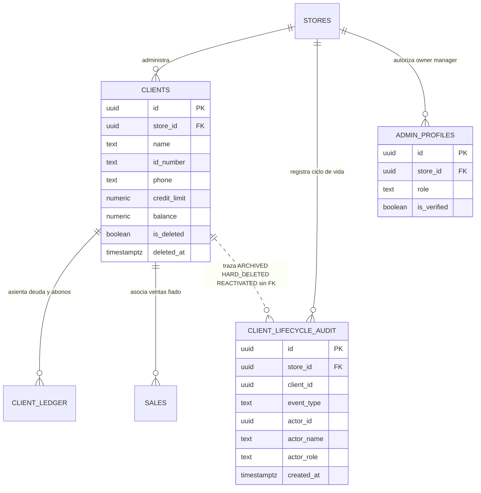

# DSD-030: Derechos del Titular (ARCO), Archivo Contable Opaco y Hardening de Cartera

| Atributo | Valor |
|----------|-------|
| **ID Documento** | `DSD-030` |
| **FRD Origen** | [FRD-030](../01_requirements/FRD/FRD_030_DERECHOS_TITULAR_Y_ARCHIVO_CONTABLE.md) |
| **SDD Técnico** | [SDD-030 v1.0.0](../01_requirements/SDD/SDD_030_DERECHOS_TITULAR_Y_ARCHIVO_CONTABLE.md) |
| **Políticas (`ARQ-002`)** | `POL-PRIV-02`, `POL-PRIV-01`, `POL-AUD-01`, `POL-AUD-02`, `POL-SEG-03` |
| **Migración Canónica** | [`20261111173000_sdd_030_client_lifecycle_and_hardening.sql`](../../supabase/migrations/20261111173000_sdd_030_client_lifecycle_and_hardening.sql) |
| **Fecha / Versión** | 2026-11-11 — `v1.0.0` |
| **Estado** | 🧪 Verificado en Docker (`supabase_db_prueba`) — Pendiente promoción a Cloud y capa Frontend |

---

## 1. Explicación Lógica y Decisiones de Arquitectura

### 1.1 Ciclo de Vida Opaco de Cartera y Derechos ARCO (`D-ARCO-01` a `D-ARCO-06`)
Este diseño implementa en PostgreSQL el ciclo de vida completo de clientes fiados garantizando preservación contable (Ley 1581 / `POL-PRIV-02`), aislamiento estricto multi-tenant (`AGENTS.md` Regla 4) y mínimo privilegio (`AGENTS.md` Regla 8):

1. **Bifurcación Opaca de Supresión (`rpc_eliminar_cliente`, `RN-01`–`RN-04`):**
   - Valida sesión y tienda (`get_current_store_id()` + `assert_store_access()`) **antes** de adquirir bloqueo `FOR UPDATE` sobre `public.clients` (previene oráculos de existencia inter-tenant).
   - Restringe la ejecución exclusivamente a roles administrativos (`owner` o `manager` en `admin_profiles`).
   - Rechaza eliminación cuando `clients.balance > 0` (`CLIENT_HAS_DEBT`).
   - Ejecuta guarda dual contable verificando `EXISTS (client_ledger)` OR `EXISTS (sales WHERE client_id = p_client_id)`:
     - **Con historial contable (`ARCHIVED_ACCOUNTING`):** Limpia datos de contacto (`phone = NULL`), anula el cupo (`credit_limit = 0`), marca `is_deleted = true` y `deleted_at = now()`, conservando nombre, identificación y registros históricos en `client_ledger` y `sales`.
     - **Sin historial contable (`HARD_DELETED`):** Ejecuta `DELETE FROM public.clients` físico definitivo. Las evidencias previas en `client_registration_confirmations` (`SDD-029`) permanecen intactas al no existir FK restrictiva.
   - Registra el evento en `public.client_lifecycle_audit` y devuelve un contrato opaco uniforme (`{ client_id, deleted: true, deleted_at }`) sin revelar al consumidor qué rama física se ejecutó.
2. **Re-alta Silenciosa por Identificación (`rpc_crear_cliente_fiado`, `D-ARCO-03`, `RN-05`):**
   - Bloquea pesimistamente (`FOR UPDATE`) por `(store_id, id_number)`. Si existe un registro archivado (`is_deleted = true`), lo reactiva manteniendo `id`, `balance` y ledger histórico, limpiando `is_deleted = false` / `deleted_at = NULL`, insertando una nueva evidencia en `client_registration_confirmations` (cardinalidad 1:N) y registrando `REACTIVATED` en `client_lifecycle_audit`.
   - Si el cliente está activo (`is_deleted = false`), rechaza con `DUPLICATE_CLIENT_ID_NUMBER` (`23505`). El retorno estándar omite `is_deleted` y `deleted_at`.
3. **Actualización Segura (`rpc_actualizar_cliente`, `RN-07`, `CL-030-05`):**
   - Edita exclusivamente `name`, `id_number`, `phone` y `credit_limit` sin mutar `balance` ni historia contable.
   - Impide colisiones de `id_number` contra **cualquier** registro de la tienda (activos o archivados) para evitar fusión de identidades contables.
4. **Exportación y Consulta Fiel de Estado de Cuenta (`rpc_obtener_estado_cuenta_cliente`, `D-ARCO-02`, `RN-06`):**
   - Autoriza lectura únicamente a `owner`/`manager` de la tienda o a un empleado explícitamente activo (`employees.is_active = true`, cubriendo también sesiones por pase diario mediante `get_employee_id_from_session()`).
   - Opera como `STABLE SECURITY DEFINER` sin bloqueo `FOR UPDATE` ni lectura sobre clientes archivados (`CLIENT_NOT_FOUND`).

### 1.2 Hardening de Superficie PostgREST y Remediación Cruzada (`G-7` / Regla 6)
1. **Cierre de escritura directa PostgREST sobre `clients`:** Se revocan `INSERT`, `UPDATE`, `DELETE` de `PUBLIC`, `anon` y `authenticated`, manteniendo únicamente `GRANT SELECT ON TABLE public.clients TO authenticated` con política `clients_select_store` (`store_id = get_current_store_id() AND COALESCE(is_deleted, false) = false`) y `GRANT ALL TO service_role`. Toda mutación pasa por RPCs `SECURITY DEFINER`.
2. **Permisos explícitos y contención en `admin_profiles`:** Se revocan privilegios anónimos y excesivos; se otorga `GRANT SELECT, UPDATE ON TABLE public.admin_profiles TO authenticated` (`GRANT ALL TO service_role`) endureciendo `admin_profiles_update_self` con `WITH CHECK` inmutable sobre `id`, `store_id` y `role` para impedir auto-escalación horizontal o vertical vía PostgREST.
3. **Contención multi-tenant en bitácoras:** Se revoca `anon` en `client_ledger`, `sales` y `client_transactions`; `ledger_read_store` oculta asientos de clientes archivados; `audit_logs` (`Admins can view audit logs`), `audit_seguridad` (`audit_seguridad_select_admin`) y `client_lifecycle_audit` (`client_lifecycle_audit_select_admin`) exigen `store_id = public.get_current_store_id()` y membresía administrativa (`owner` / `manager`).
4. **Auditoría e impacto en 8 funciones vecinas (Regla 6 `AGENTS.md`):**
   - `get_employee_id_from_session()`: exige `e.is_active = true` incluso en pases diarios aprobados.
   - `get_client_ledger_summary(uuid)`: agrega `assert_store_access(p_store_id)`, `SET search_path TO 'public'` y filtro `is_deleted = false`.
   - `rpc_admin_get_clients`: reemplaza la firma de 7 parámetros por 6 parámetros eliminando `p_include_deleted`, `is_deleted` y `deleted_at` del payload.
   - `rpc_registrar_abono`: ejecuta `assert_store_access` previo al `FOR UPDATE`, valida `is_deleted = false` y resuelve `created_by` seguro contra FK `employees(id)` (`NULL` si un `manager` no posee fila en `employees`).
   - `rpc_procesar_venta_v3`: sanitiza `client_id` a `NULL` cuando el método de pago no es `'fiado'` (`CONFLICTO-03` / `RN-16`) y rechaza ventas fiadas sobre clientes archivados.
   - `procesar_venta` (firma legada de 8 parámetros): acceso revocado a `PUBLIC`, `anon` y `authenticated`.
   - `rpc_anular_venta`: aplica `assert_store_access` previo al lock de `sales`, acepta roles `'owner'`/`'manager'`, bloquea reversión sobre cliente archivado (`CLIENT_NOT_FOUND`) o ya abonado cuando `balance < sale.total` (`CREDIT_REVERSAL_BLOCKED` antes de colisionar con restricción `23514`).
   - `rpc_force_sale` y `rpc_marcar_auditoria_revisada`: corrigen validación de rol a `('owner', 'manager')` (`CONFLICTO-05`) y `assert_store_access`.

### 1.3 Trade-offs y Alcance Diferido (`AGENTS.md` Regla 7)
| Decisión / Alcance | Trade-off Concreto | Condición de Revisión Futura |
|--------------------|--------------------|------------------------------|
| `client_lifecycle_audit.client_id` sin FK hacia `public.clients(id)` | Imprescindible para que el registro de auditoría `HARD_DELETED` sobreviva a la eliminación física de la fila en `clients` (`RN-08`). | No añadir FK; mantener la escritura confinada exclusivamente dentro de `rpc_eliminar_cliente` y `rpc_crear_cliente_fiado`. |
| Firma de `rpc_admin_get_clients` reducida de 7 a 6 parámetros (retira `p_include_deleted`) | Elimina la fuga conceptual de estado lógico al consumidor, pero exige al cliente Frontend actualizar sus llamadas de 7 a 6 argumentos antes del despliegue productivo integrado. | Coordinado en secuencia inmediata dentro de la fase Frontend de SDD-029/030. |
| `rpc_registrar_abono` tolera `created_by = NULL` cuando el administrador (`manager`) no tiene fila en `employees`, mientras `rpc_force_sale` / `rpc_anular_venta` conservan trazabilidad en tablas con FK not-null hacia `employees(id)` | Respeta la integridad referencial histórica de `sales` y `audit_logs` sin requerir migración masiva de 14 llaves foráneas sobre esquema core. | Evaluar refactor de `sales.employee_id` y `audit_logs.actor_id` en un SDD dedicado si se crean cuentas operativas sin registro previo en `employees`. |

---

## 2. Diagrama Entidad-Relación (ERD)



---

## 3. Diccionario de Datos (`CA-DSD-03`)

### 3.1 `public.client_lifecycle_audit` *(Nueva)*
| Columna | Tipo | Nulabilidad | Default | Restricciones / FK | Descripción |
|---------|------|-------------|---------|--------------------|-------------|
| `id` | `uuid` | `NOT NULL` | `gen_random_uuid()` | `PRIMARY KEY` | Identificador único del evento de ciclo de vida en cartera. |
| `store_id` | `uuid` | `NOT NULL` | — | `REFERENCES public.stores(id) ON DELETE CASCADE`, índices `(store_id, created_at DESC)` y `(store_id, client_id, created_at DESC)` | Tienda propietaria del cliente auditado. |
| `client_id` | `uuid` | `NOT NULL` | — | Sin FK hacia `clients(id)` (`RN-08`) | UUID del cliente fiado (persiste incluso tras `HARD_DELETED`). |
| `event_type` | `text` | `NOT NULL` | — | `CHECK (event_type IN ('ARCHIVED_ACCOUNTING', 'HARD_DELETED', 'REACTIVATED'))` | Naturaleza exacta de la transición interna de ciclo de vida. |
| `actor_id` | `uuid` | `NOT NULL` | — | — | UUID del administrador que ejecutó la operación. |
| `actor_name` | `text` | `NOT NULL` | — | `CHECK (length(trim(actor_name)) > 0)` | Nombre consolidado del actor resuelto por `_resolve_store_actor_name`. |
| `actor_role` | `text` | `NOT NULL` | — | `CHECK (actor_role IN ('owner', 'manager', 'employee'))` | Rol verificado en servidor al momento de la acción. |
| `created_at` | `timestamptz` | `NOT NULL` | `now()` | — | Marca temporal UTC inmutable de auditoría. |

### 3.2 Columnas Endurecidas en `public.clients`
| Columna | Tipo | Nulabilidad (Nueva) | Default (Nuevo) | Regla de Negocio Aplicada |
|---------|------|---------------------|-----------------|---------------------------|
| `is_deleted` | `boolean` | `NOT NULL` | `false` | Eliminados valores `NULL` previos (`UPDATE ... WHERE is_deleted IS NULL`). Bandera de Archivo Contable Opaco nunca expuesta en payloads estándar. |
| `balance` | `numeric` | `NOT NULL` | `0` | Eliminados valores `NULL` previos; mantiene restricción financiera existente `>= 0`. |

---

## 4. Seguridad: Triggers, RLS y Matriz de Privilegios (`CA-DSD-02`)

### 4.1 Triggers Append-Only
| Tabla | Trigger | Momento / Eventos | Función | Regla Garantizada |
|-------|---------|-------------------|---------|-------------------|
| `client_lifecycle_audit` | `trg_client_lifecycle_audit_immutable` | `BEFORE UPDATE OR DELETE FOR EACH ROW` | `fn_block_append_only_table_mutation()` | Prohíbe toda alteración o borrado de bitácora (`AUDIT_LOG_IMMUTABLE`). |
| `client_lifecycle_audit` | `trg_client_lifecycle_audit_no_truncate` | `BEFORE TRUNCATE FOR EACH STATEMENT` | `fn_block_append_only_table_mutation()` | Prohíbe truncado masivo (`AUDIT_LOG_IMMUTABLE`). |

### 4.2 Políticas RLS y Matriz de Privilegios
| Objeto | `anon` | `authenticated` | `service_role` | Políticas RLS Vigentes / Cambios |
|--------|--------|-----------------|----------------|----------------------------------|
| `client_lifecycle_audit` | Ninguno | `SELECT` | `ALL` | `client_lifecycle_audit_select_admin`: `FOR SELECT TO authenticated` con `store_id = get_current_store_id()` y `admin_profiles` `owner`/`manager`. |
| `clients` | Ninguno | `SELECT` | `ALL` | Cerradas `clients_insert_store` y `clients_update_store`; `clients_select_store` exige `store_id = get_current_store_id() AND COALESCE(is_deleted, false) = false`. |
| `admin_profiles` | Ninguno | `SELECT`, `UPDATE` | `ALL` | `admin_profiles_update_self`: bloquea cambios sobre `store_id` y `role` en `WITH CHECK`. |
| `client_ledger` | Ninguno | Lectura existente acotada | — | `ledger_read_store`: filtra por `store_id = get_current_store_id()` y cliente no archivado (`COALESCE(c.is_deleted, false) = false`). |
| `sales` | Ninguno | Privilegios previos | — | `REVOKE ALL ON TABLE public.sales FROM anon`. |
| `client_transactions` (vista) | Ninguno | Privilegios previos | — | `REVOKE ALL ON TABLE public.client_transactions FROM anon`. |
| `audit_logs` | — | Existentes | — | `Admins can view audit logs`: agrega `store_id = get_current_store_id()` y `ap.role IN ('owner', 'manager')`. |
| `audit_seguridad` | — | Existentes | — | `audit_seguridad_select_admin`: agrega `store_id = get_current_store_id()` y `ap.role IN ('owner', 'manager')`. |

---

## 5. Contratos de Funciones y RPCs

| Función / RPC | Firma | Autorización | Contrato de Retorno y Códigos de Error |
|---------------|-------|--------------|----------------------------------------|
| `_resolve_store_actor_name` | `(p_store_id uuid, p_actor_id uuid) -> text` | Solo `service_role` | Resuelve nombre desde `employees`, `auth.users` metadata o email, con fallback `'Administrador'`. |
| `rpc_crear_cliente_fiado` | `(p_store_id uuid, p_name text, p_id_number text, p_phone text DEFAULT NULL, p_credit_limit numeric DEFAULT 100000) -> jsonb` | `owner`/`manager` (`assert_store_access`) | Inserta nuevo cliente o reactiva silenciosamente uno archivado (`REACTIVATED`) registrando `client_registration_confirmations`. Retorna `{ success: true, data: { client: {...}, confirmation_id, confirmed_at } }` sin `is_deleted`/`deleted_at`. Errores: `UNAUTHORIZED` (`42501`), `INVALID_CLIENT_NAME` / `INVALID_ID_NUMBER` / `INVALID_CREDIT_LIMIT` (`22023`), `DUPLICATE_CLIENT_ID_NUMBER` (`23505`). |
| `rpc_eliminar_cliente` | `(p_client_id uuid) -> jsonb` | `owner`/`manager` (`get_current_store_id` + `assert_store_access` pre-lock) | Valida `balance <= 0`, inspecciona `client_ledger OR sales` y ejecuta `ARCHIVED_ACCOUNTING` o `HARD_DELETED`. Retorna `{ success: true, data: { client_id, deleted: true, deleted_at } }` opaco. Errores: `STORE_ACCESS_DENIED` / `UNAUTHORIZED` (`42501`), `CLIENT_NOT_FOUND` (`P0002`), `CLIENT_HAS_DEBT` (`P0001`). |
| `rpc_obtener_estado_cuenta_cliente` | `(p_client_id uuid, p_limit int DEFAULT 20, p_offset int DEFAULT 0) -> jsonb` | `owner`/`manager` o empleado activo (`is_active = true`) | Lectura `STABLE` sin `FOR UPDATE`. Retorna `{ success: true, data: { client: {..., credit_available}, movements: [...], generated_at }, count }`. Errores: `STORE_ACCESS_DENIED` / `UNAUTHORIZED` (`42501`), `CLIENT_NOT_FOUND` (`P0002`). |
| `rpc_actualizar_cliente` | `(p_client_id uuid, p_name text, p_id_number text, p_phone text DEFAULT NULL, p_credit_limit numeric DEFAULT 100000) -> jsonb` | `owner`/`manager` (`assert_store_access`) | Valida unicidad global de `id_number` en toda la tienda (activos y archivados) y actualiza datos básicos sin tocar `balance`. Errores: `STORE_ACCESS_DENIED` / `UNAUTHORIZED` (`42501`), `CLIENT_NOT_FOUND` (`P0002`), `DUPLICATE_CLIENT_ID_NUMBER` (`23505`). |
| `rpc_admin_get_clients` | `(p_store_id uuid, p_filter_debt text DEFAULT 'todos', p_search_query text DEFAULT NULL, p_order_by text DEFAULT 'name_asc', p_limit int DEFAULT 50, p_offset int DEFAULT 0) -> jsonb` | `owner`/`manager` (`assert_store_access`) | Lista paginada excluyendo archivados y omitiendo `is_deleted`/`deleted_at`. |
| `get_client_ledger_summary` | `(p_store_id uuid) -> jsonb` | `authenticated` (`assert_store_access`) | Resumen de cartera excluyendo archivados (`cartera_total`, `cartera_vencida`, `clientes_con_deuda`, `clientes_morosos`, `top_deudores`). |
| `get_employee_id_from_session` | `() -> uuid` | `authenticated` | Devuelve UUID del empleado activo únicamente si `employees.is_active = true` (incluyendo pases diarios). |
| `rpc_registrar_abono` | `(p_client_id uuid, p_amount numeric, p_payment_method text, p_notes text DEFAULT NULL) -> jsonb` | `assert_store_access` + turno abierto | Bloquea cliente activo en tienda, tolera `created_by = NULL` para manager sin fila en `employees`, descuenta saldo y asienta `client_ledger` y `cash_movements`. |
| `rpc_procesar_venta_v3` | Firma existente de 10 params | `assert_store_access` + empleado/admin | Fuerza `client_id = NULL` en métodos no `'fiado'` y rechaza fiado a cliente archivado (`CLIENT_NOT_FOUND`). |
| `rpc_anular_venta` | `(p_sale_id uuid, p_reason text) -> jsonb` | `owner`/`manager` (`assert_store_access` pre-lock) | Bloquea anulación fiado sobre cliente archivado (`CLIENT_NOT_FOUND`) o con `balance < total` (`CREDIT_REVERSAL_BLOCKED`). |
| `rpc_force_sale` / `rpc_marcar_auditoria_revisada` | Firmas existentes | `owner`/`manager` (`assert_store_access`) | Normaliza verificación administrativa a `('owner', 'manager')`. |

---

## 6. Código SQL Ejecutable (`CA-DSD-04`)

> Referencia idempotente exacta de [`supabase/migrations/20261111173000_sdd_030_client_lifecycle_and_hardening.sql`](../../supabase/migrations/20261111173000_sdd_030_client_lifecycle_and_hardening.sql).

```sql
-- ============================================================================
-- Migración: SDD-030 — Derechos del Titular, Archivo Contable y Hardening de Cartera
-- FRD Asociado: FRD-030 (POL-PRIV-02, POL-PRIV-01, POL-AUD-01, POL-AUD-02, POL-SEG-03)
-- SDD Asociado: SDD-030 v1.0.0 (D-ARCO-01..D-ARCO-06, Gap B2-01..04, G-7, CONFLICTO-01..06)
-- Fecha: 2026-11-11
-- ============================================================================

BEGIN;

-- 1. Nueva Bitácora Inmutable de Cartera (Gap B2-01, RN-08)
CREATE TABLE IF NOT EXISTS public.client_lifecycle_audit (
    id uuid PRIMARY KEY DEFAULT gen_random_uuid(),
    store_id uuid NOT NULL REFERENCES public.stores(id) ON DELETE CASCADE,
    client_id uuid NOT NULL,
    event_type text NOT NULL CHECK (event_type IN ('ARCHIVED_ACCOUNTING', 'HARD_DELETED', 'REACTIVATED')),
    actor_id uuid NOT NULL,
    actor_name text NOT NULL CHECK (length(trim(actor_name)) > 0),
    actor_role text NOT NULL CHECK (actor_role IN ('owner', 'manager', 'employee')),
    created_at timestamptz NOT NULL DEFAULT now()
);

CREATE INDEX IF NOT EXISTS idx_client_lifecycle_audit_store_date
    ON public.client_lifecycle_audit (store_id, created_at DESC);

CREATE INDEX IF NOT EXISTS idx_client_lifecycle_audit_store_client
    ON public.client_lifecycle_audit (store_id, client_id, created_at DESC);

DROP TRIGGER IF EXISTS trg_client_lifecycle_audit_immutable ON public.client_lifecycle_audit;
CREATE TRIGGER trg_client_lifecycle_audit_immutable
    BEFORE UPDATE OR DELETE ON public.client_lifecycle_audit
    FOR EACH ROW EXECUTE FUNCTION public.fn_block_append_only_table_mutation();

DROP TRIGGER IF EXISTS trg_client_lifecycle_audit_no_truncate ON public.client_lifecycle_audit;
CREATE TRIGGER trg_client_lifecycle_audit_no_truncate
    BEFORE TRUNCATE ON public.client_lifecycle_audit
    FOR EACH STATEMENT EXECUTE FUNCTION public.fn_block_append_only_table_mutation();

ALTER TABLE public.client_lifecycle_audit ENABLE ROW LEVEL SECURITY;

REVOKE ALL ON TABLE public.client_lifecycle_audit FROM PUBLIC, anon, authenticated;
GRANT SELECT ON TABLE public.client_lifecycle_audit TO authenticated;
GRANT ALL ON TABLE public.client_lifecycle_audit TO service_role;

DROP POLICY IF EXISTS "client_lifecycle_audit_select_admin" ON public.client_lifecycle_audit;
CREATE POLICY "client_lifecycle_audit_select_admin"
    ON public.client_lifecycle_audit
    FOR SELECT
    TO authenticated
    USING (
        store_id = public.get_current_store_id()
        AND EXISTS (
            SELECT 1
            FROM public.admin_profiles ap
            WHERE ap.id = auth.uid()
              AND ap.store_id = client_lifecycle_audit.store_id
              AND ap.role IN ('owner', 'manager')
        )
    );

-- 2. Endurecimiento de Esquema Existente, Privilegios y Cierre RLS (G-7 / B2-04)
UPDATE public.clients SET is_deleted = false WHERE is_deleted IS NULL;
ALTER TABLE public.clients ALTER COLUMN is_deleted SET DEFAULT false;
ALTER TABLE public.clients ALTER COLUMN is_deleted SET NOT NULL;

UPDATE public.clients SET balance = 0 WHERE balance IS NULL;
ALTER TABLE public.clients ALTER COLUMN balance SET DEFAULT 0;
ALTER TABLE public.clients ALTER COLUMN balance SET NOT NULL;

REVOKE ALL ON TABLE public.clients FROM PUBLIC, anon, authenticated;
GRANT SELECT ON TABLE public.clients TO authenticated;
GRANT ALL ON TABLE public.clients TO service_role;

REVOKE ALL ON TABLE public.admin_profiles FROM PUBLIC, anon, authenticated;
GRANT SELECT, UPDATE ON TABLE public.admin_profiles TO authenticated;
GRANT ALL ON TABLE public.admin_profiles TO service_role;

REVOKE ALL ON TABLE public.client_ledger FROM anon;
REVOKE ALL ON TABLE public.sales FROM anon;
REVOKE ALL ON TABLE public.client_transactions FROM anon;

DROP POLICY IF EXISTS "clients_insert_store" ON public.clients;
DROP POLICY IF EXISTS "clients_update_store" ON public.clients;
DROP POLICY IF EXISTS "clients_select_store" ON public.clients;

CREATE POLICY "clients_select_store"
    ON public.clients
    FOR SELECT
    TO authenticated
    USING (
        store_id = public.get_current_store_id()
        AND COALESCE(is_deleted, false) = false
    );

DROP POLICY IF EXISTS "ledger_read_store" ON public.client_ledger;
CREATE POLICY "ledger_read_store"
    ON public.client_ledger
    FOR SELECT
    TO authenticated
    USING (
        store_id = public.get_current_store_id()
        AND EXISTS (
            SELECT 1
            FROM public.clients c
            WHERE c.id = client_ledger.client_id
              AND COALESCE(c.is_deleted, false) = false
        )
    );

DROP POLICY IF EXISTS "admin_profiles_update_self" ON public.admin_profiles;
CREATE POLICY "admin_profiles_update_self"
    ON public.admin_profiles
    FOR UPDATE
    TO authenticated
    USING (id = auth.uid())
    WITH CHECK (
        id = auth.uid()
        AND store_id = (SELECT ap.store_id FROM public.admin_profiles ap WHERE ap.id = auth.uid())
        AND role = (SELECT ap.role FROM public.admin_profiles ap WHERE ap.id = auth.uid())
    );

DROP POLICY IF EXISTS "Admins can view audit logs" ON public.audit_logs;
CREATE POLICY "Admins can view audit logs"
    ON public.audit_logs
    FOR SELECT
    TO authenticated
    USING (
        store_id = public.get_current_store_id()
        AND EXISTS (
            SELECT 1
            FROM public.admin_profiles ap
            WHERE ap.id = auth.uid()
              AND ap.store_id = audit_logs.store_id
              AND ap.role IN ('owner', 'manager')
        )
    );

DROP POLICY IF EXISTS "audit_seguridad_select_admin" ON public.audit_seguridad;
CREATE POLICY "audit_seguridad_select_admin"
    ON public.audit_seguridad
    FOR SELECT
    TO authenticated
    USING (
        store_id = public.get_current_store_id()
        AND EXISTS (
            SELECT 1
            FROM public.admin_profiles ap
            WHERE ap.id = auth.uid()
              AND ap.store_id = audit_seguridad.store_id
              AND ap.role IN ('owner', 'manager')
        )
    );

-- 3. Helper Interno DRY para Resolución Segura de Nombre de Actor
CREATE OR REPLACE FUNCTION public._resolve_store_actor_name(
    p_store_id uuid,
    p_actor_id uuid
)
RETURNS text
LANGUAGE plpgsql
STABLE
SECURITY DEFINER
SET search_path TO 'public', 'auth'
AS $$
DECLARE
    v_name text;
BEGIN
    SELECT COALESCE(
        (
            SELECT NULLIF(trim(e.name), '')
            FROM public.employees e
            WHERE e.id = p_actor_id
              AND e.store_id = p_store_id
            LIMIT 1
        ),
        (
            SELECT NULLIF(trim(u.raw_user_meta_data->>'owner_name'), '')
            FROM auth.users u
            WHERE u.id = auth.uid()
        ),
        (
            SELECT NULLIF(trim(u.raw_user_meta_data->>'full_name'), '')
            FROM auth.users u
            WHERE u.id = auth.uid()
        ),
        (
            SELECT NULLIF(split_part(u.email, '@', 1), '')
            FROM auth.users u
            WHERE u.id = auth.uid()
        ),
        'Administrador'
    ) INTO v_name;

    RETURN v_name;
END;
$$;

REVOKE ALL ON FUNCTION public._resolve_store_actor_name(uuid, uuid) FROM PUBLIC, anon, authenticated;
GRANT EXECUTE ON FUNCTION public._resolve_store_actor_name(uuid, uuid) TO service_role;

-- 4. RPCs Principales de SDD-030 (y Reconciliación con SDD-029)
CREATE OR REPLACE FUNCTION public.rpc_crear_cliente_fiado(
    p_store_id uuid,
    p_name text,
    p_id_number text,
    p_phone text DEFAULT NULL,
    p_credit_limit numeric DEFAULT 100000
)
RETURNS jsonb
LANGUAGE plpgsql
SECURITY DEFINER
SET search_path TO 'public', 'auth'
AS $$
DECLARE
    v_name text := trim(COALESCE(p_name, ''));
    v_id_number text := trim(COALESCE(p_id_number, ''));
    v_phone text := NULLIF(trim(COALESCE(p_phone, '')), '');
    v_admin_role text;
    v_actor_id uuid;
    v_actor_name text;
    v_existing public.clients%ROWTYPE;
    v_client public.clients%ROWTYPE;
    v_conf_id uuid;
    v_now timestamptz := now();
BEGIN
    PERFORM public.assert_store_access(p_store_id);

    SELECT role INTO v_admin_role
    FROM public.admin_profiles
    WHERE id = auth.uid() AND store_id = p_store_id;

    IF v_admin_role IS NULL OR v_admin_role NOT IN ('owner', 'manager') THEN
        RAISE EXCEPTION 'UNAUTHORIZED: Solo administradores autorizados pueden registrar o reactivar clientes.'
            USING ERRCODE = '42501';
    END IF;

    IF length(v_name) < 3 THEN
        RAISE EXCEPTION 'INVALID_CLIENT_NAME: El nombre del cliente debe tener al menos 3 caracteres.'
            USING ERRCODE = '22023';
    END IF;

    IF v_id_number = '' THEN
        RAISE EXCEPTION 'INVALID_ID_NUMBER: El número de identificación es obligatorio.'
            USING ERRCODE = '22023';
    END IF;

    IF p_credit_limit IS NULL OR p_credit_limit < 0 THEN
        RAISE EXCEPTION 'INVALID_CREDIT_LIMIT: El límite de crédito debe ser mayor o igual a cero.'
            USING ERRCODE = '22023';
    END IF;

    v_actor_id := COALESCE(public.get_employee_id_from_session(), auth.uid());
    v_actor_name := public._resolve_store_actor_name(p_store_id, v_actor_id);

    SELECT * INTO v_existing
    FROM public.clients
    WHERE store_id = p_store_id
      AND id_number = v_id_number
    FOR UPDATE;

    IF FOUND THEN
        IF COALESCE(v_existing.is_deleted, false) = false THEN
            RAISE EXCEPTION 'DUPLICATE_CLIENT_ID_NUMBER: Ya existe un cliente activo con esa cédula en la tienda.'
                USING ERRCODE = '23505';
        END IF;

        UPDATE public.clients
        SET name = v_name,
            phone = v_phone,
            credit_limit = p_credit_limit,
            is_deleted = false,
            deleted_at = NULL
        WHERE id = v_existing.id
        RETURNING * INTO v_client;

        INSERT INTO public.client_registration_confirmations (
            store_id, client_id, created_by_user_id, created_by_name, confirmed_at
        ) VALUES (
            p_store_id, v_client.id, v_actor_id, v_actor_name, v_now
        ) RETURNING id INTO v_conf_id;

        INSERT INTO public.client_lifecycle_audit (
            store_id, client_id, event_type, actor_id, actor_name, actor_role, created_at
        ) VALUES (
            p_store_id, v_client.id, 'REACTIVATED', v_actor_id, v_actor_name, v_admin_role, v_now
        );
    ELSE
        BEGIN
            INSERT INTO public.clients (
                store_id, name, id_number, phone, credit_limit, balance, is_deleted, deleted_at
            ) VALUES (
                p_store_id, v_name, v_id_number, v_phone, p_credit_limit, 0, false, NULL
            ) RETURNING * INTO v_client;
        EXCEPTION
            WHEN unique_violation THEN
                RAISE EXCEPTION 'DUPLICATE_CLIENT_ID_NUMBER: Cédula duplicada en la tienda.'
                    USING ERRCODE = '23505';
        END;

        INSERT INTO public.client_registration_confirmations (
            store_id, client_id, created_by_user_id, created_by_name, confirmed_at
        ) VALUES (
            p_store_id, v_client.id, v_actor_id, v_actor_name, v_now
        ) RETURNING id INTO v_conf_id;
    END IF;

    RETURN jsonb_build_object(
        'success', true,
        'data', jsonb_build_object(
            'client', jsonb_build_object(
                'id', v_client.id,
                'store_id', v_client.store_id,
                'name', v_client.name,
                'id_number', v_client.id_number,
                'phone', v_client.phone,
                'credit_limit', v_client.credit_limit,
                'balance', v_client.balance,
                'created_at', v_client.created_at,
                'updated_at', v_client.updated_at
            ),
            'confirmation_id', v_conf_id,
            'confirmed_at', v_now
        )
    );
END;
$$;

REVOKE ALL ON FUNCTION public.rpc_crear_cliente_fiado(uuid, text, text, text, numeric) FROM PUBLIC, anon;
GRANT EXECUTE ON FUNCTION public.rpc_crear_cliente_fiado(uuid, text, text, text, numeric) TO authenticated, service_role;

CREATE OR REPLACE FUNCTION public.rpc_eliminar_cliente(
    p_client_id uuid
)
RETURNS jsonb
LANGUAGE plpgsql
SECURITY DEFINER
SET search_path TO 'public', 'auth'
AS $$
DECLARE
    v_store_id uuid;
    v_admin_role text;
    v_client public.clients%ROWTYPE;
    v_has_history boolean := false;
    v_actor_id uuid;
    v_actor_name text;
    v_now timestamptz := now();
BEGIN
    v_store_id := public.get_current_store_id();
    IF v_store_id IS NULL THEN
        RAISE EXCEPTION 'STORE_ACCESS_DENIED: Sesión sin tienda activa asociada.'
            USING ERRCODE = '42501';
    END IF;
    PERFORM public.assert_store_access(v_store_id);

    SELECT role INTO v_admin_role
    FROM public.admin_profiles
    WHERE id = auth.uid() AND store_id = v_store_id;

    IF v_admin_role IS NULL OR v_admin_role NOT IN ('owner', 'manager') THEN
        RAISE EXCEPTION 'UNAUTHORIZED: Solo administradores de la tienda pueden eliminar clientes.'
            USING ERRCODE = '42501';
    END IF;

    SELECT * INTO v_client
    FROM public.clients
    WHERE id = p_client_id
      AND store_id = v_store_id
    FOR UPDATE;

    IF NOT FOUND OR COALESCE(v_client.is_deleted, false) = true THEN
        RAISE EXCEPTION 'CLIENT_NOT_FOUND: El cliente no existe en la tienda activa.'
            USING ERRCODE = 'P0002';
    END IF;

    IF COALESCE(v_client.balance, 0) > 0 THEN
        RAISE EXCEPTION 'CLIENT_HAS_DEBT: El cliente tiene un saldo pendiente de $% y no puede eliminarse.', v_client.balance
            USING ERRCODE = 'P0001';
    END IF;

    v_actor_id := COALESCE(public.get_employee_id_from_session(), auth.uid());
    v_actor_name := public._resolve_store_actor_name(v_store_id, v_actor_id);

    SELECT (
        EXISTS (SELECT 1 FROM public.client_ledger cl WHERE cl.client_id = p_client_id)
        OR EXISTS (SELECT 1 FROM public.sales s WHERE s.client_id = p_client_id)
    ) INTO v_has_history;

    IF v_has_history THEN
        UPDATE public.clients
        SET phone = NULL,
            credit_limit = 0,
            is_deleted = true,
            deleted_at = v_now
        WHERE id = p_client_id
          AND store_id = v_store_id;

        INSERT INTO public.client_lifecycle_audit (
            store_id, client_id, event_type, actor_id, actor_name, actor_role, created_at
        ) VALUES (
            v_store_id, p_client_id, 'ARCHIVED_ACCOUNTING', v_actor_id, v_actor_name, v_admin_role, v_now
        );
    ELSE
        DELETE FROM public.clients
        WHERE id = p_client_id
          AND store_id = v_store_id;

        INSERT INTO public.client_lifecycle_audit (
            store_id, client_id, event_type, actor_id, actor_name, actor_role, created_at
        ) VALUES (
            v_store_id, p_client_id, 'HARD_DELETED', v_actor_id, v_actor_name, v_admin_role, v_now
        );
    END IF;

    RETURN jsonb_build_object(
        'success', true,
        'data', jsonb_build_object(
            'client_id', p_client_id,
            'deleted', true,
            'deleted_at', v_now
        )
    );
END;
$$;

REVOKE ALL ON FUNCTION public.rpc_eliminar_cliente(uuid) FROM PUBLIC, anon;
GRANT EXECUTE ON FUNCTION public.rpc_eliminar_cliente(uuid) TO authenticated, service_role;

CREATE OR REPLACE FUNCTION public.rpc_obtener_estado_cuenta_cliente(
    p_client_id uuid,
    p_limit integer DEFAULT 20,
    p_offset integer DEFAULT 0
)
RETURNS jsonb
LANGUAGE plpgsql
STABLE
SECURITY DEFINER
SET search_path TO 'public'
AS $$
DECLARE
    v_store_id uuid;
    v_is_admin boolean := false;
    v_is_active_employee boolean := false;
    v_limit integer := LEAST(GREATEST(COALESCE(p_limit, 20), 1), 500);
    v_offset integer := GREATEST(COALESCE(p_offset, 0), 0);
    v_client public.clients%ROWTYPE;
    v_movements jsonb;
    v_total_count integer := 0;
BEGIN
    v_store_id := public.get_current_store_id();
    IF v_store_id IS NULL THEN
        RAISE EXCEPTION 'STORE_ACCESS_DENIED: Sesión sin tienda activa asociada.'
            USING ERRCODE = '42501';
    END IF;
    PERFORM public.assert_store_access(v_store_id);

    SELECT EXISTS (
        SELECT 1
        FROM public.admin_profiles ap
        WHERE ap.id = auth.uid()
          AND ap.store_id = v_store_id
          AND ap.role IN ('owner', 'manager')
    ) INTO v_is_admin;

    IF NOT v_is_admin THEN
        SELECT EXISTS (
            SELECT 1
            FROM public.employees e
            WHERE e.store_id = v_store_id
              AND e.is_active = true
              AND (
                  e.id = auth.uid()
                  OR e.id = public.get_employee_id_from_session()
              )
        ) INTO v_is_active_employee;

        IF NOT v_is_active_employee THEN
            RAISE EXCEPTION 'UNAUTHORIZED: Usuario no autorizado o empleado inactivo para consultar estados de cuenta.'
                USING ERRCODE = '42501';
        END IF;
    END IF;

    SELECT * INTO v_client
    FROM public.clients c
    WHERE c.id = p_client_id
      AND c.store_id = v_store_id
      AND COALESCE(c.is_deleted, false) = false;

    IF NOT FOUND THEN
        RAISE EXCEPTION 'CLIENT_NOT_FOUND: El cliente no existe o no se encuentra activo en la tienda.'
            USING ERRCODE = 'P0002';
    END IF;

    SELECT COUNT(*) INTO v_total_count
    FROM public.client_ledger cl
    WHERE cl.client_id = p_client_id
      AND cl.store_id = v_store_id;

    SELECT COALESCE(
        jsonb_agg(
            jsonb_build_object(
                'id', sub.id,
                'transaction_type', sub.transaction_type,
                'amount', sub.amount,
                'previous_balance', sub.previous_balance,
                'new_balance', sub.new_balance,
                'reference_id', sub.reference_id,
                'ticket_number', sub.ticket_number,
                'created_at', sub.created_at
            )
            ORDER BY sub.created_at DESC, sub.id DESC
        ),
        '[]'::jsonb
    ) INTO v_movements
    FROM (
        SELECT cl.id,
               cl.transaction_type,
               cl.amount,
               cl.previous_balance,
               cl.new_balance,
               cl.reference_id,
               s.ticket_number,
               cl.created_at
        FROM public.client_ledger cl
        LEFT JOIN public.sales s ON s.id = cl.reference_id
        WHERE cl.client_id = p_client_id
          AND cl.store_id = v_store_id
        ORDER BY cl.created_at DESC, cl.id DESC
        LIMIT v_limit OFFSET v_offset
    ) sub;

    RETURN jsonb_build_object(
        'success', true,
        'data', jsonb_build_object(
            'client', jsonb_build_object(
                'id', v_client.id,
                'name', v_client.name,
                'id_number', v_client.id_number,
                'phone', v_client.phone,
                'credit_limit', v_client.credit_limit,
                'balance', v_client.balance,
                'credit_available', GREATEST(0, v_client.credit_limit - COALESCE(v_client.balance, 0))
            ),
            'movements', v_movements,
            'generated_at', now()
        ),
        'count', v_total_count
    );
END;
$$;

REVOKE ALL ON FUNCTION public.rpc_obtener_estado_cuenta_cliente(uuid, integer, integer) FROM PUBLIC, anon;
GRANT EXECUTE ON FUNCTION public.rpc_obtener_estado_cuenta_cliente(uuid, integer, integer) TO authenticated, service_role;

CREATE OR REPLACE FUNCTION public.rpc_actualizar_cliente(
    p_client_id uuid,
    p_name text,
    p_id_number text,
    p_phone text DEFAULT NULL,
    p_credit_limit numeric DEFAULT 100000
)
RETURNS jsonb
LANGUAGE plpgsql
SECURITY DEFINER
SET search_path TO 'public'
AS $$
DECLARE
    v_store_id uuid;
    v_admin_role text;
    v_client public.clients%ROWTYPE;
    v_name text := trim(COALESCE(p_name, ''));
    v_id_number text := trim(COALESCE(p_id_number, ''));
    v_phone text := NULLIF(trim(COALESCE(p_phone, '')), '');
    v_updated public.clients%ROWTYPE;
BEGIN
    v_store_id := public.get_current_store_id();
    IF v_store_id IS NULL THEN
        RAISE EXCEPTION 'STORE_ACCESS_DENIED: Sesión sin tienda activa asociada.'
            USING ERRCODE = '42501';
    END IF;
    PERFORM public.assert_store_access(v_store_id);

    SELECT role INTO v_admin_role
    FROM public.admin_profiles
    WHERE id = auth.uid() AND store_id = v_store_id;

    IF v_admin_role IS NULL OR v_admin_role NOT IN ('owner', 'manager') THEN
        RAISE EXCEPTION 'UNAUTHORIZED: Solo administradores autorizados pueden editar datos de clientes.'
            USING ERRCODE = '42501';
    END IF;

    IF length(v_name) < 3 THEN
        RAISE EXCEPTION 'INVALID_CLIENT_NAME: El nombre del cliente debe tener al menos 3 caracteres.'
            USING ERRCODE = '22023';
    END IF;

    IF v_id_number = '' THEN
        RAISE EXCEPTION 'INVALID_ID_NUMBER: El número de identificación es obligatorio.'
            USING ERRCODE = '22023';
    END IF;

    IF p_credit_limit IS NULL OR p_credit_limit < 0 THEN
        RAISE EXCEPTION 'INVALID_CREDIT_LIMIT: El límite de crédito debe ser mayor o igual a cero.'
            USING ERRCODE = '22023';
    END IF;

    SELECT * INTO v_client
    FROM public.clients
    WHERE id = p_client_id
      AND store_id = v_store_id
    FOR UPDATE;

    IF NOT FOUND OR COALESCE(v_client.is_deleted, false) = true THEN
        RAISE EXCEPTION 'CLIENT_NOT_FOUND: El cliente no existe o no se encuentra activo.'
            USING ERRCODE = 'P0002';
    END IF;

    IF EXISTS (
        SELECT 1
        FROM public.clients c
        WHERE c.store_id = v_store_id
          AND c.id_number = v_id_number
          AND c.id <> p_client_id
    ) THEN
        RAISE EXCEPTION 'DUPLICATE_CLIENT_ID_NUMBER: La cédula ingresada ya pertenece a otro registro de esta tienda.'
            USING ERRCODE = '23505';
    END IF;

    UPDATE public.clients
    SET name = v_name,
        id_number = v_id_number,
        phone = v_phone,
        credit_limit = p_credit_limit
    WHERE id = p_client_id
      AND store_id = v_store_id
    RETURNING * INTO v_updated;

    RETURN jsonb_build_object(
        'success', true,
        'data', jsonb_build_object(
            'client', jsonb_build_object(
                'id', v_updated.id,
                'store_id', v_updated.store_id,
                'name', v_updated.name,
                'id_number', v_updated.id_number,
                'phone', v_updated.phone,
                'credit_limit', v_updated.credit_limit,
                'balance', v_updated.balance,
                'updated_at', v_updated.updated_at
            )
        )
    );
END;
$$;

REVOKE ALL ON FUNCTION public.rpc_actualizar_cliente(uuid, text, text, text, numeric) FROM PUBLIC, anon;
GRANT EXECUTE ON FUNCTION public.rpc_actualizar_cliente(uuid, text, text, text, numeric) TO authenticated, service_role;

COMMIT;
```

> **Nota de brevedad:** Las secciones 5 (`5.1 get_employee_id_from_session`, `5.2 get_client_ledger_summary`, `5.3 rpc_admin_get_clients`, `5.4 rpc_registrar_abono`, `5.5 rpc_procesar_venta_v3` y revocación de `procesar_venta`, `5.6 rpc_anular_venta`, `5.7 rpc_force_sale` y `rpc_marcar_auditoria_revisada`) completan la implementación íntegra en el script canónico [`20261111173000_sdd_030_client_lifecycle_and_hardening.sql`](../../supabase/migrations/20261111173000_sdd_030_client_lifecycle_and_hardening.sql).

---

## 7. Auditoría de Verificación e Instrucción de Ejecución

1. **Verificación en Sandbox Docker (`supabase_db_prueba`):** Migración ejecutada íntegramente con `ON_ERROR_STOP=1` y validada mediante suite E2E HTTP/PostgreSQL (cubriendo creación/reactivación silenciosa 1:N, rechazo de duplicados activos y colisión con cédulas archivadas, bifurcación opaca `HARD_DELETED` vs `ARCHIVED_ACCOUNTING`, guarda dual `client_ledger OR sales`, bloqueo por deuda activa `CLIENT_HAS_DEBT`, bloqueo a empleados e inactivos en pases diarios, abono por administrador sin fila en `employees`, bloqueo `CREDIT_REVERSAL_BLOCKED` en anulaciones ya pagadas, cierre de escritura directa PostgREST sobre `clients`, protección de `admin_profiles` contra auto-escalación, `rpc_force_sale` / `rpc_marcar_auditoria_revisada` para `manager`, e inmutabilidad `BEFORE DELETE / TRUNCATE` en bitácoras).
2. **Pre-requisito de Orden:** Aplicar [`20261111172500_sdd_029_legal_consent_versioning.sql`](../../supabase/migrations/20261111172500_sdd_029_legal_consent_versioning.sql) antes de ejecutar [`20261111173000_sdd_030_client_lifecycle_and_hardening.sql`](../../supabase/migrations/20261111173000_sdd_030_client_lifecycle_and_hardening.sql) (requiere `fn_block_append_only_table_mutation()` y `client_registration_confirmations`).
3. **Promoción a Producción:** Diferida intencionalmente según estrategia **Opción A** hasta completar la sincronización Frontend y su verificación integrada contra Docker.
